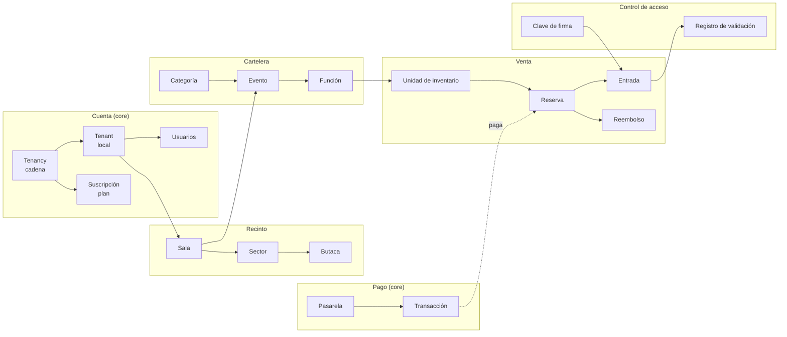
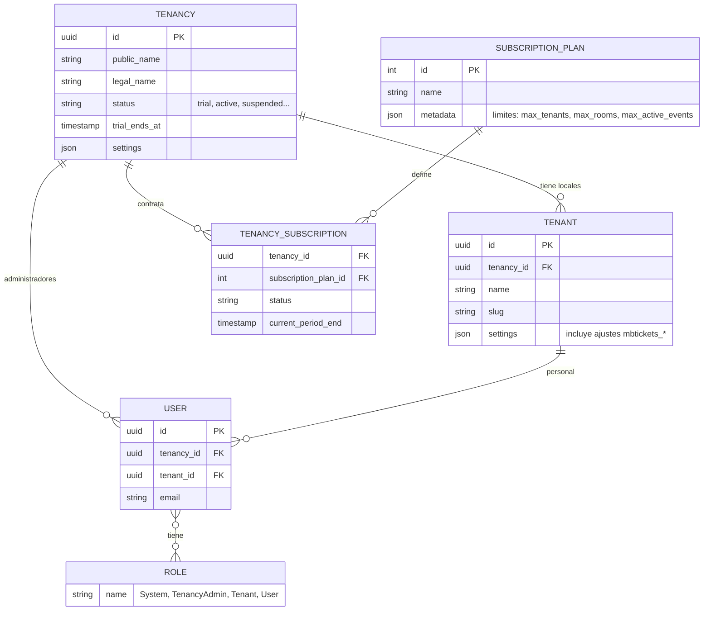
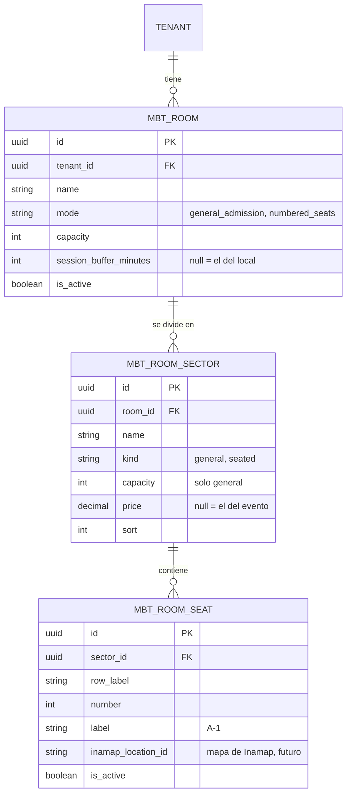
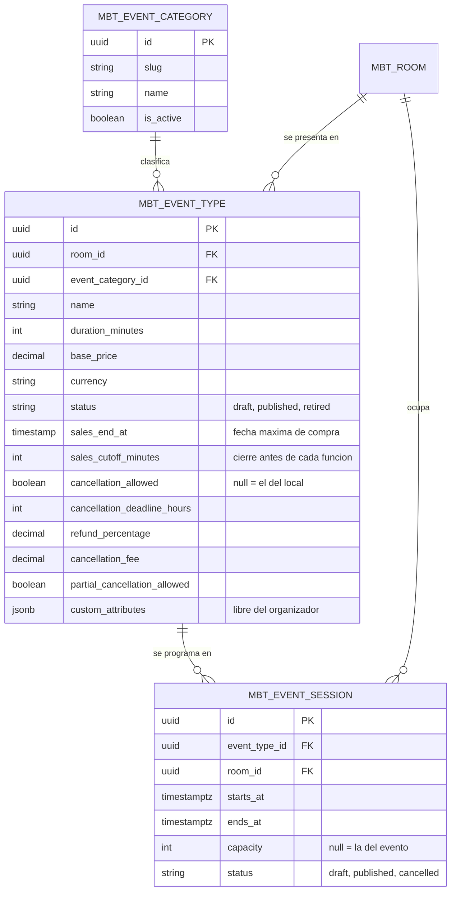
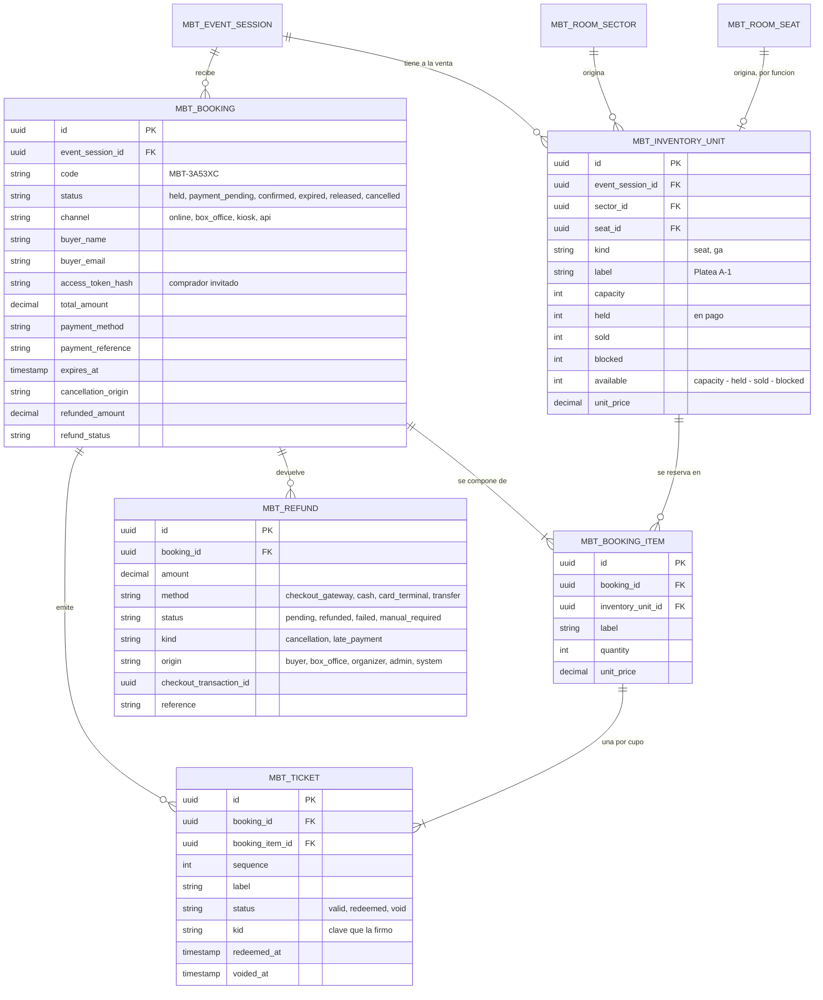
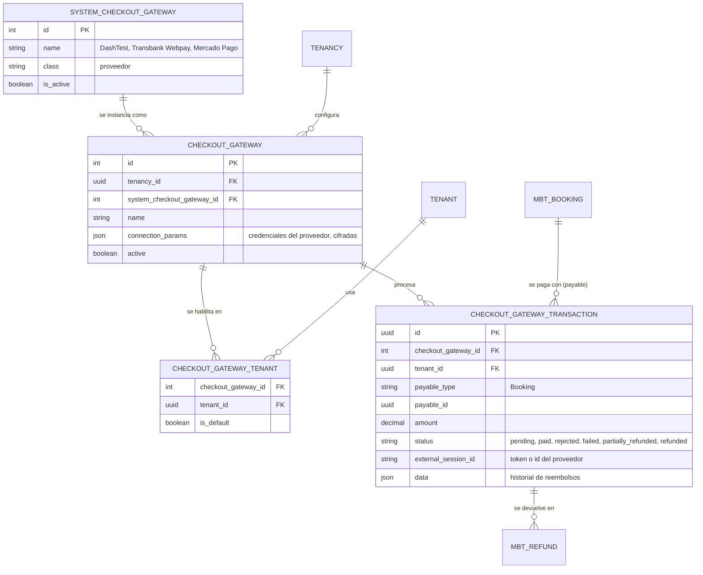
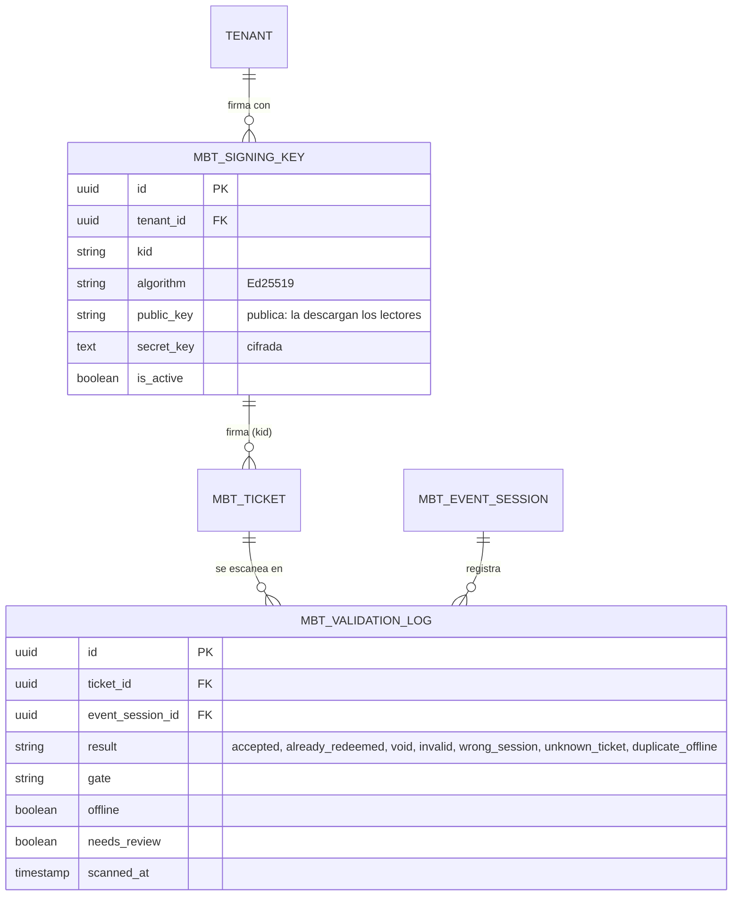

# MBTickets — Modelo entidad-relación

Este documento describe las entidades del sistema, qué representan en el negocio y cómo se
relacionan. Se divide en áreas, de la cuenta del cliente a la entrada validada en la puerta.

- Las entidades **del core** (`dash-backend`) son compartidas con los otros productos de la plataforma:
  cuentas, usuarios, suscripciones, pasarelas de pago y auditoría.
- Las entidades **del dominio** (`mbtickets-backend-domain`) son propias de MBTickets. Sus tablas
  llevan el prefijo `mbt_`.

Todas las entidades del dominio:

- usan UUID como clave;
- se borran de forma lógica (`deleted_at`);
- llevan `tenant_id` (el local dueño) y `tenancy_id` (la cadena). Un usuario solo ve las filas de su
  alcance: una fila ajena no existe para él.

## Vista general

## 1. Cuenta, locales y usuarios (core)

| Entidad | En pantalla | Qué representa |
|---|---|---|
| **Tenancy** | Cuenta / cadena | El cliente de MBTickets: la empresa que contrata el servicio. Puede operar uno o varios locales. Es la que paga la suscripción. |
| **Tenant** | Local (venue) | Un recinto: un teatro, un cine, un centro cultural. Es la unidad operativa: las salas, la cartelera, las ventas y las claves de firma de las entradas pertenecen a un local. Sus ajustes guardan los valores por defecto del local (tiempo entre funciones, política de cancelación). |
| **SubscriptionPlan** / **TenancySubscription** | Suscripción | El plan contratado y su período vigente. El plan fija los límites: cuántos locales, salas y eventos publicados a la vez. |
| **User** | Usuario | Una persona que entra al panel. El administrador de cadena se ata a la tenancy; el administrador de local y el personal, a un local. El comprador **no** es un usuario: compra como invitado. |
| **Role** | Rol | Qué puede hacer el usuario. **System**: la plataforma completa. **TenancyAdmin**: todos los locales de su cadena. **Tenant**: su local. **User**: boletería y puerta de su local. Cada endpoint de la API es un permiso. |

## 2. Recinto: salas, sectores y butacas

| Entidad | En pantalla | Qué representa |
|---|---|---|
| **Room** (`mbt_rooms`) | Sala | Un espacio físico del local donde ocurren las funciones. Es la **plantilla** del inventario: todo lo que se vende sale de su forma. Define el tiempo mínimo entre dos funciones (limpieza, montaje); dos funciones no pueden solaparse en la misma sala. Una sala con eventos no se borra: se desactiva. |
| **RoomSector** (`mbt_room_sectors`) | Sector | Una zona de la sala con su propio precio ("Platea", "Balcón"). Puede ser **de admisión general** (un cupo: se vende por cantidad) o **de butacas numeradas** (se vende cada asiento). Una sala sin sectores se vende como un único bloque general. |
| **RoomSeat** (`mbt_room_seats`) | Butaca | Un asiento concreto de un sector numerado: fila y número ("A-1"). Se generan por rangos de filas. |

## 3. Cartelera: categorías, eventos y funciones

| Entidad | En pantalla | Qué representa |
|---|---|---|
| **EventCategory** (`mbt_event_categories`) | Categoría | Una etiqueta de descubrimiento común a toda la plataforma ("Música", "Arte y Cultura"), para filtrar la cartelera. La administra la plataforma, no cada local. |
| **EventType** (`mbt_event_types`) | Evento | **Lo que se presenta**: una obra, una película, un concierto. Reúne lo que comparten todas sus funciones: sala, duración, precio base y moneda, cierre de la venta y política de cancelación. Nace en borrador y no aparece en la cartelera hasta publicarlo. `custom_attributes` guarda datos libres del organizador (elenco, clasificación) que ningún proceso interpreta. |
| **EventSession** (`mbt_event_sessions`) | Función | **Una presentación** del evento en un día y una hora, en su sala. Es la unidad que se vende: cada función tiene su propio inventario. También se publica por separado. Cancelarla anula todas sus ventas y las reembolsa. |

## 4. Inventario y ventas

| Entidad | En pantalla | Qué representa |
|---|---|---|
| **InventoryUnit** (`mbt_inventory_units`) | Disponibilidad | **Lo que se puede vender de una función.** Se genera desde la sala al crear la función: una unidad por butaca (capacidad 1) o una por sector general (capacidad = el cupo). Sus contadores dicen cuánto está disponible, retenido mientras alguien paga, vendido o bloqueado. Es la única fuente de verdad de la disponibilidad: todos los canales descuentan de aquí, y la base de datos impide que la suma no cuadre. Así nunca se vende una butaca dos veces. |
| **Booking** (`mbt_bookings`) | Reserva / venta | **Una compra**, de cualquier canal (app, boletería, kiosko o API externa). Nace **retenida**: aparta el inventario por unos minutos. Con el pago pasa a **vendida**; si no se paga, **vence** o se **libera**. Una vendida puede **cancelarse** completa o por entradas. Guarda al comprador (invitado, sin cuenta), el medio de pago y el estado de sus reembolsos. El comprador la consulta con un token secreto que solo tiene su navegador; en la base se guarda solo su huella. |
| **BookingItem** (`mbt_booking_items`) | Línea de la reserva | Qué se compró y a qué precio: una butaca, o N cupos de un sector general. Congela el precio del momento de la compra. |
| **Ticket** (`mbt_tickets`) | Entrada | **El derecho a entrar una vez**: una por cada cupo vendido. Su QR está firmado y no se guarda: se recalcula. Lo que decide si alguien entra es su estado: **válida**, **usada** (el primer escaneo la marca) o **anulada** (al cancelar). |
| **Refund** (`mbt_refunds`) | Reembolso | **Una devolución de dinero** de una reserva, por el mismo medio con que se pagó. La generan una cancelación o un pago aprobado tarde (que no llegó a convertirse en venta). Las de pasarela online se ejecutan solas; las de efectivo o transferencia esperan que el personal las marque como devueltas, con una referencia. Su estado es independiente del de la reserva: una reserva cancelada con un reembolso fallido sigue con sus entradas anuladas. |

## 5. Pagos online (core: CheckoutCore)

| Entidad | En pantalla | Qué representa |
|---|---|---|
| **SystemCheckoutGateway** | Catálogo de pasarelas | Los proveedores de pago que la plataforma soporta: DashTest (banco de demostración), Transbank Webpay y Mercado Pago. |
| **CheckoutGateway** | Pasarela | La cuenta de una cadena en uno de esos proveedores, con sus credenciales. Es la que cobra el dinero de las ventas online. |
| **CheckoutGatewayTenant** | Pasarela del local | En qué locales se usa cada pasarela, y cuál es la predeterminada. Sin una pasarela activa, el local solo vende en la boletería. |
| **CheckoutGatewayTransaction** | Transacción | **Un intento de pago** en la pasarela. Apunta a lo que paga (en MBTickets, una reserva). Cuando el proveedor la aprueba, la reserva pasa a vendida; si la rechaza, el inventario se libera. Lleva el historial de reembolsos, totales o parciales. Es compartida con KitchnTabs, que la usa para pagar pedidos. |

## 6. Control de acceso

| Entidad | En pantalla | Qué representa |
|---|---|---|
| **SigningKey** (`mbt_signing_keys`) | — (interna) | El par de claves con que un local firma sus entradas. La pública se entrega a los lectores de la puerta, para que verifiquen un QR **sin conexión**. La privada se guarda cifrada y nunca sale del servidor. Rotarla no invalida las entradas ya emitidas. |
| **ValidationLog** (`mbt_validation_logs`) | Lecturas de la puerta | Cada escaneo de una entrada, aceptado o no: en qué puerta, cuándo y con qué resultado. Incluye los escaneos hechos sin red, que se sincronizan al volver la conexión. Si una entrada entró dos veces en lectores distintos durante un corte, se marca para revisión. |

## 7. Auditoría (core)

| Entidad | Qué representa |
|---|---|
| **Activity log** (`activity_log`) | El registro de quién hizo qué y cuándo, con su motivo. En MBTickets se audita: cada cancelación (origen, motivo, entradas, monto devuelto), cada reembolso resuelto a mano, los reembolsos de pagos tardíos y la cancelación de funciones. |

## 8. Ciclos de vida

| Entidad | Estados | Cómo cambia |
|---|---|---|
| Evento | `draft` → `published` → `retired` | Solo por las acciones Publicar / Volver a borrador / Retirar. Publicar respeta el límite del plan. |
| Función | `draft` → `published` → `cancelled` | Publicar la pone a la venta; cancelarla anula y reembolsa sus ventas. |
| Reserva | `held` → `payment_pending` → `confirmed` → `cancelled`; o `expired` / `released` | Solo la cambia el motor de inventario. |
| Entrada | `valid` → `redeemed` o `void` | El primer escaneo la marca usada; una cancelación la anula. |
| Reembolso | `pending` → `refunded`, `failed` o `manual_required` | La pasarela, un reintento o la resolución manual con referencia. |

## Para saber más

- Requerimientos: [`../requirements/02-arquitectura.md`](../requirements/02-arquitectura.md).
- Detalle técnico por feature (flujos, API, decisiones): [`../features`](../features/README.md).
- Manual del administrador de cadena: [`../user/TenancyAdminManual.md`](../user/TenancyAdminManual.md).
