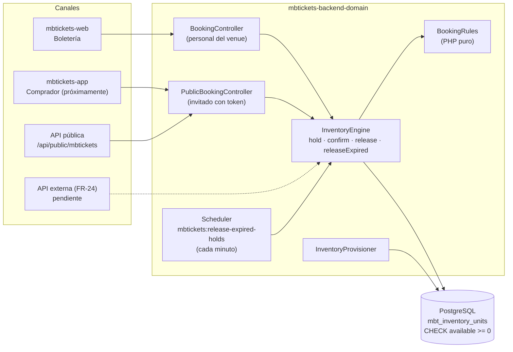
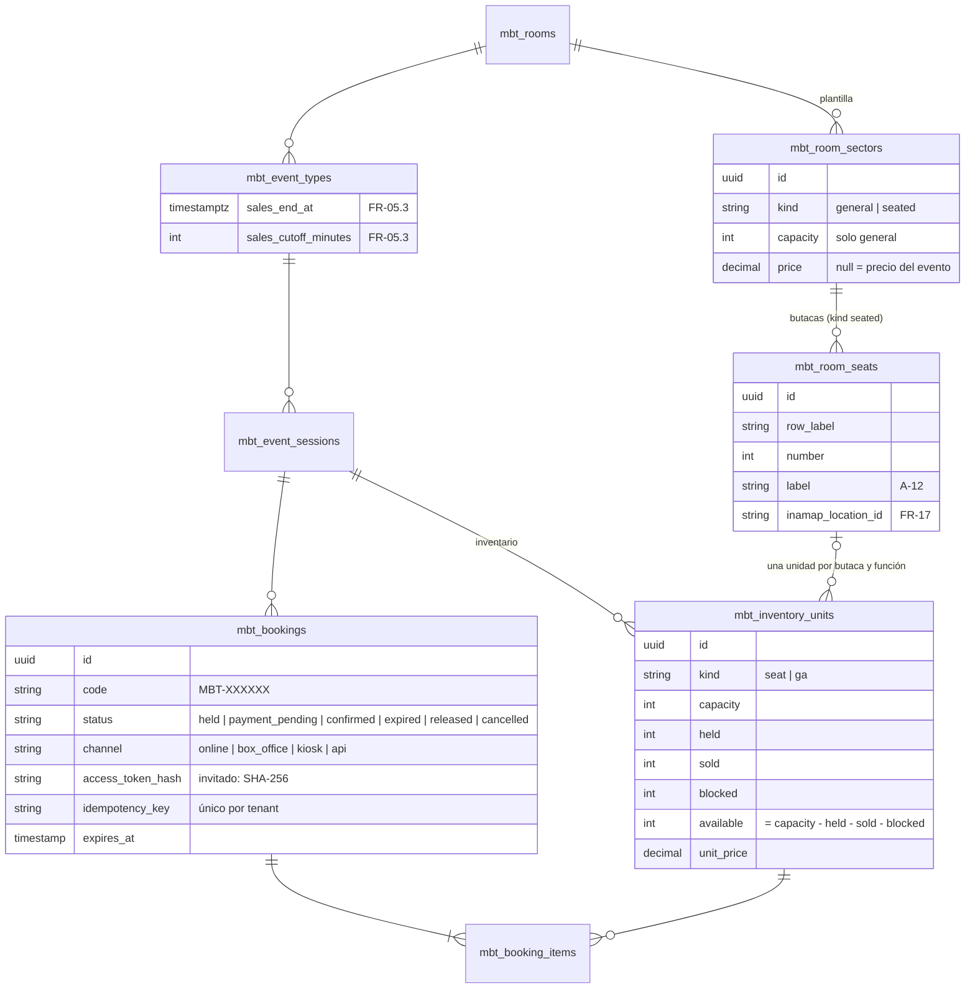
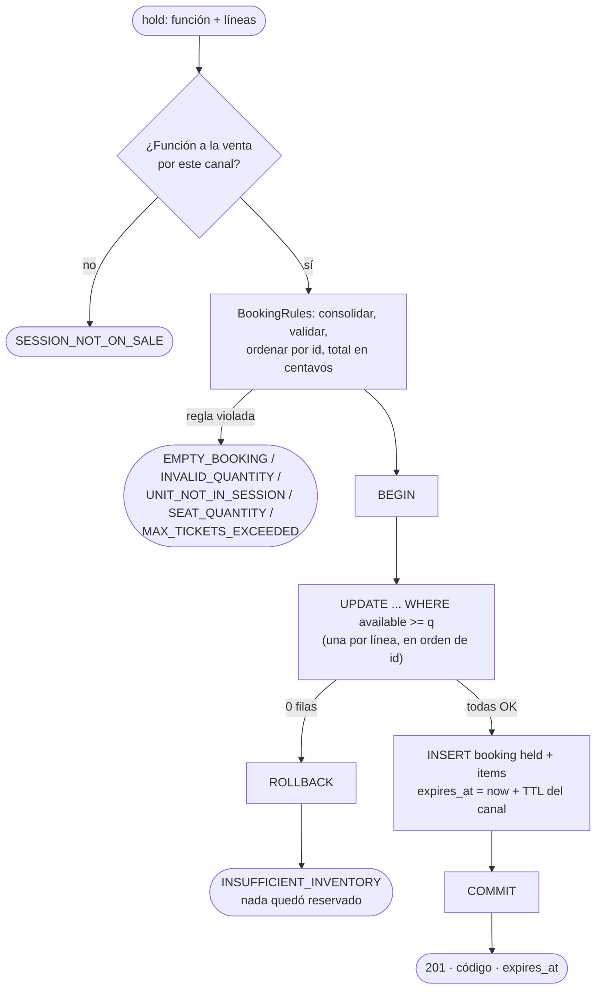
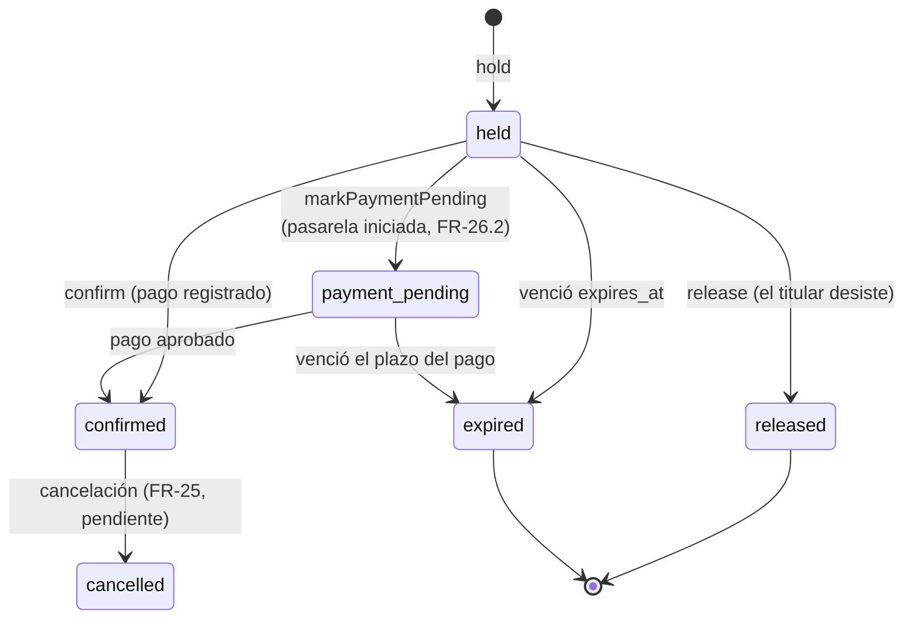
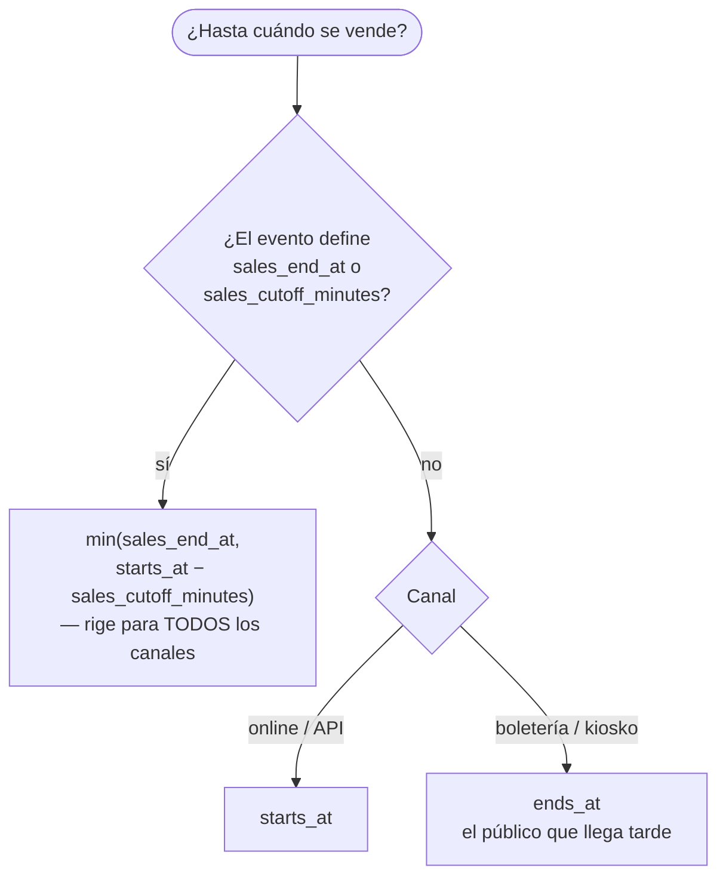
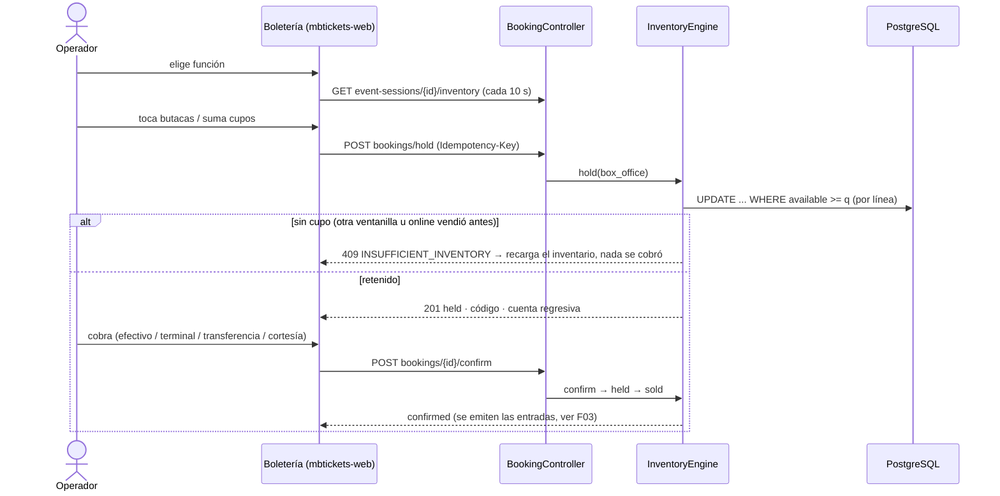

# F01 — Inventario y reservas sin sobreventa

> Documentación técnica de la feature. Requerimientos: NFR-01, FR-05 (incl. FR-05.3), FR-06, FR-07, FR-14, FR-15, FR-01.
> Historias: HU-01, HU-01b, HU-02, HU-03, HU-06b, HU-06c, HU-08c, HU-09, HU-14, HU-14b, HU-14c.
> Código: `mbtickets-backend-domain` y `mbtickets-frontend-domain`, rama `feat/inventory-booking`.

## 1. Qué resuelve

Un único inventario por función (`EventSession`) que todos los canales consumen: venta online, boletería,
kiosko y API externa. Ningún canal guarda una copia de la disponibilidad. El motor garantiza que:

- nunca se vende dos veces el mismo asiento ni más cupos que la capacidad (**NFR-01**);
- una compra que no cabe completa se rechaza entera: pedir 5 cuando quedan 3 no reserva nada (**FR-06**);
- lo retenido mientras el comprador paga se libera solo si no paga a tiempo (**FR-05.2**);
- el evento puede fijar hasta cuándo se venden entradas (**FR-05.3**).

## 2. Arquitectura



Piezas:

| Pieza | Archivo | Responsabilidad |
|---|---|---|
| `BookingRules` | `app/Services/Mbtickets/Inventory/BookingRules.php` | **PHP puro.** Consolida líneas repetidas, valida cantidades, que la unidad pertenezca a la función y el máximo por compra; calcula el total en centavos; devuelve las líneas **ordenadas por id de unidad**. |
| `InventoryEngine` | `app/Services/Mbtickets/Inventory/InventoryEngine.php` | Único código que mueve contadores: `hold`, `markPaymentPending`, `confirm`, `release`, `releaseExpired`, `isOnSale`. |
| `InventoryProvisioner` | `app/Services/Mbtickets/Inventory/InventoryProvisioner.php` | Genera el inventario de una función desde la plantilla de su sala. Idempotente; nunca toca lo vendido. |
| `InventoryException` | `app/Services/Mbtickets/Inventory/InventoryException.php` | Rechazos de negocio con código estable (se responden como JSON, no como 500). |
| `BookingCode` | `app/Services/Mbtickets/Inventory/BookingCode.php` | Código legible de la reserva (`MBT-7KQ2X9`), sin caracteres ambiguos. |
| Comando | `app/Console/Commands/ReleaseExpiredHoldsCommand.php` | Barrido de holds vencidos (scheduler, cada minuto). |

## 3. Modelo de datos



Decisiones de modelo:

- **Una butaca es una unidad de capacidad 1.** Butacas numeradas y bloques de admisión general pasan por
  el mismo código: un contador que baja. No hay dos motores.
- **Sala sin sectores** → un bloque de admisión general implícito con la capacidad de la función, o la
  del evento, o la de la sala (HU-08c).
- **Restricción en la base de datos** (PostgreSQL):
  `CHECK (held >= 0 AND sold >= 0 AND blocked >= 0 AND available >= 0 AND available = capacity - held - sold - blocked)`.
  Es la red de seguridad: aunque el código tuviera un error, la base rechaza un contador negativo o incoherente.
- Las unidades **no tienen borrado lógico**: una unidad con ventas nunca se elimina.

## 4. Cómo se garantiza "nunca sobreventa"

Cada unidad pedida se reserva con **un único UPDATE condicional**:

```sql
UPDATE mbt_inventory_units
   SET held = held + :q, available = available - :q, updated_at = NOW()
 WHERE id = :unit AND available >= :q
```

- PostgreSQL bloquea la fila durante el UPDATE. Si dos transacciones piden la última unidad, se serializan
  y la segunda ve `available = 0`: **0 filas afectadas** → `INSUFFICIENT_INVENTORY`.
- Todas las líneas de una reserva van en **una transacción**. Si una falla, el rollback deshace las
  anteriores: rechazo total (FR-06).
- Las líneas se reservan **en orden de id** (lo garantiza `BookingRules`). Dos compras que piden las mismas
  butacas en distinto orden bloquean filas en el mismo orden: no hay deadlock.



### Ciclo de vida de una reserva



Cambiar de estado bloquea primero la fila de la reserva (`SELECT ... FOR UPDATE`). Así un pago que llega
justo cuando vence el hold no puede confirmar y liberar a la vez. Si `confirm` encuentra el hold vencido
pero aún no barrido, lo libera, hace commit y **después** responde `BOOKING_EXPIRED`, para que la liberación
no se revierta.

TTL del hold por canal (`config('mbtickets.booking.hold_ttl_minutes')`): online 10, kiosko 5,
boletería 5 y API 10 minutos. Máximo 10 entradas por compra (`MBT_MAX_TICKETS_PER_BOOKING`).

### Idempotencia

Un `Idempotency-Key` repetido devuelve la reserva original sin volver a descontar. Si dos peticiones con la
misma clave llegan a la vez, el índice único `(tenant_id, idempotency_key)` rechaza la segunda. Su
transacción, descuento incluido, se revierte, y el motor devuelve la primera reserva.

## 5. Fecha máxima de compra (FR-05.3)

`EventType::salesCloseAt(EventSession, channel)`:



El descubrimiento público aplica la misma regla en SQL. Una función con la venta cerrada no aparece, y
cada función informa su `sales_close_at`.

## 6. Generación del inventario (`InventoryProvisioner`)

Se ejecuta al **crear** una función, al **publicarla**, y a pedido (`POST event-sessions/{id}/inventory/sync`).

| Situación | Resultado |
|---|---|
| Unidad que falta en la función | Se crea con `available = capacity`. |
| Unidad sin nada retenido, vendido ni bloqueado | Se actualizan etiqueta, precio y capacidad. |
| Unidad con ventas | Solo etiqueta y orden; una capacidad menor que lo comprometido se ignora. |
| Unidad que ya no está en la plantilla | Se elimina solo si no tiene nada ni líneas de reserva; si no, se conserva. |

## 7. API

Autenticada (personal del venue, `access` + `auth:sanctum`, permisos `api.mbtickets.*`):

| Método | Ruta | Uso |
|---|---|---|
| CRUD | `/api/mbtickets/room-sectors` | Sectores de las salas. |
| POST | `/api/mbtickets/room-sectors/{id}/seats/generate` | `{rows: "A-J" \| "1-12" \| "A,B", seats_per_row, start_number?}`. No duplica. |
| CRUD | `/api/mbtickets/room-seats` | Butacas sueltas. |
| GET | `/api/mbtickets/event-sessions/{id}/inventory` | Unidades con contadores y totales por sector (HU-09). |
| POST | `/api/mbtickets/event-sessions/{id}/inventory/sync` | Regenera desde la plantilla. |
| GET | `/api/mbtickets/bookings` | Listado (filtros: `status`, `channel`, `code`, `q`, `event_session_id`). |
| POST | `/api/mbtickets/bookings/hold` | `{event_session_id, items[{inventory_unit_id, quantity}], buyer_*}` + `Idempotency-Key`. |
| POST | `/api/mbtickets/bookings/{id}/confirm` | `{payment_method: cash \| card_terminal \| transfer \| courtesy, payment_reference?}`. |
| POST | `/api/mbtickets/bookings/{id}/release` | Suelta un hold. |

Pública (sin autenticación, `throttle:mbtickets-public`; el hold usa un límite propio más bajo):

| Método | Ruta | Uso |
|---|---|---|
| GET | `/api/public/mbtickets/categories` | Categorías de plataforma. |
| GET | `/api/public/mbtickets/sessions` | Cartelera: `category`, `venue`, `room_id`, `from`, `to`, `available`, `q`. |
| GET | `/api/public/mbtickets/sessions/{id}` | Detalle con disponibilidad por unidad (sin contadores de holds ni ventas). |
| GET | `/api/public/mbtickets/venues/{tenantId}/billboard?date=` | Cartelera del día por sala (HU-01b). |
| POST | `/api/public/mbtickets/sessions/{id}/holds` | Hold de invitado. Devuelve `access_token` **una sola vez**. |
| GET | `/api/public/mbtickets/bookings/{id}` | Requiere `X-Booking-Token`. |
| POST | `/api/public/mbtickets/bookings/{id}/release` | Requiere `X-Booking-Token`. |

El token del invitado sigue el patrón de token opaco de Inamap: 48 caracteres aleatorios, en la base solo
su SHA-256, y comparación con `hash_equals`. Sin token, o con uno ajeno, la respuesta es 404, como si la
reserva no existiera.

Errores del motor (`InventoryException`), siempre `{message, error: {code, details}}`:

| Código | HTTP | Cuándo |
|---|---|---|
| `INSUFFICIENT_INVENTORY` | 409 | Una línea no tenía cupo; `details.label` dice cuál. |
| `SESSION_NOT_ON_SALE` | 422 | Función o evento no publicados, o venta cerrada (FR-05.3). |
| `BOOKING_EXPIRED` | 409 | El hold venció; el inventario ya se liberó. |
| `BOOKING_INVALID_STATE` | 409 | Confirmar algo liberado, vencido o cancelado. |
| `EMPTY_BOOKING`, `INVALID_QUANTITY`, `UNIT_NOT_IN_SESSION`, `SEAT_QUANTITY`, `MAX_TICKETS_EXCEEDED` | 422 | Reglas de `BookingRules`. |

## 8. Flujos

### Venta en boletería (HU-14b)



### Comprador invitado (API pública)

```mermaid
sequenceDiagram
    actor C as Comprador
    participant APP as mbtickets-app
    participant API as /api/public/mbtickets
    participant ENG as InventoryEngine

    C->>APP: busca y elige función
    APP->>API: GET sessions?category=&from=
    APP->>API: GET sessions/{id} (disponibilidad por unidad)
    C->>APP: elige asientos o cantidad
    APP->>API: POST sessions/{id}/holds {items, buyer_name, buyer_email}
    API->>ENG: hold(online, with_token)
    ENG-->>APP: 201 {id, code, expires_at, access_token}
    Note over APP: guarda access_token; lo envía como X-Booking-Token
    APP->>API: GET bookings/{id} · POST bookings/{id}/release
```

El pago online de este hold se implementa en la fase 4, sobre `app/CheckoutCore` (ver F02).

## 9. Frontend (`mbt-events`, `mbtickets-web`)

| Pieza | Ubicación | Qué hace |
|---|---|---|
| Sectores | `resources/roomSectorResource.tsx` + `components/SeatGenerator.tsx` | CRUD y generador de butacas por filas. |
| Disponibilidad | `components/SessionInventory.tsx` | En el formulario de la función: vendidas, en pago y disponibles por sector; refresco cada 15 s; sincronizar con la sala. |
| Reservas | `resources/bookingResource.tsx` | Listado de solo lectura de todos los canales. |
| Boletería | `boxoffice/BoxOfficePage.tsx` + `resources/boxOfficeResource.tsx` | Página propia (no CRUD): mapa de butacas por fila, cupos de admisión general, hold con cuenta regresiva, cobro y confirmación. |
| Fecha máxima | `resources/eventTypeResource.tsx` | Campos `sales_end_at` y `sales_cutoff_minutes`. |

La boletería no calcula disponibilidad: muestra la del backend y deja que el motor decida.

## 10. Pruebas

| Prueba | Cubre |
|---|---|
| `tests/Unit/Mbtickets/BookingRulesTest.php` | Consolidación, orden, total en centavos, butaca única, rechazos, máximo por compra. |
| `tests/Feature/API/Mbtickets/InventoryAndBookingTest.php` | Sala sin sectores, generación de butacas, venta en boletería, rechazo total 5 de 3, butaca vendida online rechazada en boletería, vencimiento y barrido, cierre online vs boletería, idempotencia, resync sin tocar lo vendido, aislamiento entre venues. |
| `tests/Feature/API/Mbtickets/InventoryConcurrencyTest.php` | **Concurrencia real**: 12 procesos (`pcntl_fork`) con su propia conexión compiten. Gana exactamente uno por la última butaca; admisión general nunca sobrevende; butacas pedidas en orden inverso ni se bloquean ni se duplican. |
| `tests/Feature/API/Mbtickets/PublicDiscoveryAndGuestBookingTest.php` | Solo funciones publicadas y futuras, filtros, cartelera del día, token del invitado, sin exponer holds. |
| `tests/Feature/API/Mbtickets/SalesDeadlineTest.php` | FR-05.3: fecha absoluta, corte relativo, el más temprano gana, todos los canales. |

Sobre la prueba de concurrencia: el `TestCase` del core usa `RefreshDatabase`, que envuelve cada prueba en
una transacción que los procesos hijos no verían. Los datos de la carrera se crean por una segunda
conexión (`mbt_race`) que sí hace commit, y se borran al final. Cada hijo termina con `SIGKILL` para no
cerrar la sesión de base de datos que comparte con el padre.

```bash
cd mbtickets-backend-docker
./mbtickets.sh test --filter=InventoryConcurrencyTest
```

## 11. Trampa de zona horaria (corregida)

La app usa `America/Santiago`, pero la sesión de PostgreSQL usaba UTC. Laravel envía las fechas sin offset,
así que las columnas `timestamptz` (horario de las funciones, `sales_end_at`) quedaban desplazadas 3 horas,
y `starts_at > now()` comparaba horas distintas. Corrección: `AppDomainServiceProvider::alignDatabaseTimezone()`
fija la zona de la conexión a la de la app, salvo que el core defina otra. Además, las fechas de entrada con
offset se normalizan a la zona de la app antes de consultar.

## 12. Pendiente

- Bloqueos administrativos de unidades (`blocked`: cortesías, butacas de producción).
- Cancelación de reservas vendidas y reembolsos (FR-25, fase 3).
- Pago online del hold (FR-26, fase 4) y app del comprador `mbtickets-app`.
- API externa con credenciales de integración y webhooks (FR-24).
- Mapa de sala desde Inamap (FR-17): el campo `inamap_location_id` ya existe en las butacas.
- Bug conocido de dash-admin: el botón "Crear" del estado vacío de una lista no abre el formulario; el "+" sí.
