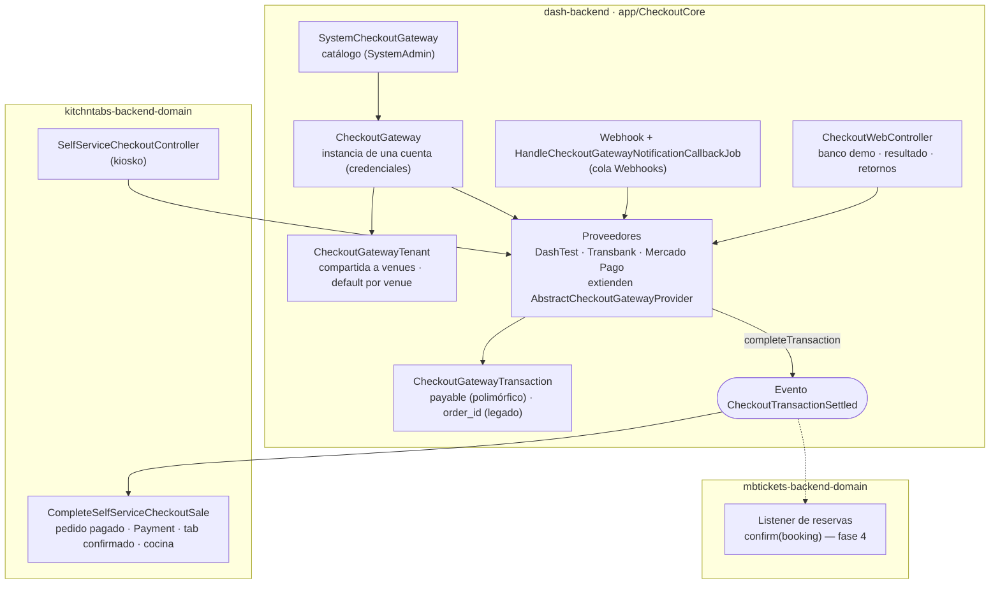
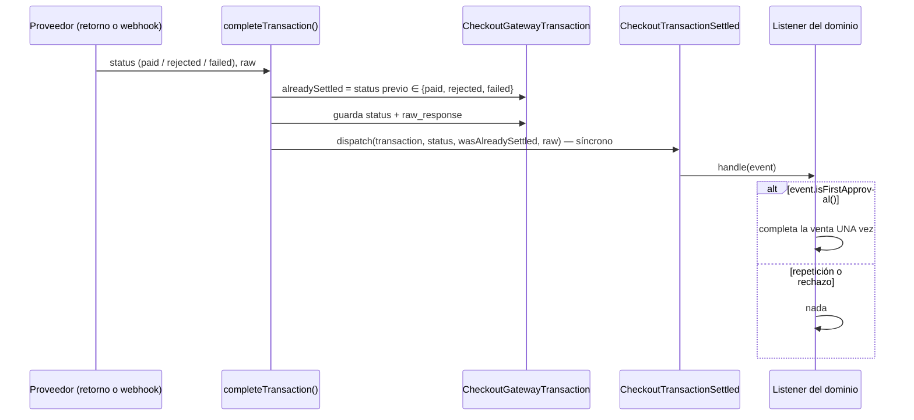
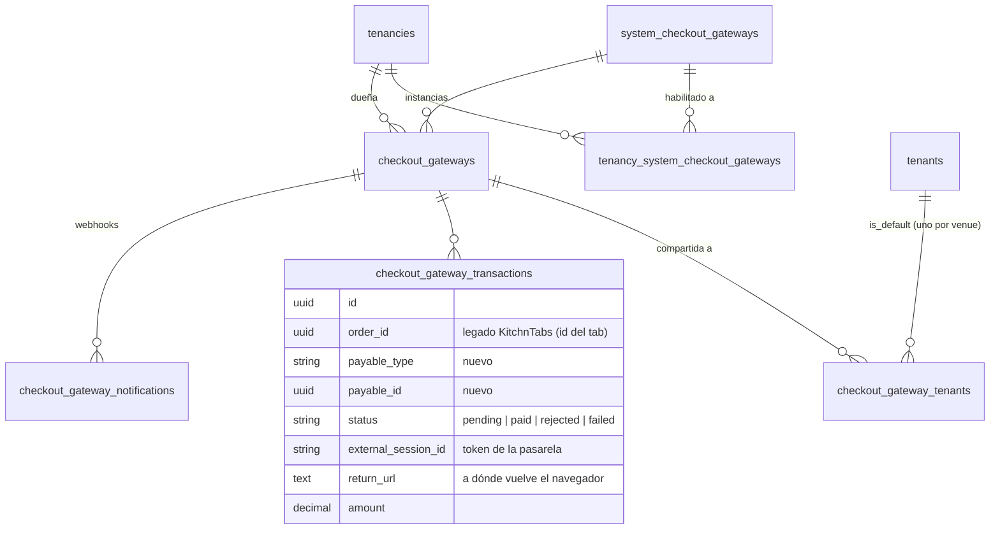
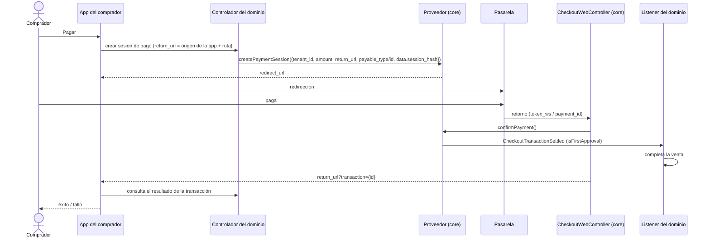

# F02 — Pasarelas de pago online en el core (`app/CheckoutCore`)

> Documentación técnica de la feature. Decisión de producto (2026-10-19): la lógica de pasarelas de pago se
> mueve al core para que KitchnTabs y MBTickets la compartan.
> Código: `dash-backend` y `kitchntabs-backend-domain`, rama `feat/checkout-core`; MBTickets en
> `mbtickets-backend-domain`, rama `feat/online-payments`.
> Relacionado: FR-26 (pago online de reservas, fase 4), doc 09 (pago presencial, `PosPaymentCore`).

## 1. Qué cambió

Antes, el checkout online (el comprador paga en la página de la pasarela y vuelve) vivía en el dominio de
KitchnTabs y estaba acoplado a sus tabs y pedidos. Ahora vive en el core como el módulo `app/CheckoutCore`,
igual que `DeviceCore`, `ReportCore` o `PosPaymentCore`, y cualquier dominio que vende online lo usa.

Proveedores incluidos:

| Proveedor | Clase | Confirmación |
|---|---|---|
| DashTest (demo) | `App\CheckoutCore\Gateways\DashTest\DashTestCheckoutProvider` | Página de "banco" propia; tarjeta `4051 8856 0044 6623` aprueba, `5186 0595 5959 0568` rechaza. |
| Transbank Webpay Plus (PST) | `App\CheckoutCore\Gateways\Transbank\TransbankPSTCheckoutProvider` | Por URL de retorno (`token_ws`). |
| Mercado Pago Checkout Pro | `App\CheckoutCore\Gateways\MercadoPago\MercadoPagoCheckoutProvider` | Webhook (autoritativo) + URL de retorno como camino rápido. |

## 2. Arquitectura



El core **no sabe qué se pagó**. Liquida el pago una vez y lo anuncia con `CheckoutTransactionSettled`;
cada dominio escucha y completa su propia venta.

## 3. El contrato de liquidación

`AbstractCheckoutGatewayProvider::completeTransaction()` es la única cola por la que convergen el camino
del retorno del navegador y el del webhook:



- Mercado Pago puede liquidar el mismo pago dos veces (retorno + webhook, en cualquier orden).
  `wasAlreadySettled` lo marca, y **los listeners deben usar `isFirstApproval()`**.
- El evento es síncrono: la venta se completa en la misma petición (o job) que liquidó el pago.

`CheckoutGatewayTransaction` registra qué se paga:

| Columna | Quién la usa |
|---|---|
| `payable_type` + `payable_id` (nuevas) | MBTickets (`Booking`) y cualquier dominio nuevo. |
| `order_id` (legado) | KitchnTabs: guarda el **id del tab**. |

## 4. Compatibilidad con KitchnTabs en producción

| Riesgo | Cómo se resolvió |
|---|---|
| Permisos, frontend y URL de retorno registradas en las pasarelas | **Mismas URL y nombres de ruta** (`api.checkout.*`, `checkout.*`, webhook `POST /api/checkout/{id}/webhook/{type}`). |
| Migraciones ya ejecutadas en la base de KitchnTabs | Se movieron con **el mismo nombre de archivo**: Laravel las ve como ejecutadas. Además tienen guarda `hasTable`. |
| `system_checkout_gateways.class` guarda el nombre completo de la clase PHP del proveedor | `2026_10_20_000020_move_checkout_provider_classes_to_core` reescribe `Domain\App\Services\ECommerce\Checkout\…` → `App\CheckoutCore\Gateways\…`. Sin ella, `CheckoutGateway::service()` instanciaría clases inexistentes. |
| Lógica de venta del kiosko | `CompleteSelfServiceCheckoutSale` (KitchnTabs) hace exactamente lo que hacía la cola anterior: pedido pagado, un `Payment` (`firstOrCreate` por transacción), tab `CREATED → CONFIRMED` y aviso a cocina. |
| Configuración vieja en contenedores que montan solo algunos archivos | `SystemCheckoutGateway::getAvailableClasses()` usa `config('checkout.providers')` y, si la clave no existe, los proveedores del core. |

Qué quedó en KitchnTabs: el checkout del kiosko (`SelfServiceCheckoutController`), el retorno
`GET checkout/return/{hash}` que redirige al tab del kiosko, los ajustes de tienda (`checkout_tenant.php`),
el listener y un seeder que delega en el del core.

**Despliegue: el core y KitchnTabs deben salir juntos.** Si sale solo el core, sus rutas chocan con las
que KitchnTabs todavía registra. La imagen de producción de KitchnTabs se construye desde la imagen del core.

## 5. Modelo de datos



## 6. Flujo de un pago (patrón de KitchnTabs, el mismo para MBTickets)



En KitchnTabs, `SelfServiceOrderActions` arma el `return_url` al origen de la app y
`SelfServiceAppHookComponent` lee `?transaction={id}`. MBTickets seguirá ese patrón en `mbtickets-app`.

## 7. API (sin cambios de contrato)

| Método | Ruta | Auth |
|---|---|---|
| CRUD + `availableClasses` | `/api/checkout/system_checkout_gateway` | SystemAdmin |
| CRUD | `/api/checkout/checkout_gateway` | TenancyAdmin (crea/configura), Tenant (ve, elige default) |
| GET | `/api/checkout/checkout_gateway/{id}/connectionParamFormats` | idem |
| POST | `/api/checkout/checkout_gateway/{id}/setUpConnection` · `assignTenants` · `setAsDefault` | idem |
| POST | `/api/checkout/{instanceId}/webhook/{type}` | Pública; firma validada por el proveedor |
| GET | `/checkout/dashtest/{token}/pay` · GET/POST `/checkout/dashtest/{token}/process` | Pública (banco demo) |
| GET | `/checkout/result` | Pública (resultado genérico) |
| GET/POST | `/checkout/transbank/return/{hash}` · `/checkout/mercadopago/return/{hash}` | Pública (retornos) |

`{hash}` es un contexto opaco que elige quien inicia el pago (el kiosko de KitchnTabs pasa su hash de
sesión). Se mantiene en la URL por compatibilidad. El navegador vuelve siempre al `return_url` de la
transacción, o a `/checkout/result` si no tiene.

Las vistas Blade usan el namespace `checkout::` (`checkout::dashtest_pay`, `checkout::result`).

## 8. Código

| Ruta | Contenido |
|---|---|
| `dash-backend/app/CheckoutCore/CheckoutCoreServiceProvider.php` | Migraciones, vistas `checkout::`, policies, rutas API y web. |
| `…/Contracts/CheckoutGateway.php` | Contrato del proveedor. |
| `…/Gateways/AbstractCheckoutGatewayProvider.php` | Credenciales, transacción, `completeTransaction()` → evento. |
| `…/Gateways/{DashTest,Transbank,MercadoPago}/` | Proveedores. |
| `…/Models/` | `SystemCheckoutGateway`, `CheckoutGateway`, `CheckoutGatewayTenant`, `CheckoutGatewayTransaction`, `CheckoutGatewayNotification`. |
| `…/Events/CheckoutTransactionSettled.php` | Evento de liquidación. |
| `…/Http/Controllers/` | Admin, webhook, páginas web. |
| `…/Jobs/HandleCheckoutGatewayNotificationCallbackJob.php` | Procesa webhooks en la cola `Webhooks`. |
| `…/Seeders/SystemCheckoutGatewaysSeeder.php` | Catálogo desde `config('checkout.providers')`. |
| `…/database/migrations/` | Tablas (nombres originales) + `payable` + reescritura de clases. |
| `dash-backend/config/checkout.php` | `providers` y credenciales de plataforma (PST de Transbank, sandbox de Mercado Pago). |
| `kitchntabs-backend-domain/app/Listeners/Checkout/CompleteSelfServiceCheckoutSale.php` | Venta del kiosko. |
| `mbtickets-backend-domain/database/seeders/Checkout/SystemCheckoutGatewaysSeeder.php` | Delega en el core; no hace nada en un core sin el módulo. |

## 9. Pruebas

| Prueba | Repo | Cubre |
|---|---|---|
| `tests/Feature/CheckoutCore/CheckoutCoreTest.php` | dash-backend | Catálogo y seeder idempotente; pago con tarjeta aprobada liquida una vez y anuncia una primera aprobación; repetición marcada como tal; rechazo nunca es aprobación; sin `return_url` → página de resultado; webhook de instancia desconocida → 200. |
| `tests/API/Checkout/SelfServiceCheckoutSaleTest.php` | kitchntabs-backend-domain | Pedido pagado + un `Payment` + tab confirmado; repetición no duplica; rechazo no toca nada; pago de otro dominio no es una venta del kiosko. |

Suite completa de KitchnTabs: 203 pruebas pasan. En la suite del core fallan 3 pruebas
(`TenantAuthorizationTest` ×2, `InvoiceServiceTest` ×1) que fallan igual en `development`: no las causa
este cambio.

```bash
docker exec -e DB_DATABASE=kt_dev_db_test dash_image_app php -d error_reporting=22527 artisan test --filter=CheckoutCore
```

## 10. Pendiente

- Reconstruir la imagen del core. Mientras tanto, MBTickets corre con `./mbtickets.sh up --core-dev` (monta
  el código del core; el overlay ahora también monta `config/checkout.php`).
- Inamap y Vanexa también recibirán las tablas de checkout al migrar con el core nuevo (misma pregunta abierta
  que con las tablas de POS).
- `kitchntabs-backend-domain/app/Services/Payments` (Flow, Rebill, Transbank, Internal) es código sin uso; no se tocó.
- Fase 4 de MBTickets: listener que confirma la reserva, sesión de pago del comprador, `markPaymentPending`,
  aprobación tardía (FR-26.3) y la UI de pago en `mbtickets-app`.
