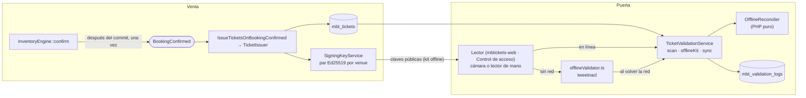
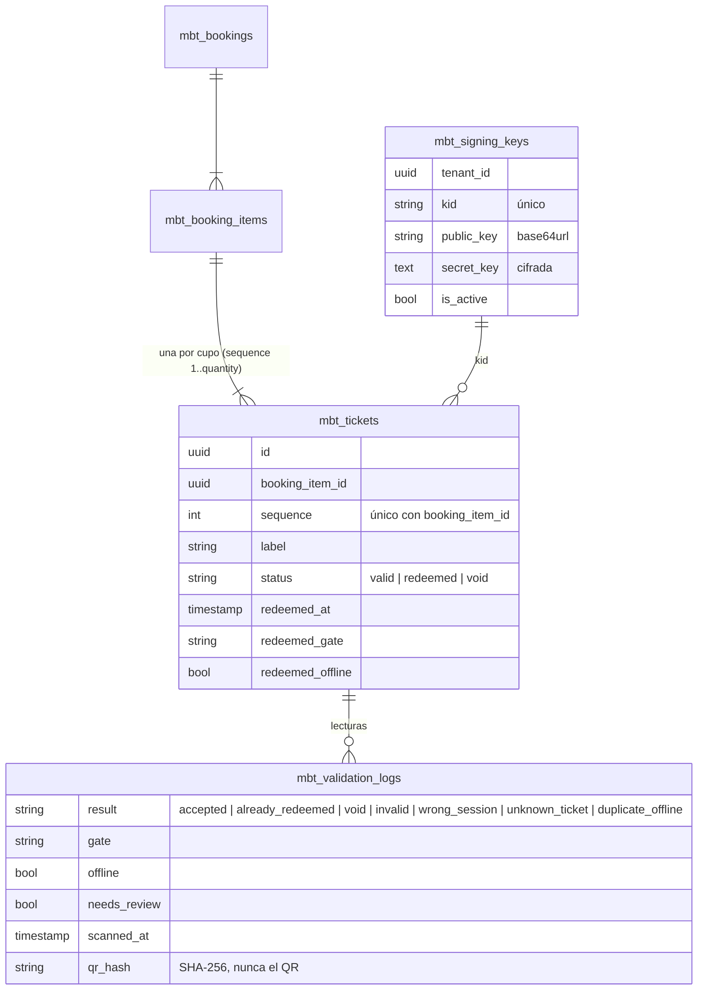
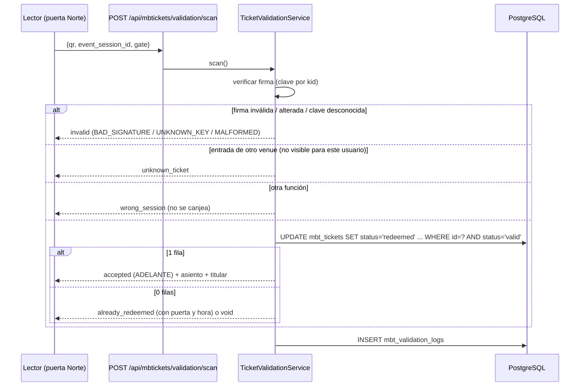
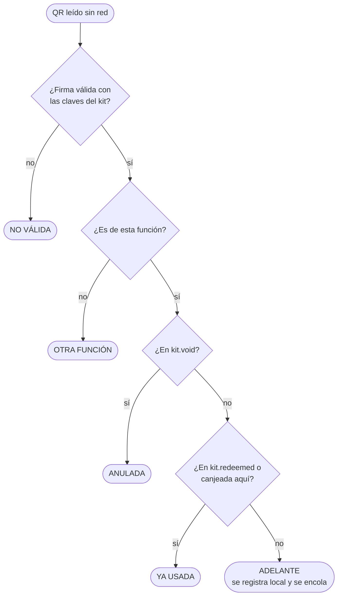
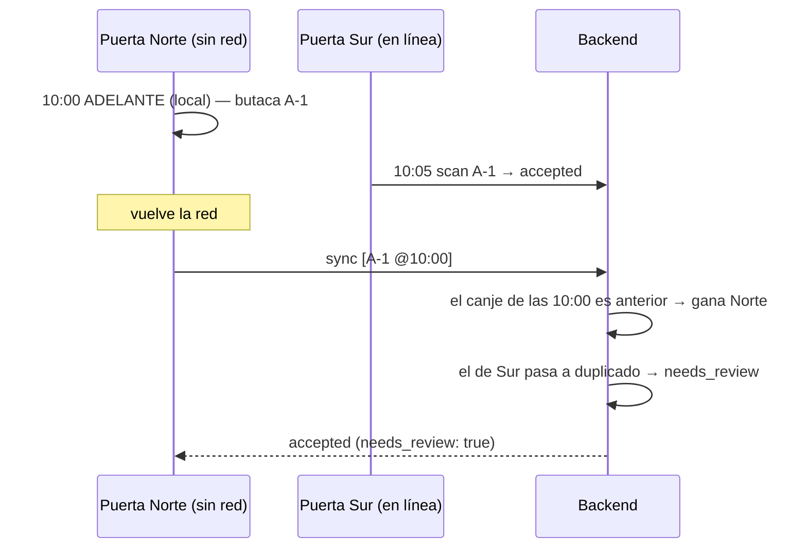

# F03 — Entradas con QR firmado y control de acceso

> Documentación técnica de la feature. Requerimientos: FR-08, FR-09 (incl. FR-09.1, FR-09.2), FR-10.1
> (`BookingConfirmed`), NFR-03, NFR-04. Historias: HU-04, HU-05, HU-15, HU-16, HU-17, HU-17b.
> Código: `mbtickets-backend-domain` y `mbtickets-frontend-domain`, rama `feat/signed-tickets`.

## 1. Qué resuelve

- Cada cupo vendido es una **entrada con un QR firmado** que no se puede falsificar ni alterar.
- En la puerta, una entrada **entra una sola vez**, aunque se presente en otra puerta (anti-passback).
- Si se cae internet, los lectores **siguen validando**: verifican la firma localmente, evitan el doble
  ingreso en el mismo lector y sincronizan al volver la red.

## 2. Arquitectura



## 3. La credencial

```
MBT1.<base64url(JSON de claims)>.<base64url(firma Ed25519 de esos bytes)>
```

| Claim | Significado |
|---|---|
| `t` | id de la entrada |
| `s` | id de la función |
| `v` | venue (tenant) |
| `l` | asiento o sector ("Platea A-9", "Galería") |
| `i` | emisión (unix) |
| `k` | id de la clave que firmó |

- La firma cubre los bytes exactos del JSON: cambiar un carácter (otra butaca, otra función) la invalida.
- Verificar solo requiere la **clave pública** del venue: un lector verifica sin red.
- El QR **no es secreto**. Copiarlo o fotografiarlo no sirve, porque el primer canje la marca usada. Lo que
  decide el acceso es el **estado** de la entrada, no la firma.
- El QR no se guarda en la base: se recalcula firmando los mismos datos con la clave que la emitió.
  Son unos 335 caracteres.

**Claves**: un par Ed25519 por venue, creado al emitir la primera entrada. La privada se guarda cifrada con
la `APP_KEY` (cast `encrypted`) y nunca sale del servidor. Rotar (`SigningKeyService::rotate`) crea una
clave activa nueva. Las anteriores siguen publicadas para verificar las entradas que ya firmaron.

## 4. Modelo de datos



## 5. Emisión

`InventoryEngine::confirm` publica `BookingConfirmed` **una sola vez**: solo cuando la reserva pasa a
vendida, después del commit. Reconfirmar no vuelve a publicar.

`IssueTicketsOnBookingConfirmed` llama a `TicketIssuer::issueFor`, que crea una entrada por cupo: una
línea de admisión general por 3 da 3 entradas. Es idempotente gracias al índice único
`(booking_item_id, sequence)`.

## 6. Validación en línea (HU-05, HU-16, HU-17b)



El canje es un **UPDATE condicional**, el mismo patrón que el motor de inventario (F01). Si dos puertas
leen la misma entrada a la vez, exactamente una recibe "1 fila".

## 7. Validación sin red (NFR-04, HU-17)

### Kit offline

`GET /api/mbtickets/validation/offline-kit?event_session_id=` →
`{public_keys[{kid, public_key}], redeemed[], void[], issued, generated_at}`. El lector lo refresca cada
minuto mientras tiene red y lo guarda en `localStorage` por función, así sobrevive a una recarga de la
página o a un corte de red.

### En el lector (`access/offlineValidator.ts`, TypeScript puro)



Si la red se cae a mitad de una lectura en línea, el lector valida localmente sin hacer esperar a nadie.
El modo "Trabajar sin red" fuerza este camino.

### Sincronización y conflictos

`POST /api/mbtickets/validation/sync {scans[{ref, qr, scanned_at, gate}]}`. El backend vuelve a verificar
cada firma y aplica `OfflineReconciler` (PHP puro) en una transacción que bloquea las entradas involucradas.

**Regla: gana el primer canje** (el `scanned_at` más temprano).



| Caso | Resultado |
|---|---|
| Entrada sin usar, canjeada sin red | `accepted`; la entrada queda canjeada a la hora de la lectura, `redeemed_offline = true`. |
| La misma entrada en dos lectores sin red | El primero `accepted`; el resto `duplicate_offline`, para revisión. |
| Lectura sin red posterior a un canje en línea | `duplicate_offline`, para revisión. |
| Lectura sin red **anterior** a un canje en línea | La lectura sin red gana; el canje en línea queda marcado para revisión. |
| Entrada anulada leída sin red | `void`, para revisión (alguien entró con una entrada anulada). |
| QR inválido o de otro venue | `invalid` / `unknown_ticket`, para revisión. |

Los logs con `needs_review = true` son la cola de revisión del equipo de operaciones del recinto.

## 8. API

| Método | Ruta | Quién |
|---|---|---|
| GET | `/api/mbtickets/bookings/{id}/tickets` | Personal del venue: entradas con QR (boletería, reimpresión). |
| POST | `/api/mbtickets/validation/scan` | Personal del venue. |
| GET | `/api/mbtickets/validation/offline-kit` | Personal del venue. |
| POST | `/api/mbtickets/validation/sync` | Personal del venue. |
| GET | `/api/public/mbtickets/bookings/{id}/tickets` | Comprador, con `X-Booking-Token`; solo con la reserva vendida (409 si no). |
| GET | `/api/public/mbtickets/venues/{tenantId}/keys` | Pública: claves para verificar entradas. |

Permisos: `api.mbtickets.booking.tickets` y `api.mbtickets.validation.{scan,offlineKit,sync}`, para
Tenant, TenancyAdmin y User (el personal de puerta).

## 9. Frontend (`mbtickets-web`)

| Pieza | Ubicación | Qué hace |
|---|---|---|
| Entradas | `components/TicketsPanel.tsx` | QR de cada entrada (`qrcode.react`), estado, imprimir solo las entradas (`@media print`). En la boletería tras confirmar y en el detalle de la reserva. |
| Control de acceso | `access/AccessControlPage.tsx` + `resources/accessControlResource.tsx` | Función, puerta, indicadores (en línea / sin red, kit, pendientes, ingresos y rechazos), resultado a pantalla completa (verde o rojo). |
| Cámara | `access/QrCamera.tsx` | `BarcodeDetector` nativo; `jsQR` como respaldo (Safari, Firefox). |
| Lector de mano | Campo de texto | Los lectores USB o Bluetooth "teclean" el QR y Enter. |
| Validación local | `access/offlineValidator.ts` | Firma Ed25519 con `tweetnacl`, kit, registro local, cola. |

Las páginas del comprador (sus entradas en el teléfono) van en `mbtickets-app`, en la fase 4.

## 10. Pruebas

| Prueba | Cubre |
|---|---|
| `tests/Unit/Mbtickets/TicketSignerTest.php` | Verifica solo con la pública; alterar un claim rompe la firma; clave ajena y desconocida; rotación; basura → `MALFORMED`. |
| `tests/Unit/Mbtickets/OfflineReconcilerTest.php` | Primer canje gana; dos puertas sin red; posterior a uno en línea; anterior a uno en línea (lo reemplaza); anuladas y desconocidas. |
| `tests/Feature/API/Mbtickets/SignedTicketsTest.php` | Emisión 1 por cupo e idempotente; verificación con las claves publicadas; entra una vez y se rechaza en otra puerta; QR alterado, otra función y otro venue; kit offline; sync con conflictos; entradas del comprador solo tras la venta y con token. |
| `packages/mbt-events/src/access/offlineValidator.test.ts` (vitest) | **Contrato entre lenguajes**: un QR firmado por el PHP real se verifica en JavaScript; alterado, clave ajena y basura rechazados; un ingreso por lector y cola; kit con canjeadas, anuladas y otra función. |

Prueba de punta a punta en el navegador (Playwright, 2026-10-20): venta en boletería → 2 entradas con QR;
control de acceso: ADELANTE → YA USADA en línea; "Trabajar sin red": ADELANTE → YA USADA sin llamar al
servidor; al reconectar, 1 → 0 pendientes y la entrada quedó `redeemed_offline` en la base.

```bash
cd mbtickets-backend-docker && ./mbtickets.sh test --filter='TicketSigner|OfflineReconciler|SignedTickets'
cd mbtickets-frontend-domain && pnpm --filter mbt-events test
```

## 11. Pendiente

- **Credenciales propias de cada lector o torniquete** (HU-18, FR-11, sobre DeviceCore). Hoy el personal
  valida con su sesión de usuario.
- **Anular entradas** (`void`) al cancelar o reembolsar (FR-25, fase 3). El kit ya distribuye la lista de
  anuladas: falta quien las anule.
- Riesgo residual documentado en NFR-04: una entrada anulada durante un corte de red se rechaza offline
  recién cuando el lector recibe el kit actualizado.
- Los rechazos sin red (por ejemplo, el segundo intento en el mismo lector) no se suben al backend: solo se
  sincronizan los ingresos.
- Pantalla de revisión de conflictos (`needs_review`) y reporte de throughput de check-in (FR-13).
- Entradas del comprador en `mbtickets-app` y envío por correo (fases 3 y 4).
