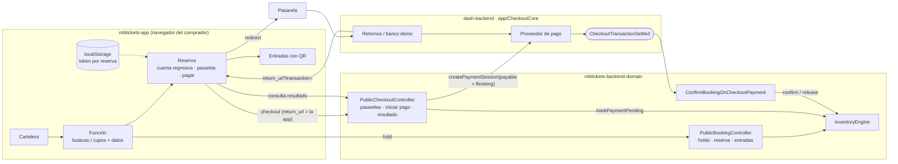
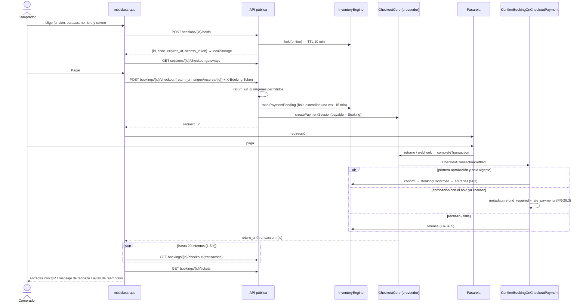
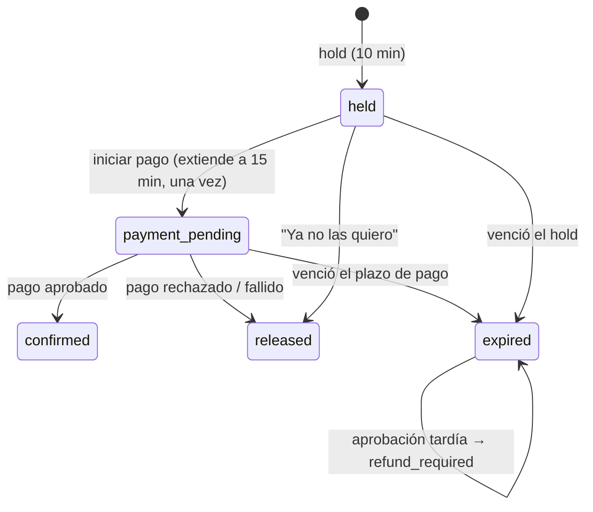

# F04 — Pago online de reservas y app del comprador (`mbtickets-app`)

> Documentación técnica de la feature. Requerimientos: FR-26 (26.1 a 26.5), FR-01, FR-05; base para FR-25.10.
> Historias: HU-01, HU-02, HU-04, HU-29, HU-29b, HU-29c.
> Código: `mbtickets-backend-domain`, rama `feat/booking-checkout`; `mbtickets-frontend-domain`, rama
> `feat/buyer-app`. Usa `app/CheckoutCore` del core (ver F02).

## 1. Qué resuelve

- El comprador compra **solo desde `mbtickets-app`**: cartelera, elección de butacas o cupos, pago online
  y entradas con QR. Es la regla de audiencias del producto: el venue y la cadena usan `mbtickets-web` y la
  plataforma `mbtickets-system`.
- El pago corre sobre las pasarelas del core (DashTest, Transbank Webpay, Mercado Pago) y se concilia con el
  hold de inventario:
  - mientras paga, las butacas no se liberan;
  - si el pago se rechaza, se liberan al instante;
  - si se aprueba tarde (el hold ya no existía), no se le quitan butacas a nadie y queda registrado para
    reembolso.

## 2. Arquitectura

## 3. Flujo completo

La consulta repetida existe porque con Mercado Pago el webhook (la confirmación autoritativa) puede llegar
unos segundos después que el navegador.

## 4. Estados de la reserva con pago online

## 5. Decisiones

| Decisión | Por qué |
|---|---|
| El `return_url` debe apuntar al origen de `mbtickets-app` (`MBT_APP_URL`) o a uno de `MBT_CHECKOUT_RETURN_ORIGINS`. | Sin esa validación, el checkout serviría como redirector abierto hacia cualquier sitio. |
| `markPaymentPending` extiende el hold **una sola vez** al iniciar el pago. | El comprador no pierde sus butacas mientras escribe la tarjeta (HU-29), pero tampoco puede retenerlas indefinidamente reiniciando pagos. |
| Aprobación tardía: no se reconfirma la reserva. | Las butacas pudieron venderse a otro comprador (FR-26.3). El cobro queda marcado `refund_required` con la transacción, para el flujo de reembolso (FR-25, fase 3). |
| El listener ignora repeticiones (`wasAlreadySettled`) y pagos de otros dominios (`payable_type`). | La misma liquidación puede llegar por retorno y por webhook (HU-29c). |
| La app guarda el token de cada reserva en `localStorage`. | Es la única credencial del comprador invitado y se recibe una sola vez; "Mis entradas" lista las reservas de este dispositivo. |
| `mbtickets-app` no depende de react-admin ni de `mbt-events`. | Es una app pública liviana, como `inamap-app`; tiene su propio cliente de API mínimo. |

## 6. API (nueva en esta feature)

Pública, `throttle:mbtickets-public`. Todo lo de una reserva exige `X-Booking-Token`.

| Método | Ruta | Respuesta |
|---|---|---|
| GET | `/api/public/mbtickets/sessions/{id}/checkout-gateways` | `[{id, name, is_default}]`, activas del venue y la default primero. |
| POST | `/api/public/mbtickets/bookings/{id}/checkout` | Body `{checkout_gateway_id?, return_url}`. Responde 201 `{transaction_id, redirect_url, provider}`. 422 si el `return_url` no está permitido o el venue no tiene pasarela; 409 si el hold venció. |
| GET | `/api/public/mbtickets/bookings/{id}/checkout/{transactionId}` | `{transaction_status, booking_status, booking_code}`. |

Configuración (`config/mbtickets.php` → `checkout`):

| Clave | Env | Defecto |
|---|---|---|
| `app_url` | `MBT_APP_URL` | `http://localhost:5190` |
| `allowed_return_origins` | `MBT_CHECKOUT_RETURN_ORIGINS` (separados por coma) | — |
| `payment_timeout_minutes` | `MBT_PAYMENT_TIMEOUT_MINUTES` | 15 |

## 7. `mbtickets-app`

| Ruta | Pantalla |
|---|---|
| `/` | Cartelera: búsqueda, fecha, categorías; tarjetas con precio desde y cupos restantes. |
| `/funcion/:id` | Detalle, atributos del evento, cierre de venta, mapa de butacas por fila o cupos por sector, resumen, nombre y correo. |
| `/reserva/:id` | Cuenta regresiva, pasarela (si hay más de una), pagar o soltar; retorno con `?transaction=`; entradas con QR. |
| `/mis-entradas` | Reservas de este dispositivo. |

Código: `apps/mbtickets-app/src/` — `main.tsx` (tema y rutas), `api.ts`, `storage.ts`, `format.ts`, `pages/`.
Desarrollo: `pnpm dev:app` (puerto 5190; `.env.local` con `VITE_API_URL`).

## 8. Pruebas

| Prueba | Cubre |
|---|---|
| `tests/Feature/API/Mbtickets/OnlineCheckoutTest.php` | Pago aprobado con DashTest: reserva confirmada, `payment_method = checkout_gateway`, 2 entradas, contadores; liquidación repetida no vende dos veces. Tarjeta rechazada libera al instante. Aprobación tras vencer el plazo: sigue vencida, `refund_required`, nada vendido. `return_url` ajeno rechazado y token obligatorio. Venue sin pasarelas. |

Suite completa del dominio: 65 pruebas (21 unitarias, 44 de API).

Punta a punta en el navegador (Playwright, 2026-10-20, venue demo con DashTest):
- cartelera → Hamlet → butacas C-5 y C-6 → "Continuar al pago" → pagar → banco demo con tarjeta que aprueba → de vuelta en la app, 2 entradas con QR;
- con la tarjeta que rechaza: mensaje de rechazo y butacas liberadas;
- la lista de pasarelas se pide una sola vez.

## 9. Pendiente

- Reembolsar automáticamente los pagos aprobados tarde (`refund_required`), dentro de cancelaciones y
  reembolsos (FR-25, fase 3), con la cola de revisión de la Admin Payments UI.
- Envío de las entradas por correo al confirmar (FR-10.2, fase 3).
- Recuperar una reserva desde otro dispositivo (hoy el token vive en el navegador donde se compró).
  Opciones: enlace mágico al correo, o cuenta de comprador.
- Configurar pasarelas desde `mbtickets-web`. La API existe (F02), falta la pantalla en este frontend; en
  desarrollo se configuró DashTest para el venue demo directamente en la base.
- Túnel y dominio de producción de la app (`app-dev.mbtickets.example` es un marcador).
