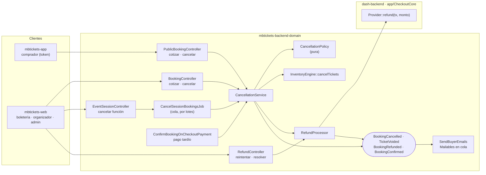
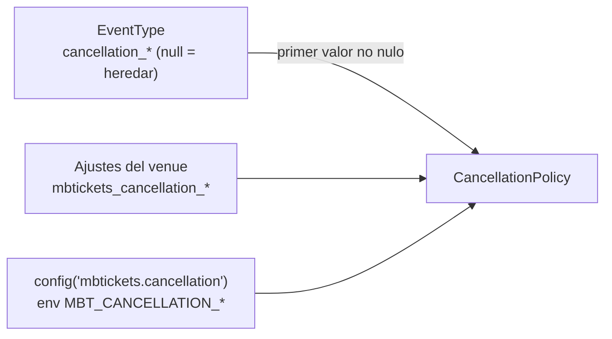
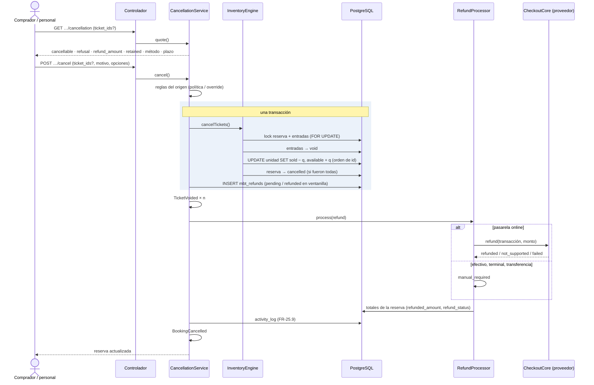
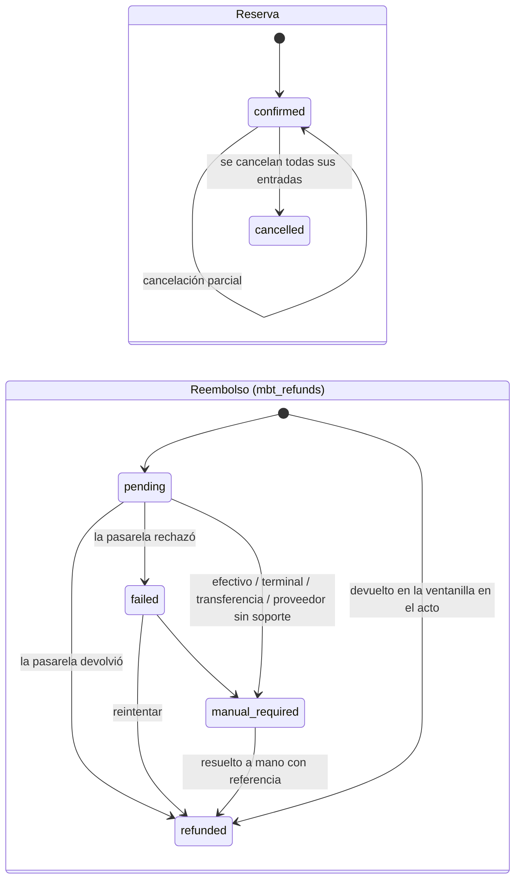
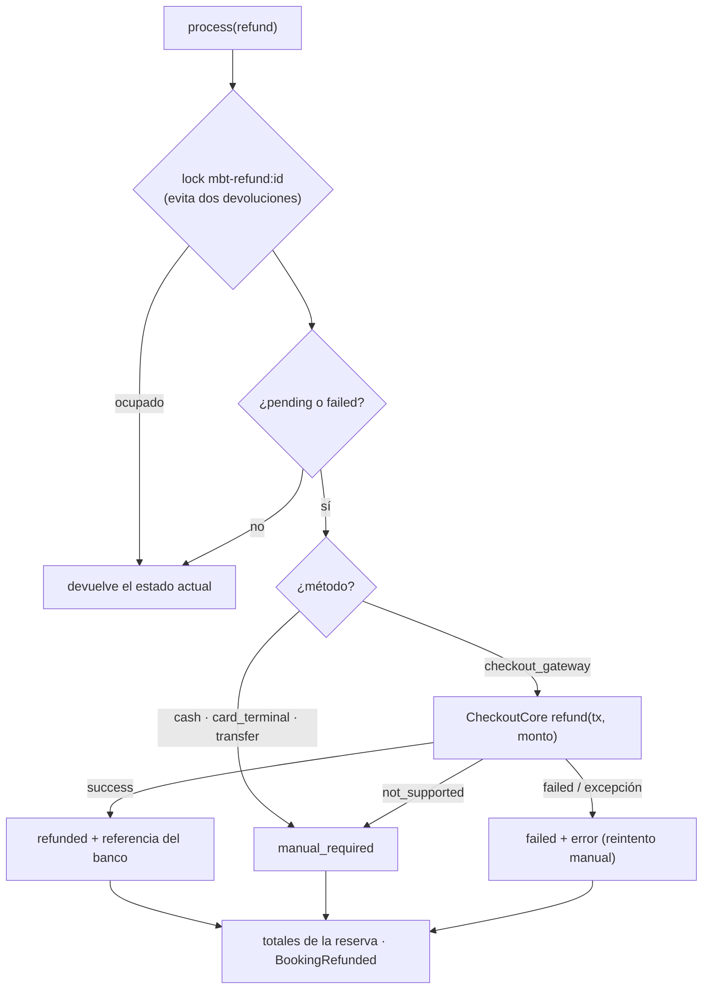
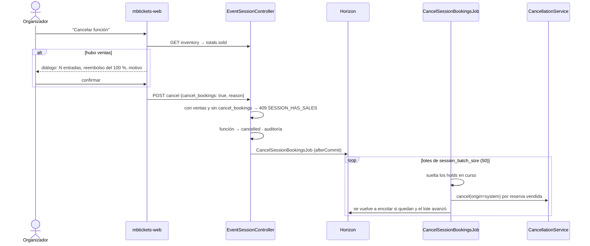
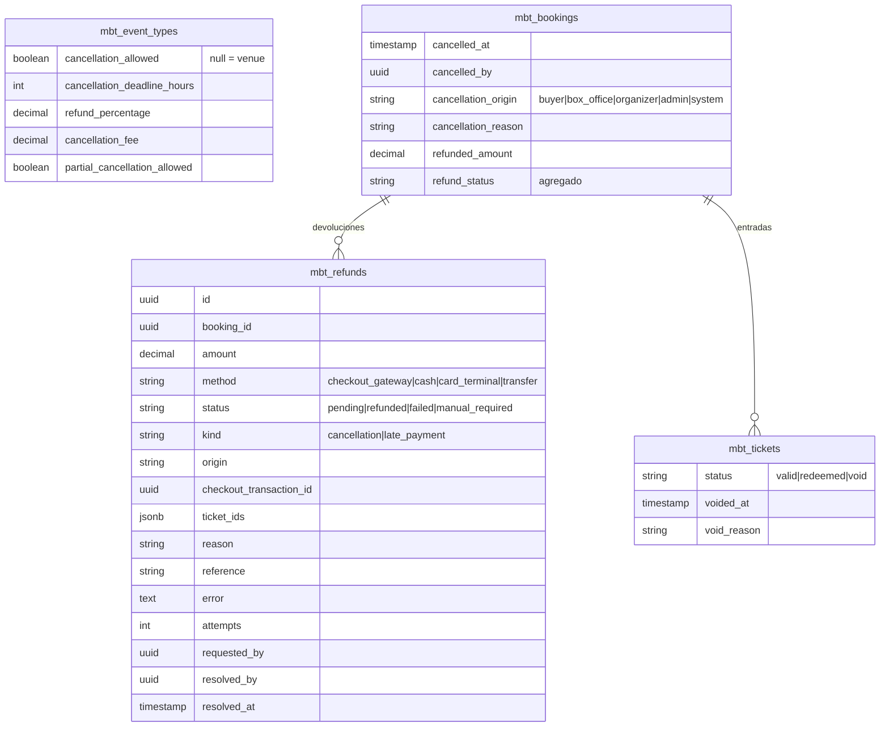

# F05 — Cancelaciones, reembolsos y correos al comprador

> Documentación técnica de la feature. Requerimientos: FR-25 (25.1 a 25.10), FR-26.3, FR-10.2, NFR-04.
> Historias: HU-04, HU-28, HU-28b, HU-28c, HU-28d, HU-28e, HU-28f, HU-28g, HU-29b.
> Código:
> - `dash-backend`, rama `feat/checkout-core`: reembolso uniforme en `app/CheckoutCore`.
> - `mbtickets-backend-domain`, rama `feat/cancellations-refunds`.
> - `mbtickets-frontend-domain`, rama `feat/cancellations-refunds`.
>
> Se apoya en F01 (motor de inventario), F02 (pasarelas), F03 (entradas firmadas) y F04 (pago online).

## 1. Qué resuelve

- **Cancelar una venta**, completa o por entradas sueltas, desde cuatro orígenes:
  - el comprador en `mbtickets-app`;
  - la boletería, el organizador o un administrador en `mbtickets-web`;
  - el sistema, cuando se cancela una función completa.
- **Política de cancelación por evento** (FR-25.1): si se permite, hasta cuántas horas antes, qué
  porcentaje se devuelve, cargo fijo y si se admiten entradas sueltas. Cada valor puede heredarse del
  venue. El comprador ve el monto antes de confirmar.
- **Anulación atómica** (FR-25.4): en una sola transacción la entrada pasa a `void` y su cupo vuelve
  a estar disponible. Los lectores sin red reciben la anulación en la lista `void` de su kit (F03).
- **Reembolso** por el mismo medio de pago (FR-25.5, FR-25.6):
  - pasarela online: automático, total o parcial;
  - efectivo, terminal sin conector o transferencia: cola de revisión, que se resuelve con referencia.
- **Pago aprobado tarde** (FR-25.10, HU-29b): ya no queda solo marcado, se devuelve automáticamente.
- **Correos al comprador** (FR-10.2): las entradas con su QR al comprar, el aviso de cancelación y el
  de reembolso, con la marca del venue.

## 2. Arquitectura

| Pieza | Responsabilidad |
|---|---|
| `CancellationPolicy` | Pura. Resuelve la política (evento → venue → config), el plazo, el motivo de rechazo y el monto a devolver. |
| `CancellationService` | Orquesta una cancelación: reglas del origen, transacción (motor + fila de reembolso), eventos, reembolso y auditoría. También el reembolso de un pago tardío. |
| `InventoryEngine::cancelTickets` | La única pieza que mueve los contadores al cancelar: entradas a `void` y `sold → available`, por unidad y en orden de id. |
| `RefundProcessor` | Ejecuta un reembolso (pasarela o cola manual), lo reintenta, lo resuelve a mano y recalcula los totales de la reserva. |
| `CancelSessionBookingsJob` | Cancelación de una función completa: lotes en cola, reembolso del 100 %. |
| `SendBuyerEmails` | Suscriptor que encola los correos al comprador. |
| `AbstractCheckoutGatewayProvider::refund()` (core) | Reembolso total o parcial uniforme para todos los proveedores. |

## 3. Política de cancelación (FR-25.1, HU-28c)

### 3.1 Resolución

| Campo del evento | Ajuste del venue | Config / env | Defecto |
|---|---|---|---|
| `cancellation_allowed` | `mbtickets_cancellation_allowed` | `MBT_CANCELLATION_ALLOWED` | sí |
| `cancellation_deadline_hours` | `mbtickets_cancellation_deadline_hours` | `MBT_CANCELLATION_DEADLINE_HOURS` | 24 |
| `refund_percentage` | `mbtickets_refund_percentage` | `MBT_CANCELLATION_REFUND_PERCENTAGE` | 100 |
| `cancellation_fee` | `mbtickets_cancellation_fee` | `MBT_CANCELLATION_FEE` | 0 |
| `partial_cancellation_allowed` | `mbtickets_partial_cancellation_allowed` | `MBT_CANCELLATION_PARTIAL_ALLOWED` | sí |

FR-25.1 deja los valores por defecto "a definir con negocio". Se partió de lo más favorable para el
comprador; se cambian por env sin tocar código.

### 3.2 Monto a devolver

`reembolso = max(0, pagado × porcentaje / 100 − cargo fijo)`

- Se redondea al entero en monedas sin decimales (`zero_decimal_currencies`: CLP, PYG, JPY, KRW).
- `pagado` es el precio unitario de la línea de cada entrada cancelada (`BookingItem.unit_price`).
- Una cortesía (`payment_method = courtesy`) no tiene nada que devolver: no crea reembolso.

| Origen | Plazo y "se permite" | Monto |
|---|---|---|
| `buyer` | Sí aplican. | La política. |
| `box_office`, `organizer`, `admin` | No aplican: corrigen errores en el acto (HU-28f). | 100 %, salvo que marquen `apply_policy`. |
| `system` (función cancelada) | No aplican. | Siempre 100 % (FR-25.7). |

El origen de un usuario del panel sale de su rol (`CancellationService::originFor`):

| Rol | Origen |
|---|---|
| SystemAdmin | `admin` |
| TenancyAdmin, Tenant | `organizer` |
| User | `box_office` |

### 3.3 Por qué no se puede cancelar (HU-28b)

Códigos estables. El backend los traduce (`mbtickets.inventory.*`) y la app muestra `refusal_message`.

| Código | HTTP | Cuándo |
|---|---|---|
| `CANCELLATION_NOT_ALLOWED` | 422 | El evento no admite cancelaciones del comprador. |
| `CANCELLATION_DEADLINE_PASSED` | 422 | Pasó el plazo (`inicio − deadline_hours`). |
| `PARTIAL_NOT_ALLOWED` | 422 | Pidió entradas sueltas y el evento solo admite la reserva completa. |
| `TICKETS_NOT_CANCELLABLE` | 422 | Alguna entrada no es de la reserva o ya estaba anulada. |
| `TICKET_REDEEMED` | 409 | Una entrada ya se usó: solo la anula un administrador (FR-25.3). |
| `OVERRIDE_REASON_REQUIRED` | 422 | El administrador pidió `override` sin motivo. |
| `NOTHING_TO_CANCEL` | 409 | No quedan entradas vigentes. |
| `BOOKING_INVALID_STATE` | 409 | La reserva no está vendida (o ya se canceló). |

## 4. Cancelar una reserva

### 4.1 Secuencia

### 4.2 Por qué así

| Decisión | Por qué |
|---|---|
| Entradas y cupo en la misma transacción, la entrada primero. | Nadie puede comprar el asiento mientras su QR anterior aún vale (FR-25.4). |
| El reembolso se crea dentro de la transacción y se ejecuta después del commit. | Si la base falla, no hay ni anulación ni reembolso. Si el banco falla, la entrada sigue anulada y el inventario libre (FR-25.5). |
| Las unidades se tocan en orden de id, con `UPDATE … WHERE sold >= q`. | Mismo orden que `hold` y `confirm`: sin deadlocks. Si el contador no cuadra, se aborta todo (`INVENTORY_INCONSISTENT`). |
| Una cancelación parcial deja la reserva `confirmed`. | El resto de sus entradas sigue válido; lo cancelado se ve en las entradas `void` y en `mbt_refunds`. |
| Una venta confirmada sin entradas (anterior a F03, o con la emisión fallida) se completa antes de cotizar o cancelar. | Se cancela por entrada: sin entradas no habría qué anular. |

### 4.3 Estados

La reserva y su reembolso tienen estados independientes (FR-25.5):

`Booking.refund_status` es el agregado de sus reembolsos. Manda el más urgente:
`manual_required` > `failed` > `pending` > `refunded`. `Booking.refunded_amount` suma lo devuelto.

## 5. Reembolsos

### 5.1 En el core: un `refund()` para todos los proveedores

`AbstractCheckoutGatewayProvider::refund(CheckoutGatewayTransaction $tx, ?float $amount = null)`:

- Total si no se pasa monto; parcial si se pasa. Nunca más de lo que queda por devolver.
- Guarda el historial en `transaction.data.refunds`. La transacción pasa a `partially_refunded` o `refunded`.
- Cada proveedor resuelve su propia referencia en `performRefund()`:

| Proveedor | Referencia | Parcial |
|---|---|---|
| DashTest | — (banco de demostración: siempre aprueba) | Sí |
| Transbank Webpay Plus | token (`external_session_id`) → `Webpay::refund(token, monto)` | Sí |
| Mercado Pago | `raw_response.payment_id` → `refund()` / `refundTotal()` | Sí |
| Otro proveedor sin override | `refundPayment()` del contrato | Solo total; si es el stub "no implementado" → `not_supported` |

- Un aviso "aprobado" que llega para una transacción ya reembolsada no la devuelve a `paid` ni se anuncia
  como primera aprobación.
- Las respuestas del SDK se guardan como arreglos planos. `(array)` sobre esos objetos dejaba claves con
  bytes nulos, que la columna JSON de PostgreSQL rechaza.

### 5.2 En el dominio: `RefundProcessor`

La cola de revisión (HU-28g) es el recurso **Reembolsos** de `mbtickets-web` (menú "Por resolver",
filtro `open=1`):

- **Reintentar**: solo un reembolso por pasarela en estado `failed` o `pending`.
- **Marcar como devuelto**: exige una referencia (folio de caja, comprobante de transferencia) y acepta
  una nota. Queda en `resolved_by`, `resolved_at` y en el log de auditoría.

### 5.3 Pago aprobado tarde (FR-25.10, HU-29b)

`ConfirmBookingOnCheckoutPayment` (F04) ya no se limita a marcar `refund_required`:

1. Registra el pago en `metadata.late_payments`, como antes.
2. Crea un reembolso `kind = late_payment`, `origin = system`, por el total de la transacción, y lo procesa.
   Un índice único parcial (`checkout_transaction_id` cuando `kind = 'late_payment'`) impide que un aviso
   repetido devuelva dos veces.
3. `metadata.refund_required` queda en `false` si el reembolso salió, y en `true` si quedó pendiente de acción.

## 6. Cancelar una función completa (FR-25.7, HU-28d)

- Sin política: reembolso del 100 % y también de las entradas ya usadas (la función no se completó).
- Un hold en pago se suelta. Si después la pasarela aprueba, entra por el camino del pago tardío (5.3).
- Una reserva que falla no frena al resto. Si un lote entero falla, el job no insiste en bucle: esas
  reservas quedan vendidas a la vista del organizador y en el log.
- El frontend consulta el inventario antes de cancelar: dash-axios-hook muestra cualquier error de la API
  como modal global, así que esperar el 409 taparía el diálogo de confirmación.

## 7. Correos al comprador (FR-10.2, FR-25.8)

El comprador es un invitado, no un usuario: no pasa por `AppNotificationBuilder`, que notifica a
usuarios o roles. Se usan Mailables al correo de la reserva:

- en cola (Horizon);
- con el layout del core `layouts.emails`;
- con la marca del venue (`TenantResource`), y si el venue no tiene, la del dominio (sección 7.2).

| Evento | Correo | Contenido |
|---|---|---|
| `BookingConfirmed` | `BookingConfirmedMail` | Una imagen QR por entrada, incrustada (`cid`, PNG de `endroid/qr-code`): se ve sin descargar imágenes externas y sirve sin conexión (HU-04). |
| `BookingCancelled` | `BookingCancelledMail` | Entradas anuladas y monto a devolver con su estado. Si el origen es `system`, el texto dice que **se canceló la función**. |
| `BookingRefunded` | `BookingRefundedMail` | Monto devuelto y referencia. Solo si se devolvió **después** de la cancelación: si fue en el acto, ya lo dijo el aviso de cancelación (`duringCancellation`). |

### 7.1 Reglas

- Solo con `buyer_email`: una venta de boletería puede no tenerlo.
- `MBT_MAIL_ENABLED=false` apaga los correos.
- Un error al encolar se registra y nunca afecta la venta ni la cancelación.

### 7.2 Marca por defecto del dominio

El core la descubre sola:

- `config/branding.php`: azul `#336699` en degradado a `#1F3F5F`.
- `resources/branding/`:
  - `logo-horizontal.png` es la variante **toda en blanco** (`brand/logo-horizontal-white.*`). Sobre la
    cabecera azul, el azul de "MB" y del ícono desaparecería.
  - `logo-squared.png` y `login-back.png`, los del brand.

## 8. Eventos de dominio (FR-25.8)

| Evento | Cuándo | Datos | Suscriptores hoy |
|---|---|---|---|
| `TicketVoided` | Por cada entrada anulada, después del commit. | `ticket` | — (para webhooks, FR-24) |
| `BookingCancelled` | Una vez por cancelación. | `booking`, `ticketIds`, `full`, `origin`, `refund` | `SendBuyerEmails` |
| `BookingRefunded` | Un reembolso quedó devuelto. | `refund`, `duringCancellation` | `SendBuyerEmails` |

Los lectores sin red no dependen de estos eventos: la anulación les llega en la lista `void` de
`validation/offline-kit` (F03, NFR-04), con el riesgo residual allí documentado.

## 9. Auditoría (FR-25.9)

`activity_log` (spatie, log `mbtickets`):

| `event` | Sujeto | Propiedades |
|---|---|---|
| `cancelled` | Reserva | origen, motivo, override, completa, entradas, pagado, reembolso, estado del reembolso |
| `refund_resolved` | Reserva | reembolso, monto, método, referencia, nota (causante: quien lo resolvió) |
| `late_payment_refund` | Reserva | reembolso, transacción, monto, motivo |
| `session_cancelled` | Función | motivo, reservas vendidas, holds |

## 10. Modelo de datos

Migración `2026_10_21_000100_create_mbtickets_cancellation_tables`.

## 11. API

### 11.1 Pública (`mbtickets-app`, `X-Booking-Token`)

| Método | Ruta | Respuesta |
|---|---|---|
| GET | `/api/public/mbtickets/bookings/{id}/cancellation?ticket_ids[]=` | Cotización: `cancellable`, `refusal`, `refusal_message`, `deadline_at`, `policy`, `full`, `tickets`, `paid_amount`, `refund_amount`, `retained_amount`, `refund_method`. |
| POST | `/api/public/mbtickets/bookings/{id}/cancel` | Body `{ticket_ids?, reason?}`. La reserva con `cancelled_at`, `refunded_amount` y `refund_status`. |
| GET | `/api/public/mbtickets/sessions/{id}` | Ahora incluye `cancellation_policy` (con `deadline_at`), que la app muestra antes de comprar. |
| GET | `/api/public/mbtickets/bookings/{id}/tickets` | También en reservas canceladas; una entrada `void` trae `qr: null`. |

### 11.2 Autenticada (`mbtickets-web`)

Nombre de ruta = permiso.

| Método | Ruta | Permiso | Notas |
|---|---|---|---|
| GET | `mbtickets/bookings/{id}/cancellation` | `booking.cancellationQuote` | `ticket_ids[]`, `apply_policy=1/0`. Booleanos como 1/0: la regla `boolean` de Laravel no acepta `"true"`. |
| POST | `mbtickets/bookings/{id}/cancel` | `booking.cancel` | `ticket_ids`, `reason`, `apply_policy`, `refund_settled`, `refund_reference`, `override`. |
| POST | `mbtickets/event-sessions/{id}/cancel` | `eventSession.cancel` | `cancel_bookings`, `reason`. 409 `SESSION_HAS_SALES` con `details.count`. Responde `meta.bookings_to_cancel`. |
| GET | `mbtickets/refunds` | `refund.getList` | Filtros: `open`, `status`, `method`, `kind`, `booking_id`, `q`. |
| POST | `mbtickets/refunds/{id}/retry` | `refund.retry` | 409 `REFUND_NOT_RETRYABLE`. |
| POST | `mbtickets/refunds/{id}/resolve` | `refund.resolve` | `reference` (obligatoria), `note`. 409 `REFUND_NOT_OPEN`. |

Permisos por rol:

| Rol | Cancelar ventas | Reembolsos |
|---|---|---|
| User (boletería) | Sí | No |
| Tenant | Sí | Ver, reintentar, resolver |
| TenancyAdmin | Sí | Ver, reintentar, resolver |
| SystemAdmin | Sí | Todo |

## 12. Frontend

### 12.1 `mbtickets-web` (paquete `mbt-events`)

| Pieza | Qué hace |
|---|---|
| `CancelBookingPanel` (vista de una reserva) | Estado y tabla de reembolsos. Botón **Cancelar venta**: elige entradas y pide la cotización en vivo. Opciones: aplicar la política, "ya devolví el efectivo" (con referencia) y, si hay entradas usadas, override de administrador con motivo. |
| `refundResource` + `RefundActions` | Recurso **Reembolsos**, con los menús "Por resolver" y "Todos". En la vista: reintentar o marcar como devuelto. |
| `StatusActions` (funciones) | Antes de cancelar, consulta el inventario; si hubo ventas, abre la confirmación con motivo. |
| `NullableBooleanSetting` | Sí / No / "Como el venue" para los booleanos heredables de la pestaña **Cancelación** del evento. |
| `TicketsPanel` | Una entrada anulada muestra "Anulada" en lugar del QR. |
| `ChoiceField` | Dibuja columnas `select` en recursos de solo lectura (bug de dash-auto-admin, sección 14). |

### 12.2 `mbtickets-app`

| Pantalla | Cambio |
|---|---|
| `/funcion/:id` | Bajo el formulario: la política en una frase ("Puedes cancelar hasta 24 h antes… te devolvemos el 80 %"). |
| `/reserva/:id` | Sección **Cancelar entradas** (`CancelSection`): elegir entradas si el evento lo permite, cotización o motivo del rechazo, confirmar. Una reserva cancelada muestra el estado del reembolso. |

## 13. Pruebas

| Prueba | Cubre |
|---|---|
| `dash-backend` `tests/Feature/CheckoutCore/CheckoutCoreTest.php` | Reembolso parcial y luego total con DashTest. Nunca más de lo pagado. Un aviso tardío no reabre un pago reembolsado. |
| `tests/Unit/Mbtickets/CancellationPolicyTest.php` | Precedencia evento → venue → config. Porcentaje, cargo y redondeo. Motivos de rechazo y plazo. |
| `tests/Feature/API/Mbtickets/CancellationsAndRefundsTest.php` | Ver el detalle abajo. |
| `OnlineCheckoutTest` | Actualizada: la aprobación tardía queda `refunded`. |

`CancellationsAndRefundsTest` (8 pruebas):

- Comprador:
  - cotiza y cancela todo; reembolso por pasarela; transacción `refunded`;
  - eventos y correos;
  - entradas sin QR y en la lista `void` del kit offline;
  - cancelar dos veces no devuelve dos veces.
- Política: 50 % − 1.000 sobre una entrada (2.500), cancelación parcial, transacción `partially_refunded`.
- Rechazos: plazo vencido, cancelación no permitida, solo reserva completa, default del venue, sin token.
- Boletería:
  - efectivo devuelto en el acto;
  - transferencia a la cola manual y luego resuelta;
  - auditoría;
  - cortesía sin reembolso.
- Entrada usada: rechazada al personal, y aceptada para el administrador con motivo.
- Función cancelada: exige confirmación, lotes de 1, reembolso del 100 % aunque la política diga 0 %, holds sueltos, correos.
- Pago tardío: reembolso automático e idempotente.
- Correo de entradas: un PNG incrustado por entrada.

Suite del dominio: **76 pruebas** (24 unitarias, 52 de API).

Punta a punta en el navegador (Playwright, 2026-10-19, venue demo con DashTest):

- **Web, política:** pestaña **Cancelación** del evento Hamlet; reembolso del 80 %, el resto heredado.
- **App, compra y cancelación:**
  - se compran 2 butacas;
  - la cotización de 1 entrada muestra $6.400 (80 % de $8.000) y el plazo;
  - se cancela esa entrada y luego la otra;
  - la reserva queda cancelada, con $12.800 devueltos.
- **Correos (Mailhog):** entradas con 2 QR incrustados, dos avisos de cancelación y el aviso de función
  cancelada, todos con la cabecera azul y el logo blanco.
- **Web, venta en efectivo:**
  - una venta anterior a F03 (sin entradas) se completa y se cancela;
  - el reembolso queda "Requiere acción";
  - se resuelve en Reembolsos con "Caja 1 folio 2231".
- **Web, entradas usadas:** en una venta con entradas usadas, el diálogo advierte y no deja confirmar
  sin override y motivo.
- **Web, función cancelada:**
  - se cancela una función de prueba con una venta;
  - el diálogo muestra 1 entrada vendida;
  - Horizon ejecuta el job;
  - la reserva queda `cancelled` por `system`, con el motivo.

## 14. Pendiente

- **Reembolso por terminal físico** (doc 09 FR-23.2): hoy `card_terminal` va a la cola manual. Cuando
  PosPaymentCore tenga `refund()`, `RefundProcessor` lo usa igual que la pasarela.
- **Webhooks y reportes** (FR-24, FR-13): `TicketVoided`, `BookingCancelled` y `BookingRefunded` ya se
  publican; faltan los suscriptores.
- **Reprogramar una función** (FR-25.7, abierto): no es una cancelación; sin especificar.
- **dash-auto-admin**: `type: 'select'` no se dibuja en listas ni vistas. Hoy hay un parche local (`ChoiceField`).
- **dash-axios-hook**: no hay opción para omitir el modal global de error. Hoy se evita con una consulta previa.
- **Recuperar la reserva desde otro dispositivo** (de F04): el correo de entradas lleva los QR, pero
  cancelar sigue exigiendo el token del navegador donde se compró.
- **Datos de prueba del E2E en la base de desarrollo:** una función de Hamlet del 24-10 a las 15:00,
  cancelada, con su venta; y la política del 80 % en Hamlet.
