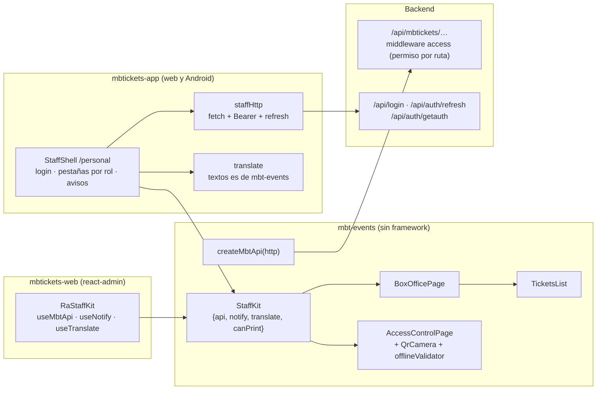
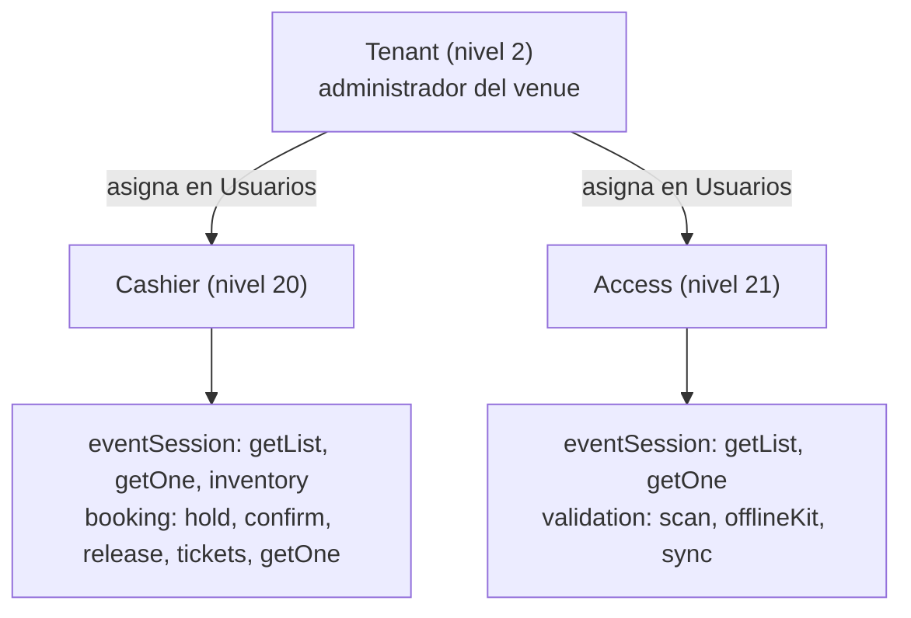
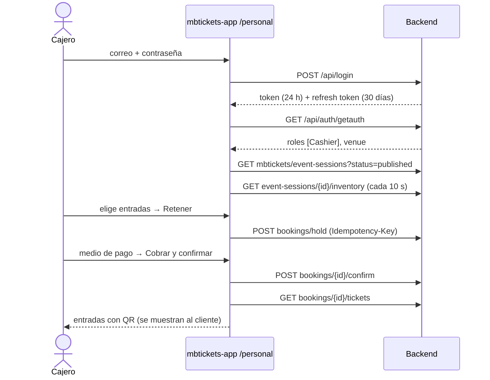
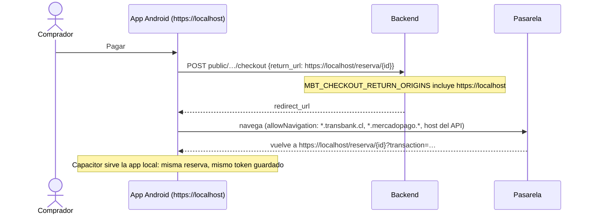

# F06 — Boletería y control de acceso en la app, roles de personal y app Android

> Documentación técnica de la feature.
> Código:
> - `mbtickets-backend-domain`, rama `feat/staff-app-roles`: roles `Cashier` y `Access`.
> - `mbtickets-frontend-domain`, rama `feat/staff-app`: pantallas compartidas, área del personal en
>   `mbtickets-app` y proyecto Android (Capacitor).
> - `mbtickets-backend-docker`: `MBT_CHECKOUT_RETURN_ORIGINS` en la plantilla de entorno.
>
> Se apoya en F01 (boletería), F03 (validación en la puerta, kit offline) y F04 (`mbtickets-app`).

## 1. Qué resuelve

- **Dos roles de personal**, con una sola tarea cada uno y solo en su venue:
  - **Cashier** (cajero): vende en la boletería.
  - **Access** (control de acceso): valida entradas en la puerta.
- **La boletería y el control de acceso también en `mbtickets-app`**, además de `mbtickets-web`.
  El personal entra con su usuario de MBTickets en **Acceso del personal** (`/personal`) y ve lo que
  sus roles permiten. El comprador no inicia sesión y no ve nada de esto.
- **Una sola implementación de las pantallas**: la web y la app corren el mismo código de venta y de
  validación (`mbt-events`); cambia solo lo que las rodea (login, cliente HTTP, avisos).
- **`mbtickets-app` como app Android** con Capacitor, como KitchnTabs: la misma app del comprador,
  con el área del personal, el lector QR con la cámara del teléfono y el kit offline.

## 2. Arquitectura

### 2.1 Las pantallas no dependen de react-admin

Antes, `BoxOfficePage`, `AccessControlPage` y `TicketsPanel` usaban `useNotify`, `useTranslate` y
`useMbtApi` (axios de DashAdmin). `mbtickets-app` no tiene react-admin, así que se separó lo que
necesitan de dónde corren:

| Pieza | Qué es |
|---|---|
| `api/mbtApi.ts` | Las llamadas (`createMbtApi(http)`), los tipos y `apiErrorMessage`/`apiErrorCode`. Sin imports de framework. `http` es cualquier cliente con forma de axios. |
| `api/useMbtApi.ts` | En la web: `createMbtApi` con el axios de DashAdmin (Bearer, refresh, `X-Tenant-Id`). Reexporta `mbtApi.ts`: el resto del paquete no cambia. |
| `staff/StaffKit.tsx` | Contexto `{api, notify, translate, canPrint}` y `useStaffKit()`. |
| `staff/RaStaffKit.tsx` | El kit en la web, con react-admin. Los recursos `boxOfficeResource` y `accessControlResource` envuelven sus páginas. |
| `components/TicketsList.tsx` | Las entradas de una venta, con el kit. `TicketsPanel` (vista de la reserva en la web) es un envoltorio que toma el id del registro. |

`canPrint` oculta **Imprimir** en Android: `window.print()` no hace nada en el WebView.

### 2.2 El área del personal en la app

| Archivo (`apps/mbtickets-app/src`) | Qué hace |
|---|---|
| `staff/session.ts` | Login (`POST /api/login`, `X-Device-Name: mbtickets-app`), lectura de roles y venue (`/api/auth/getauth`), refresh (`/api/auth/refresh`, una renovación a la vez), logout. Guarda la sesión en el dispositivo. Rechaza en el login a quien no tiene un rol de personal (y revoca el token recién creado). |
| `staff/http.ts` | Cliente con forma de axios para `createMbtApi`: `{data}` en éxito; en error `response.{status,data}`; **sin `response` si falla la red**, que es lo que el control de acceso usa para pasar a validar con el kit offline. En un 401 renueva el token una vez y repite. |
| `staff/translate.ts` | Los textos `mbt_events.*` (los mismos de la web), en español, con `%{variable}`. |
| `staff/StaffShell.tsx` | `/personal/*`: login, nombre y venue, pestañas **Boletería** / **Control de acceso** según los roles, avisos (Snackbar). Se carga aparte (`React.lazy`): el comprador no descarga el lector QR. |
| `native.ts` | En Android, el botón "atrás" navega dentro de la app y solo la cierra desde la primera pantalla. |

Qué ve cada rol en la app:

| Rol | Boletería | Control de acceso |
|---|---|---|
| Cashier | Sí | No |
| Access | No | Sí |
| Tenant (administrador del venue), TenancyAdmin | Sí | Sí |
| Otros (User, comprador) | No entran |  |

En la web, `Cashier` y `Access` se agregaron a los `roles` de los recursos de boletería y control de
acceso, y cada rol entra directo a su pantalla (`roles.redirect`).

## 3. Roles y permisos

- Definidos en `Domain\App\Models\Extended\Role` (como los roles propios de KitchnTabs). Nivel alto
  = poca autoridad: `User::level` es el mínimo de sus roles, así que darlos no sube el nivel de nadie,
  y el administrador del venue (nivel 2) puede asignarlos (el core solo deja asignar roles de nivel
  igual o mayor).
- `RoleSeeder` del dominio los crea con su nivel y su pantalla de entrada, y les **sincroniza**
  exactamente los permisos de `database/data/rolePermissions/cashierPermissions.json` y
  `accessPermissions.json` (si se quita una ruta del archivo, se le quita al rol).
- El alcance por venue no necesitó cambios: `MbtModel::visibleTo` y `canBeManagedBy` ya limitan a
  cualquier usuario que no sea administrador a su `tenant_id`.

## 4. Flujos

### 4.1 Venta en la boletería desde la app

### 4.2 Validación en la puerta (con y sin red)

Igual que en la web (F03): en línea cada lectura va a `validation/scan`; si `staffHttp` lanza un
error sin `response` (sin red), la pantalla valida con el kit offline y encola; al volver la red,
`validation/sync`. En Android el kit y la cola viven en el almacenamiento del WebView y sobreviven a
cerrar la app.

### 4.3 Pago online dentro de la app Android

Sin `allowNavigation`, Capacitor abriría la pasarela en el navegador del teléfono y el retorno a
`https://localhost` no llegaría a la app.

## 5. App Android (Capacitor)

| Pieza | Dónde |
|---|---|
| Configuración | `apps/mbtickets-app/capacitor.config.ts`: `appId` `com.mbtickets.app`, `webDir` `dist`, esquema https, `allowNavigation`, contenido mixto y depurador solo fuera de producción. |
| Proyecto nativo | `apps/mbtickets-app/android/` (generado con `cap add android`, versionado). |
| Build | `apps/mbtickets-app/scripts/android.mjs`: lee `VITE_API_URL` de `.env.android` (dev) o `.env.android-production` (tienda; exige https público), compila, `cap sync`, y Gradle. |
| Ícono y splash | `scripts/android-resources.cjs` (desde `brand/`) → `resources/*.png` → `pnpm android:assets` (@capacitor/assets). |
| Cámara | `AndroidManifest.xml`: permiso `CAMERA`, cámara no obligatoria. El WebView pide el permiso al abrir el lector. |
| Firma | `android/app/build.gradle` lee `MBTICKETS_RELEASE_*` de `~/.gradle/gradle.properties`. El keystore no va al repositorio. |

Comandos: ver `apps/mbtickets-app/ANDROID.md`.

Diferencia con KitchnTabs: allí varias apps comparten un proyecto `android/` en la raíz y un
`build_config.js` lo reapunta a cada una. MBTickets publica una sola app nativa, así que su proyecto
vive junto a la app y la configuración es estática.

## 6. Pruebas

- `StaffRolesTest` (3):
  - los roles existen bajo el administrador del venue, con su pantalla de entrada;
  - el cajero vende en su venue (retener, cobrar, entradas) pero no valida, no publica, no ve salas
    ni las ventas de otros venues;
  - el control de acceso valida (kit offline, canje) pero no vende ni ve entradas.
- En el navegador (`mbtickets-app`, ancho de teléfono): cajero → venta con QR; puerta → **ADELANTE**
  y, la segunda vez, **YA USADA**. En `mbtickets-web`, la boletería sigue funcionando para el cajero.
- `pnpm android:apk` produce el APK de desarrollo (`android/app/build/outputs/apk/debug/`).

## 7. Pendientes

- Probar el APK en un teléfono o emulador: cámara (permiso y lectura), modo sin red, pago online con
  retorno a la app. En el equipo de desarrollo no hay emulador ni teléfono conectado.
- Dominio y API público reales para `.env.android-production` (hoy `mbtickets.example`) y el
  keystore de firma.
- Impresión de entradas desde Android (impresora Bluetooth/térmica): hoy se muestran en pantalla.
- Un administrador de cadena (TenancyAdmin) en la app ve las funciones de todos sus venues; no hay
  selector de venue en la app.
