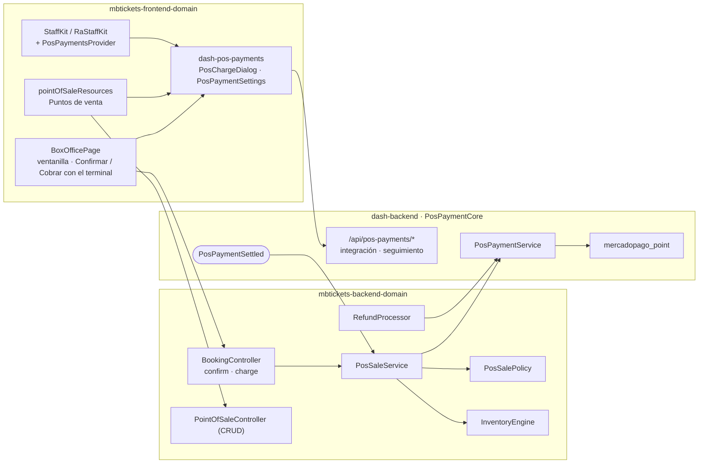

# F07 — Puntos de venta y terminales de tarjeta en la boletería

> Documentación técnica de la feature. Requerimientos: documento 09 (FR-20 a FR-23, HU-25).
> Código:
> - `mbtickets-backend-domain`: rama `feat/pos-terminals` (`ee64713`, `eca915b`, `6db7ab5`);
> - `mbtickets-frontend-domain`: rama `feat/pos-terminals` (`a7d3b8f`);
> - el core: `dash-backend`, `app/PosPaymentCore`, rama `feat/pos-terminals`;
> - el componente compartido `dash-frontend-core/packages/dash-pos-payments`.
>
> El core está documentado en `kitchntabs.github.io/docs/FEATURES/PHYSICAL-POS-INTEGRATIONS.md`.
> Los flujos de pago completos están en [`../flows/payment.md`](../flows/payment.md).

## 1. Qué resuelve

- Cada venue tiene **puntos de venta**: ventanillas y kioskos. Cada cobro de la boletería queda
  registrado en uno, sea en efectivo o con tarjeta (FR-20.4).
- Una ventanilla puede tener un **terminal de tarjeta integrado** (Mercado Pago Point). El cajero
  pulsa "Cobrar con el terminal", el cliente paga ahí, y la venta se confirma sola.
- Qué pasa si la tarjeta se rechaza o se aprueba tarde lo decide **cada evento**.
- Cancelar una venta con tarjeta la devuelve **por el mismo terminal**, si la ventanilla está
  configurada así.
- Es el mismo módulo y la misma interfaz que usa KitchnTabs.

## 2. Arquitectura

| Pieza | Rol |
|---|---|
| `PosPaymentCoreServiceProvider::enable(PointOfSale::class)` en `AppDomainServiceProvider` | Activa el módulo del core para MBTickets (crea sus tablas y rutas) y registra el listener de `PosPaymentSettled`. |
| `Models/Mbtickets/PointOfSale` | Extiende el modelo del core. `scopeVisibleTo` (venue del usuario; cadena; plataforma), `canBeManagedBy`. |
| `Services/Mbtickets/Pos/PosSaleService` | `pointOfSaleFor`, `payManually`, `charge`, `settled`; aprobación tardía. |
| `Services/Mbtickets/Pos/PosSalePolicy` | Resuelve `pos_decline_behavior` y `pos_late_approval`: evento → venue → config. |
| `InventoryEngine::resumeHold` | `payment_pending → held` por unos minutos, para reintentar tras un rechazo. |
| `RefundProcessor` | Método `card_terminal`: devuelve por el terminal si corresponde (`terminalRefundsItself`, `refundThroughTerminal`). |

## 3. Modelo de datos

Tablas del core (creadas al activar el módulo): `point_of_sales` y `pos_payment_transactions`
(ver la documentación del core §5). Migración del dominio
`2026_10_23_000100_add_pos_payments_to_mbtickets`:

| Tabla | Columna | Uso |
|---|---|---|
| `mbt_bookings` | `point_of_sale_id` (bigint, null) | La ventanilla que cobró. |
| | `pos_payment_transaction_id` (uuid, null, índice) | El cobro vigente de la reserva. Un reintento lo reemplaza. |
| `mbt_event_types` | `pos_decline_behavior` (null) | `keep_hold` \| `release`. |
| | `pos_late_approval` (null) | `refund` \| `reconfirm_if_available` \| `manual_review`. |
| `mbt_refunds` | `pos_payment_transaction_id` (uuid, null) | El cobro de terminal que se devuelve. Un reembolso `late_payment` por transacción, único. |

Nuevo método de reembolso: `Refund::METHOD_CARD_TERMINAL`.

## 4. Flujos

Ver [`../flows/payment.md`](../flows/payment.md):
- §4: boletería a mano y con terminal;
- §4.3: rechazo;
- §5.2: aprobación tardía;
- §6: devoluciones.

## 5. Decisiones

| Decisión | Por qué |
|---|---|
| El cajero **elige la ventanilla** al cobrar; la app recuerda la última. | Decisión de producto, como en KitchnTabs. Un mismo usuario puede atender ventanillas distintas. |
| Todo cobro de boletería es una transacción del core, también el efectivo. | Decisión de producto: un solo libro por ventanilla para cuadrar caja y reportes. |
| Rechazo y aprobación tardía se configuran **por evento**, con valor del venue y de config. | Decisión de producto: una función con sobreventa crítica prefiere liberar; otra prefiere mantener al cliente. |
| Devolver por el terminal es una opción **de la integración de la ventanilla** (`refund_mode`). | Decisión de producto: hay venues que devuelven en el terminal a mano. |
| Un cobro en curso nunca se repite; tras un rechazo, cada intento es un cobro nuevo (`booking:<id>:<n>`). | Idempotencia del core por intento. |
| `payment_pending` se extiende al plazo del cobro más los márgenes. | El hold no debe vencer mientras el cliente tiene la tarjeta en el terminal. |
| El cobro rechazado al entregarse se aplica después de enlazarlo a la reserva. | El core lo liquida dentro de `charge()`, antes de que la reserva apunte al cobro; sin esto la reserva quedaba en `payment_pending`. |

## 6. API

Autenticada (`mbtickets-web`, app del personal):

| Método | Ruta | Permiso |
|---|---|---|
| CRUD | `/api/mbtickets/point-of-sales` | `api.mbtickets.pointOfSale.*` (lectura para el cajero; escritura para administradores) |
| POST | `/api/mbtickets/bookings/{id}/confirm` | Ahora acepta `point_of_sale_id`. Con él, registra el cobro en la ventanilla. |
| POST | `/api/mbtickets/bookings/{id}/charge` | `api.mbtickets.booking.charge`. Body `{point_of_sale_id}`. Responde `{data: reserva, transaction}`. |
| — | `/api/pos-payments/*` (core) | Integración de la ventanilla y seguimiento del cobro (documentación del core §15.1). |

`BookingResource` incluye `point_of_sale_id` y `pos_payment_transaction_id`. El recurso de
ventanillas incluye `uses_terminal`.

Configuración: `config/mbtickets.php` → `pos`. Settings del venue:
`mbtickets_pos_decline_behavior` y `mbtickets_pos_late_approval` (`config/tenant_settings.php`).
Ver la tabla en [`payment.md`](../flows/payment.md) §9.

## 7. Frontend

| Dónde | Qué |
|---|---|
| `mbt-events/src/resources/pointOfSaleResources.tsx` | Recurso **Puntos de venta** (`mbtickets-web`, venue y cadena). Lista con forma de cobro. En la edición, `PosPaymentSettings`: integración, credenciales, terminal y modo de devolución. |
| `mbt-events/src/resources/eventTypeResource.tsx` | Pestaña **Boletería** del evento: tarjeta rechazada y aprobación tardía. |
| `mbt-events/src/boxoffice/BoxOfficePage.tsx` | Selector de ventanilla (con "· terminal"). "Confirmar venta" en ventanilla manual. "Cobrar con el terminal" y `PosChargeDialog` en ventanilla con terminal. Al terminar relee la reserva y avisa si se vendió, quedó retenida o se liberó. |
| `mbt-events/src/staff/StaffKit.tsx`, `RaStaffKit.tsx` | El contexto del personal (`api`, `http`, `notify`, `translate`) también envuelve el `PosPaymentsProvider`, igual en web y en la app. |
| `mbt-events/src/api/mbtApi.ts` | `put` en el cliente HTTP del personal. |
| `apps/mbtickets-app/src/staff/*` | La boletería de la app del personal usa lo mismo. |
| `vite-plugins/dashCoreSrcAliases.mts` | `dash-pos-payments` en `UNPUBLISHED_CORE_PACKAGES` hasta publicarlo en npm. |

## 8. Pruebas

`tests/Feature/API/Mbtickets/PosTerminalSalesTest.php` (6), con un terminal falso
(`Fakes/FakeTerminalConnector`):

| Prueba | Cubre |
|---|---|
| `a_cash_window_confirms_at_once_and_records_the_payment` | Ventanilla manual: venta confirmada y transacción manual en su libro. |
| `a_cashier_charges_on_the_terminal_and_the_approval_sells_the_tickets` | Cobro → `payment_pending` → aprobado → vendida, con autorización. |
| `a_declined_card_keeps_the_seats_for_a_retry_or_releases_them_per_event` | `keep_hold` vuelve a `held`; `release` libera. |
| `a_charge_the_terminal_refuses_at_once_applies_the_decline_rule_immediately` | Rechazo al entregar el cobro. |
| `a_late_approval_is_refunded_resold_or_reviewed_per_event` | Las tres políticas de aprobación tardía. |
| `cancelling_a_card_sale_refunds_through_the_terminal_or_queues_it_per_window` | `refund_mode` `connector` y `manual`. |

Suite del dominio: 85 pruebas en verde. La prueba de concurrencia del inventario a veces falla
cuando corre en paralelo con otras, y pasa al repetirla.

En el navegador (entorno de desarrollo, venue "teatro", ventanillas 1 y 2):
- listado y configuración de ventanillas;
- venta en efectivo;
- cobro con terminal: Mercado Pago rechazó el token de prueba y la reserva quedó retenida, como
  pide `keep_hold`.

## 9. Después de esta feature (2026-10-20)

| Qué | Dónde |
|---|---|
| *Ventas > Cobros*: el listado de cobros de las ventanillas (`PosPaymentsList`). Las ventas con tarjeta de una reserva se devuelven cancelándolas desde la reserva, no desde el listado. | `mbtickets-frontend-domain` `2035d74`; `mbtickets-backend-domain` `2be9ca5`; [`payment.md`](../flows/payment.md) §11 |
| "Conectar mi cuenta" de Mercado Pago (OAuth de la plataforma) en la integración de la ventanilla. | core `733f7ba`, `dash-pos-payments` `23741cf`; [`payment.md`](../flows/payment.md) §10 |
| Los cobros pueden ir a un dispositivo del local (puente Raspberry Pi), que ejecuta el programa del local (`dash_core`). | core `16f1ea7`, `dash-python-service` `91c0f08` |
| Los textos del core (`pos_payments.*`) salían como claves sin traducir: ahora se cargan. | core `94d1abf` |

## 10. Pendiente

- **Prueba con un terminal real** (runbook en la documentación del core, §14.4). Aún no hay
  acceso a un terminal.
- La **aplicación de Mercado Pago de MBTickets** para "Conectar mi cuenta", y una prueba en vivo.
- Publicar `dash-pos-payments` en npm antes de construir para producción.
- Kiosco VaneXa de MBTickets pagando en el terminal (doc 08).
- El driver de Transbank (puente Raspberry Pi) y la capa de MBTickets del programa del local
  (`domain/mbtickets/`: impresión de entradas, lector de control de acceso).
