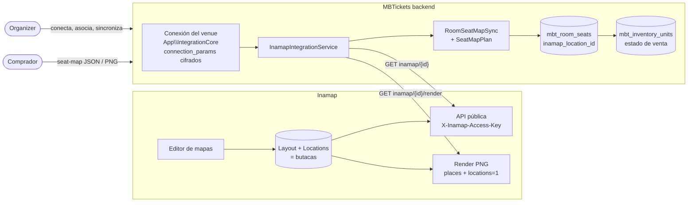
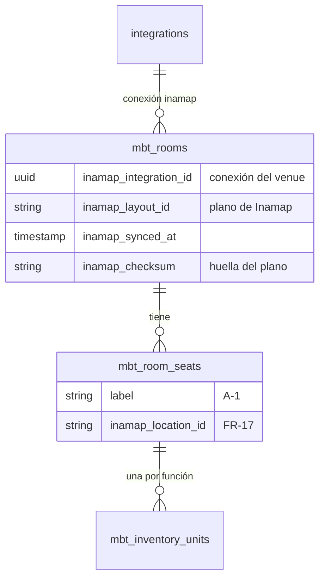
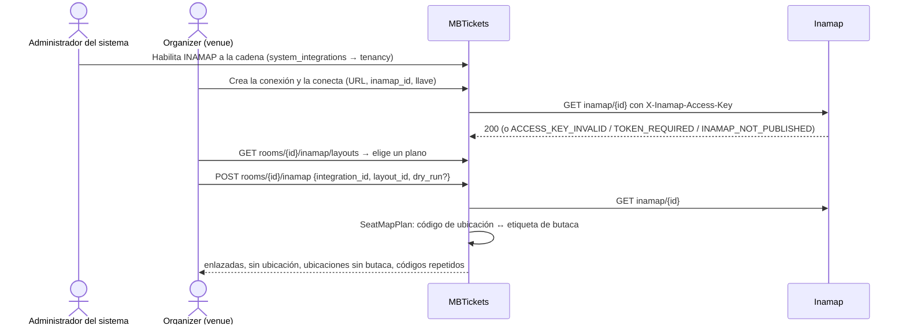
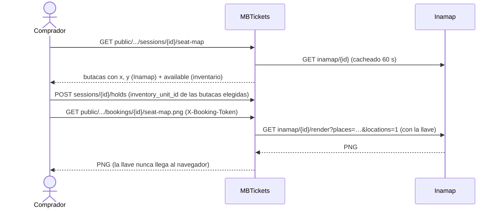

# F08 — Mapas de sala desde Inamap

> Documentación técnica de la feature. Requerimientos: FR-17; arquitectura `02-arquitectura.md`
> §4.3; Flujo 7 de `07-features-comunes-y-flujos.md`.
> Código:
> - `mbtickets-backend-domain`: rama `feat/inamap-seat-maps` (`c9761e7`);
> - `inamap-backend-domain`: rama `feat/render-all-locations` (`3815d45`, la imagen con todas las
>   ubicaciones);
> - el core `dash-backend`, `app/IntegrationCore` (sin cambios: se usa tal cual, como Vanexa).

## 1. Qué resuelve

- El mapa de una sala con butacas numeradas **se dibuja y se mantiene en Inamap**. Cada butaca es
  una **ubicación** (`Location`) de un plano (`Layout`), con el código de la butaca (`A-1`).
- El venue **conecta** su inamap una vez (URL de la API, id del inamap y su llave de acceso) y
  **asocia** cada sala a un plano. MBTickets lee las ubicaciones y guarda en cada butaca el id de
  su ubicación (`mbt_room_seats.inamap_location_id`).
- El comprador ve el **mapa de la función**: la posición de cada butaca viene de Inamap, si está
  libre o no lo decide MBTickets.
- El comprador ve **dónde están sus butacas**: una imagen del plano con todas las butacas y las
  suyas marcadas, que Inamap dibuja y MBTickets entrega.
- Si el plano cambia en Inamap, una **re-sincronización** lo detecta y re-enlaza, sin tocar ventas.

Lo que **no** hace: Inamap nunca conoce ni decide el estado de venta de una butaca, y vender nunca
depende de que Inamap responda (solo asociar y sincronizar lo necesitan).

## 2. Arquitectura

- La conexión es una integración del core (`App\IntegrationCore`), igual que la de Vanexa:
  el administrador del sistema habilita **INAMAP** a la cadena, y el venue la conecta con el
  formulario de siempre. La llave se guarda cifrada y se envía solo de servidor a servidor.
- MBTickets usa la **API pública** de Inamap (la del visor), con la credencial de dispositivo del
  inamap (`X-Inamap-Access-Key`). No hace falta ningún endpoint nuevo en Inamap para leer.
- El cliente HTTP del core (`IntegrationHttpClient`) reintenta, registra cada llamada en
  `integration_calls` (con la llave redactada) y rechaza direcciones privadas salvo las de
  `INTEGRATION_HTTP_ALLOWED_HOSTS`.

## 3. Modelo de datos

- Migración `2026_10_24_000100_add_inamap_seat_maps`: las cuatro columnas de la sala y la fila
  `inamap` de `system_integrations`.
- `inamap_checksum`: SHA-256 del plano (id, código, nombre y posición de cada ubicación, y el
  tamaño del plano). Si cambia entre dos sincronizaciones, Inamap editó el plano.
- La geometría **no** se copia: se lee de Inamap y se cachea 60 s para el mapa del comprador.

## 4. Flujos

### 4.1 Conectar, asociar, sincronizar

### 4.2 Comprador

### 4.3 El plano cambia en Inamap

`POST rooms/{id}/inamap/sync` (o `php artisan mbtickets:inamap:sync`, todas las salas):

| En Inamap | En MBTickets |
|---|---|
| Se mueve una butaca | Mismo id: no se re-enlaza; el checksum cambia y el mapa muestra la nueva posición |
| Se borra una butaca | La butaca pierde el enlace (`cleared`). La butaca y sus ventas siguen; en el mapa del comprador pasa a `unplaced` y se vende desde la lista |
| Se agrega una ubicación | Se reporta como ubicación sin butaca (o se enlaza si ya existe la butaca con ese código) |
| Código repetido | Ambiguo: no se enlaza ninguna de las dos; se reporta |

Nunca se crean ni borran butacas desde una sincronización.

## 5. Decisiones

| Decisión | Por qué |
|---|---|
| Cada butaca es una ubicación de Inamap, enlazada por código | Es como Inamap ya modela lugares; no hace falta un tipo nuevo en Inamap ni un campo de vuelta |
| La comparación ignora mayúsculas, espacios, guiones y puntos | `A-1`, `a1` y `A 1` escritos por personas distintas en dos sistemas son la misma butaca |
| Conexión vía `App\IntegrationCore`, como Vanexa | Mismo formulario, misma llave cifrada, mismo registro de llamadas; nada nuevo en el core |
| API pública de Inamap con la llave de dispositivo | Ya existe y es de solo lectura; responde la pregunta abierta de §4.3 ("¿Inamap ya expone un endpoint?"): sí |
| La geometría se lee, no se copia | Inamap es la fuente; un caché de 60 s basta para el mapa del comprador |
| El estado de venta nunca va a Inamap | El motor de inventario no puede depender de un servicio externo (NFR-01) |
| El mapa del comprador dice solo `available` | No revela si una butaca está retenida o vendida |
| Imagen con todas las ubicaciones (`locations=1`, en Inamap) | Sin imagen de plano, las dos marcas del comprador quedaban sobre un fondo vacío |
| Sin programar la re-sincronización | El Flujo 7 la deja "a definir" (pull o webhook); el comando existe para programarla |

## 6. API

| Método y ruta | Permiso | Qué hace |
|---|---|---|
| `GET mbtickets/rooms/{id}/inamap/layouts?integration_id=` | `room.inamapLayouts` | Planos de la conexión, para elegir |
| `POST mbtickets/rooms/{id}/inamap` `{integration_id, layout_id, dry_run?}` | `room.inamapLink` | Asocia y sincroniza |
| `POST mbtickets/rooms/{id}/inamap/sync` `{dry_run?}` | `room.inamapSync` | Re-sincroniza |
| `DELETE mbtickets/rooms/{id}/inamap` | `room.inamapUnlink` | Quita la asociación |
| `GET public/mbtickets/sessions/{id}/seat-map` | público | Plano + butacas con `x`, `y`, `available`; `landmarks`, `unplaced` |
| `GET public/mbtickets/bookings/{id}/seat-map.png` | `X-Booking-Token` | Imagen con las butacas de la reserva |

La conexión usa las rutas del core (`api/integration`, `…/setUpConnection`,
`…/connectionParamFormats`); sus permisos quedaron también en los archivos de rol de MBTickets
(`TenancyAdmin`, `Tenant`) para que un `db:sync_roles` no los quite.

## 7. Frontend

Pendiente. El panel necesita, en la ficha de la sala: elegir la conexión y el plano, ver el
reporte (en seco y real) y re-sincronizar. La app del comprador necesita dibujar el mapa con
`seat-map` (pintar libre / no libre) y mostrar la imagen en la reserva.

## 8. Pruebas

- `tests/Unit/Mbtickets/SeatMapPlanTest.php` (5): ortografía de códigos, enlaces sin cambio,
  ubicación borrada, código repetido, ubicaciones que no son butacas.
- `tests/Feature/API/Mbtickets/InamapSeatMapTest.php` (8), con Inamap simulado por HTTP: la llave
  se comprueba contra Inamap y nunca se devuelve; asociar enlaza todas las butacas; una
  simulación no guarda nada; no se puede usar la conexión de otro venue; mapa del comprador =
  geometría + disponibilidad; la imagen se pide con la llave, con `locations=1` y las butacas de la
  reserva, y exige el token; un cambio en Inamap se toma sin tocar ventas; Inamap caído no impide
  vender.
- `inamap-backend-domain`, `tests/Unit/Inamap/MapRenderServiceTest.php`: un punto por ubicación.
- **Ida y vuelta real** (2026-10-20), con los dos backends locales (MBTickets en :25300 llamando a
  Inamap en :25200 por `host.docker.internal`): un inamap publicado con llave obligatoria y un
  plano de 74 ubicaciones (72 butacas A-1…F-12, pantalla, entrada) para la sala "Sala Principal".
  17 verificaciones pasaron: conexión con llave mala y buena, 72/72 butacas enlazadas, mapa del
  comprador con las coordenadas de Inamap, la ubicación de Inamap devuelve la misma butaca,
  reserva de D-6 y D-7 que el mapa muestra ocupadas, imagen con las dos butacas marcadas. Luego,
  en Inamap: A-1 movida, D-6 borrada (con su reserva activa), G-1 agregada → la sincronización
  lo detectó, D-6 quedó sin enlace con su reserva intacta, y al restaurar el plano el comando
  `mbtickets:inamap:sync` re-enlazó las 72.

## 9. Pendiente

- **Frontend** (§7).
- **Re-sincronización automática**: programar el comando o recibir un webhook de Inamap (Flujo 7
  lo deja abierto).
- **Estado en la imagen**: hoy la imagen muestra todas las butacas en gris y las del comprador
  marcadas. Para una vista de boletería con libres/ocupadas en colores, Inamap podría aceptar grupos
  de ubicaciones con color en el render (sin guardar estado).
- **Más de 12 butacas en la imagen**: Inamap marca hasta 12 lugares por imagen
  (`MAX_PLACES`); una reserva más grande muestra las primeras 12.
- **Caché del render en Inamap**: la clave incluye `updated_at` del inamap y de los planos, no el
  de las ubicaciones; mover una ubicación sin tocar el inamap deja la imagen anterior hasta 10 min.
- **Local**: `INTEGRATION_HTTP_ALLOWED_HOSTS=host.docker.internal` en `.env.app.local` para llegar a
  Inamap local. No debe ir en un backend expuesto (staging por túnel): permitiría a un venue apuntar
  una integración a servicios del equipo.
