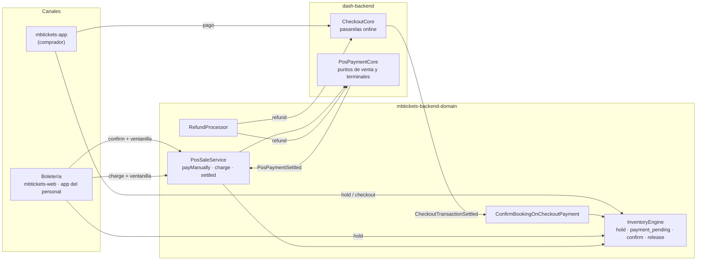
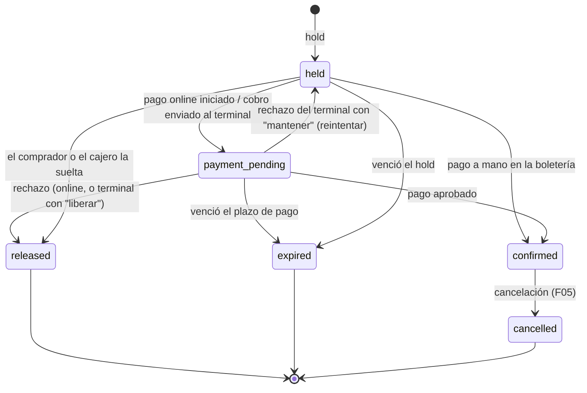
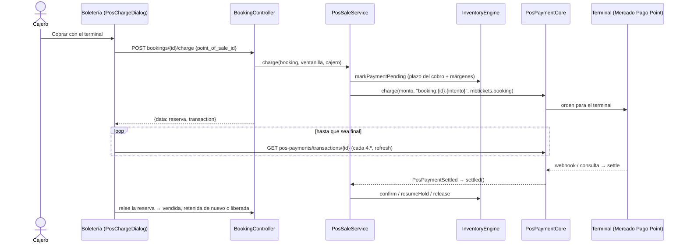
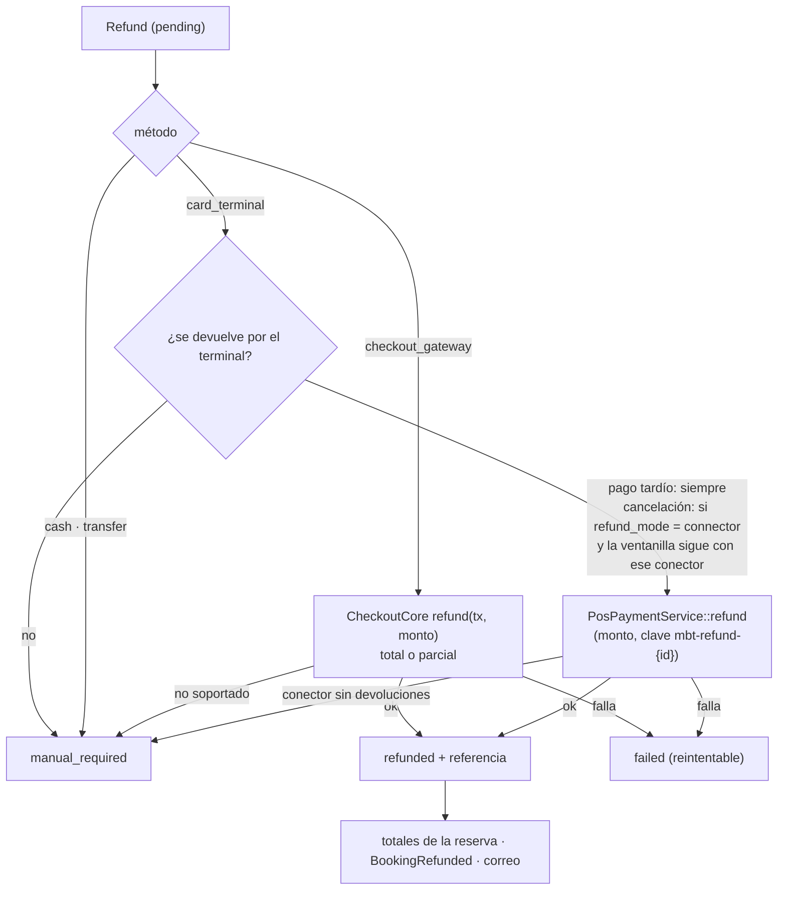

# Flujos de pago de MBTickets

> Toda la lógica de cobro de MBTickets en un solo lugar: cómo se paga una reserva, qué pasa con las
> butacas mientras tanto, qué pasa si el pago falla o llega tarde, y cómo se devuelve el dinero.
> El detalle de cada pieza está en su feature: [F01](../features/F01-inventario-y-reservas.md)
> (reservas), [F02](../features/F02-pasarelas-de-pago-checkout-core.md) (pasarelas online),
> [F04](../features/F04-pago-online-y-app-del-comprador.md) (pago online),
> [F05](../features/F05-cancelaciones-reembolsos-y-correos.md) (cancelaciones y reembolsos),
> [F06](../features/F06-personal-en-la-app-y-android.md) (boletería en la app) y
> [F07](../features/F07-puntos-de-venta-y-terminales.md) (puntos de venta y terminales de tarjeta).
>
> **Actualizado:** 2026-10-20.

## 1. Las tres formas de cobrar

| Forma | Quién paga | Dónde | Módulo del core | Confirmación |
|---|---|---|---|---|
| **Online** | El comprador, en `mbtickets-app` | Página de la pasarela (DashTest, Transbank Webpay Plus, Mercado Pago Checkout Pro) | `CheckoutCore` | Retorno de la pasarela y/o webhook → `CheckoutTransactionSettled` |
| **Boletería a mano** | El cliente, frente al cajero | Ventanilla **sin** terminal integrado: efectivo, transferencia, cortesía, o un terminal no integrado | `PosPaymentCore` (registro manual) | En el acto: el cajero confirma |
| **Boletería con terminal** | El cliente, en el terminal de tarjeta de la ventanilla | Mercado Pago Point (más adelante, Transbank) | `PosPaymentCore` (conector) | El terminal → webhook o consulta → `PosPaymentSettled` |

Regla común: **una reserva solo se vende cuando un pago aprobado la encuentra reteniendo sus
butacas.** Todo lo demás (rechazos, vencimientos, aprobaciones tardías) se resuelve sin vender dos
veces la misma butaca y sin perder dinero.

## 2. La reserva mientras se paga

Todo cobro parte de un **hold**: el motor (`InventoryEngine`, F01) aparta las butacas o cupos con un
plazo. El plazo depende del canal (`config/mbtickets.php` → `booking.hold_ttl_minutes`):

| Canal | Plazo del hold | Env |
|---|---|---|
| `online` | 10 min | `MBT_HOLD_TTL_ONLINE` |
| `box_office` | 5 min | `MBT_HOLD_TTL_BOX_OFFICE` |
| `kiosk` | 5 min | `MBT_HOLD_TTL_KIOSK` |
| `api` | 10 min | `MBT_HOLD_TTL_API` |

- **`payment_pending` no vence mientras se espera el pago.** Al pasar a ese estado el plazo se
  extiende **una vez**:
  - online, `checkout.payment_timeout_minutes` (15 min);
  - terminal, el plazo del cobro más el margen del adquirente más `pos.hold_margin_minutes`
    (≈ 2 + 1 + 2 = 5 min).
- Un hold vencido libera las butacas aunque después llegue la aprobación. Eso es una **aprobación
  tardía** (§5).

## 3. Pago online

Detalle en F04. Resumen:

1. El comprador retiene butacas (`POST public/mbtickets/sessions/{id}/holds`) y recibe un token de
   la reserva (`X-Booking-Token`), que la app guarda en `localStorage`.
2. Elige pasarela entre las activas del venue (la predeterminada primero) y paga
   (`POST public/mbtickets/bookings/{id}/checkout` con un `return_url` que debe ser un origen
   permitido de la app; si no, sería un redirector abierto).
3. El dominio marca la reserva `payment_pending` y CheckoutCore crea la sesión de pago con
   `payable = Booking`.
4. La pasarela liquida (retorno o webhook; con Mercado Pago el webhook es el autoritativo) →
   `CheckoutTransactionSettled` → `ConfirmBookingOnCheckoutPayment`:

| Resultado | Reserva aún retenida | Reserva ya liberada o vencida |
|---|---|---|
| Aprobado | `confirm` → `BookingConfirmed` → entradas con QR y correo | **Aprobación tardía**: no se vende; reembolso automático (§5.1) |
| Rechazado o fallido | `release`: las butacas vuelven a la venta al instante | — |

5. La app vuelve con `?transaction=` y consulta el resultado hasta 20 veces cada 1,5 s, porque el
   webhook puede llegar unos segundos después que el navegador.

Una liquidación repetida (retorno + webhook) se ignora (`wasAlreadySettled`). También se ignora un
pago de otro dominio (`payable_type`).

## 4. Boletería

El cajero trabaja en `mbtickets-web` o en la app del personal (F06): retiene, cobra y entrega. Elige
**la ventanilla** (punto de venta) desde la que cobra. La app recuerda la última elegida, y si no
hay una elegida usa la predeterminada del venue. Cada ventanilla cobra de una de dos formas:

| Ventanilla | Botón | Endpoint |
|---|---|---|
| Sin integración | **Confirmar venta**, con el medio (`cash`, `card_terminal` no integrado, `transfer`, `courtesy`) y una referencia opcional | `POST mbtickets/bookings/{id}/confirm {payment_method, payment_reference, point_of_sale_id}` |
| Con terminal de tarjeta | **Cobrar con el terminal** | `POST mbtickets/bookings/{id}/charge {point_of_sale_id}` |

La ventanilla debe estar activa, ser del mismo venue que la reserva y ser visible para el usuario
(`PointOfSale::visibleTo`). Si el venue no tiene ventanillas, la boletería cobra como antes, sin
registrar ventanilla.

### 4.1 A mano

`PosSaleService::payManually()`:

1. Registra el cobro en el libro de la ventanilla como transacción **manual** aprobada
   (`registerManualPayment`, clave `booking:<id>:manual`). La cortesía se registra por $0.
2. Confirma la reserva (`InventoryEngine::confirm`) con el medio y la referencia.
3. Guarda en la reserva `point_of_sale_id` y `pos_payment_transaction_id`.

Una ventanilla con terminal no acepta este camino: responde `422`, y el cajero debe cobrar con el
terminal.

### 4.2 Con el terminal

- **Nunca se cobra dos veces.** Si la reserva ya espera un cobro en curso, `charge` devuelve ese
  mismo. Después de un rechazo, cada reintento es un cobro nuevo (`booking:<id>:<n>`).
- **Rechazo antes de llegar al terminal** (moneda, configuración incompleta): la reserva vuelve a
  `held` y la pantalla muestra el error.
- **Rechazo al entregar el cobro** (credenciales, terminal ocupado): el core lo liquida dentro de
  `charge()`, antes de que la reserva apunte al cobro. `PosSaleService` lo aplica apenas lo enlaza.
- En el diálogo, el cajero puede **cancelar** (el terminal deja de esperar) o **confirmar a mano**
  cuando Mercado Pago pide revisar el terminal (`action_required`) y el voucher dice aprobado.

### 4.3 Si el terminal no aprueba

Lo decide el **evento**. Si el evento no lo define, decide el venue en su configuración, y si
tampoco, `config/mbtickets.php` → `pos`. Es la misma cascada de la política de cancelación
(`PosSalePolicy`):

| `pos_decline_behavior` | Qué pasa |
|---|---|
| `keep_hold` (predeterminado) | La reserva vuelve a `held` por `pos.retry_hold_minutes` (5 min) para reintentar o cobrar de otra forma. |
| `release` | Las butacas vuelven a la venta al instante. |

Cubre rechazo, cancelación, error y vencimiento del cobro. Solo se aplica si la reserva sigue
esperando ese cobro.

## 5. Aprobación tardía

El dinero se cobró, pero la reserva ya no esperaba ese pago. Puede pasar porque venció, porque se
liberó, porque se vendió por otro medio, o porque un intento posterior ya la pagó.

### 5.1 Online

Siempre se **devuelve** (F05 §5.3):
- se anota en `metadata.late_payments`;
- se crea un reembolso `kind = late_payment`, `origin = system`, por el total, y se procesa;
- un índice único impide devolverlo dos veces si el aviso se repite.

### 5.2 Terminal

Lo decide el evento, con la misma cascada (`pos_late_approval`):

| Valor | Qué pasa |
|---|---|
| `refund` (predeterminado) | Reembolso `late_payment` por el mismo terminal, automático. |
| `reconfirm_if_available` | Si **las mismas** butacas siguen libres, se retienen y se venden en una reserva nueva confirmada con ese pago (`metadata.reconfirmed_from`). Si no, se devuelve. |
| `manual_review` | El reembolso queda en la cola **Reembolsos** (`manual_required`) para que el personal decida. |

Siempre queda un aviso en el log y una entrada de auditoría `late_payment_refund` con el motivo
(`ALREADY_PAID`, `BOOKING_EXPIRED`, `NOT_AVAILABLE_ANYMORE`…). Un reembolso tardío por la misma
transacción se crea una sola vez (índice único).

## 6. Cancelaciones y reembolsos

Detalle en F05. La cancelación calcula el monto según la política y el origen, anula las entradas
y crea un `Refund` con el **medio por el que se pagó**. `RefundProcessor` lo ejecuta:

- **Modo de devolución por ventanilla** (`payment_settings.refund_mode`, en la configuración de
  la integración de la ventanilla):
  - `connector`: una venta con tarjeta cancelada se devuelve sola por el terminal;
  - `manual`: el cajero la devuelve en el terminal o en el panel del adquirente, y la marca como
    devuelta en la cola.

  Una ventanilla sin terminal, o con un conector que no devuelve, es siempre `manual`.
- **Parciales:** una cancelación parcial devuelve solo su monto. Cada reembolso usa su propia
  clave de idempotencia (`mbt-refund-<id>`), así varios parciales del mismo cobro nunca se
  confunden ni superan lo cobrado.
- **Efectivo y transferencia** siempre van a la cola. Si el cajero devuelve el efectivo en el
  acto, marca "ya devolví el efectivo" con la referencia, y la cancelación queda resuelta.
- **Cola "Reembolsos"** en `mbtickets-web`: reintentar un reembolso automático `failed` o
  `pending`, o marcarlo como devuelto con una referencia (queda en auditoría).
- **Función cancelada** (`CancelSessionBookingsJob`): todas sus reservas vendidas se cancelan con
  el 100 %, cada una por su medio de pago.

## 7. Dónde queda registrado cada cobro

| Cobro | Registro |
|---|---|
| Online | `checkout_gateway_transactions` (core). La reserva guarda `payment_method = checkout_gateway` y la transacción en `payment_reference`. |
| Boletería, a mano | `pos_payment_transactions` (core), `provider = manual`. La reserva guarda `payment_method`, `point_of_sale_id` y `pos_payment_transaction_id`. |
| Boletería, terminal | `pos_payment_transactions` (core), `provider = mercadopago_point`, con autorización, marca y número de pago del adquirente. La reserva guarda `payment_method = card_terminal`, la referencia, `point_of_sale_id` y `pos_payment_transaction_id`. |
| Reembolsos | `mbt_refunds`, con `checkout_transaction_id` o `pos_payment_transaction_id`. En el core: `data.refunds` de la transacción online, o `raw_response.refunds[]` de la del terminal. |

Así cada ventanilla tiene un libro con **todos** sus cobros, a mano o con terminal (FR-20.4).

## 8. Permisos

| Rol | Puede |
|---|---|
| Cajero (`cashier`) | Retener, confirmar a mano, cobrar con terminal (`api.mbtickets.booking.charge`), ver ventanillas, seguir, consultar, cancelar y confirmar a mano un cobro (`api.pos-payments.transaction.*`). |
| Administrador del venue, de la cadena, de la plataforma | Además, crear ventanillas y configurar su integración (credenciales, terminal, modo de devolución), y resolver reembolsos. |

Las filas se acotan por venue: un cajero nunca ve las ventanillas ni los cobros de otro venue
(`404`).

## 9. Configuración

| Dónde | Clave | Defecto | Efecto |
|---|---|---|---|
| `config/mbtickets.php` → `booking` | `hold_ttl_minutes.*` | §2 | Plazo del hold por canal. |
| | `manual_payment_methods` | `cash, card_terminal, transfer, courtesy` | Medios que el cajero puede registrar a mano. |
| `config/mbtickets.php` → `checkout` | `payment_timeout_minutes` | 15 | Extensión del hold al iniciar el pago online. |
| | `app_url`, `allowed_return_origins` | — | Orígenes permitidos para volver de la pasarela. |
| `config/mbtickets.php` → `pos` | `decline_behavior` (`MBT_POS_DECLINE_BEHAVIOR`) | `keep_hold` | §4.3. |
| | `late_approval` (`MBT_POS_LATE_APPROVAL`) | `refund` | §5.2. |
| | `hold_margin_minutes` | 2 | Margen extra mientras se espera al terminal. |
| | `retry_hold_minutes` | 5 | Plazo para reintentar tras un rechazo con `keep_hold`. |
| Configuración del venue | `mbtickets_pos_decline_behavior`, `mbtickets_pos_late_approval` | — | Para todos los eventos del venue. |
| Evento (pestaña **Boletería**) | `pos_decline_behavior`, `pos_late_approval` | — | Solo ese evento. |
| Ventanilla (integración) | conector, credenciales, terminal, `refund_mode` | sin integración | §4, §6. |
| Core `pos_payment_core` | `charge_timeout_seconds` | 120 | Plazo del cobro en el terminal. |

## 10. Cuentas de Mercado Pago para los terminales

El venue conecta su cuenta de dos maneras (decisión de producto). El detalle está en la
documentación del core (PHYSICAL-POS-INTEGRATIONS §14.6):

- **Token pegado** (construido). El venue crea su aplicación en Mercado Pago, pega el access
  token en la integración de la ventanilla y configura el webhook en su aplicación.
- **OAuth de la plataforma** (diseñado, sin construir). El venue pulsa "Conectar con Mercado Pago"
  y autoriza la aplicación de MBTickets. El token dura 180 días y se renueva solo. El webhook se
  configura una sola vez, en la aplicación de la plataforma.

Las pasarelas **online** (Mercado Pago Checkout Pro) son otra integración, de CheckoutCore, con su
propia configuración por venue (F02).

## 11. Pendiente

- Prueba con un terminal real (runbook en la documentación del core, §14.4). Aún no hay acceso a
  un terminal.
- OAuth de la plataforma para Mercado Pago (§10).
- Listado de cobros por ventanilla con filtros, en el admin de pagos.
- Transbank POS Integrado por un puente Raspberry Pi, cuando llegue el hardware.
- Pago en el terminal desde el kiosco VaneXa de MBTickets (doc 08). KitchnTabs ya lo hace.
