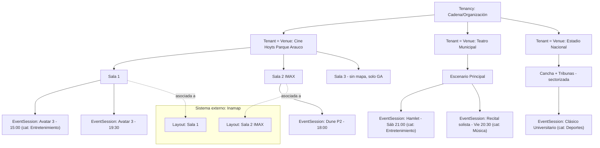
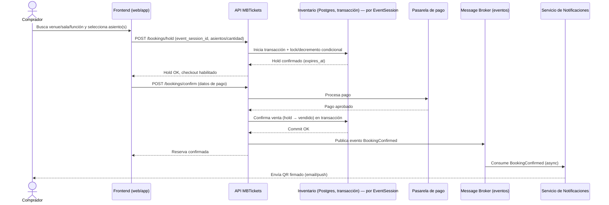
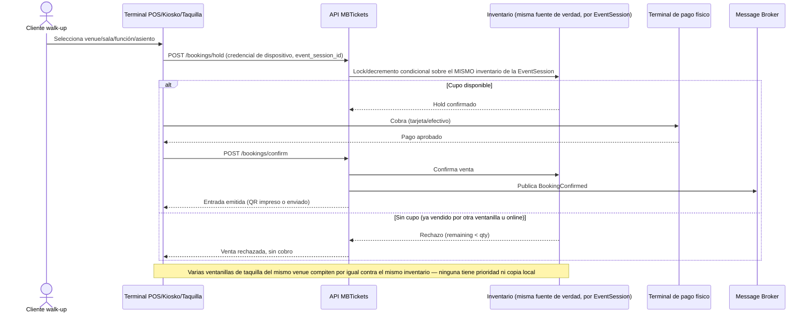
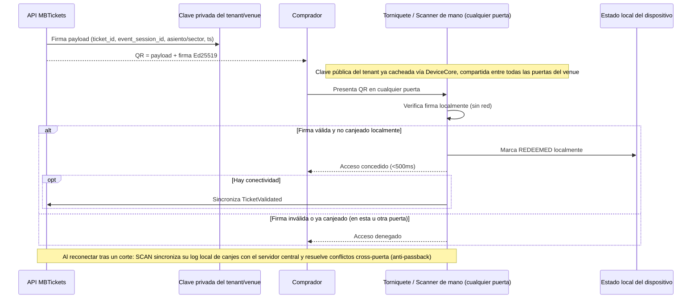
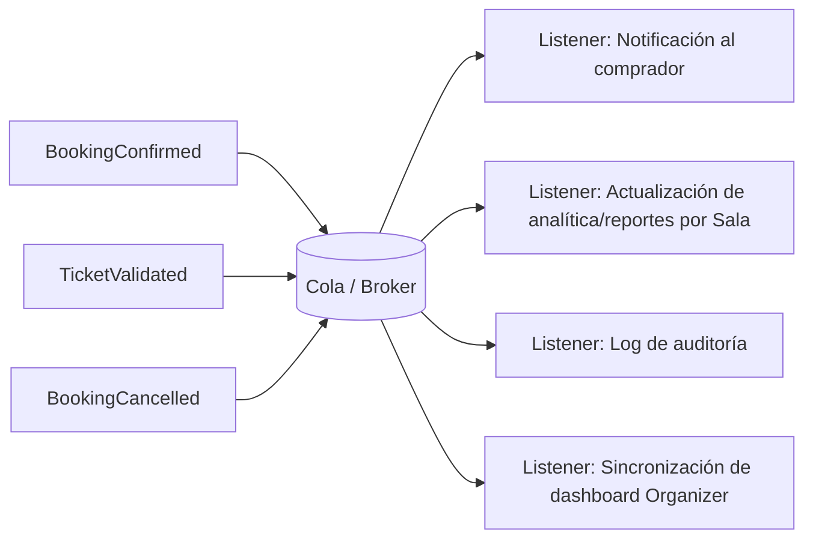
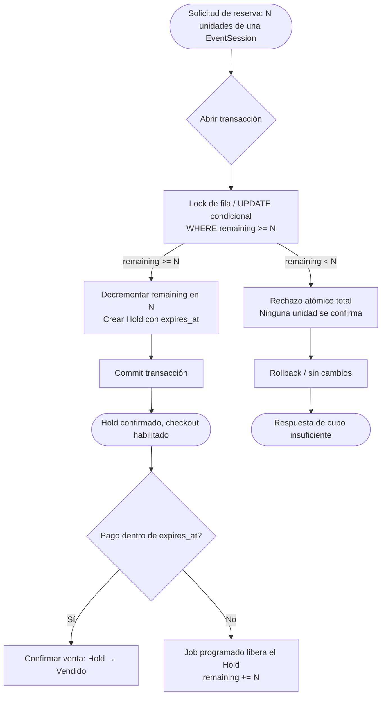
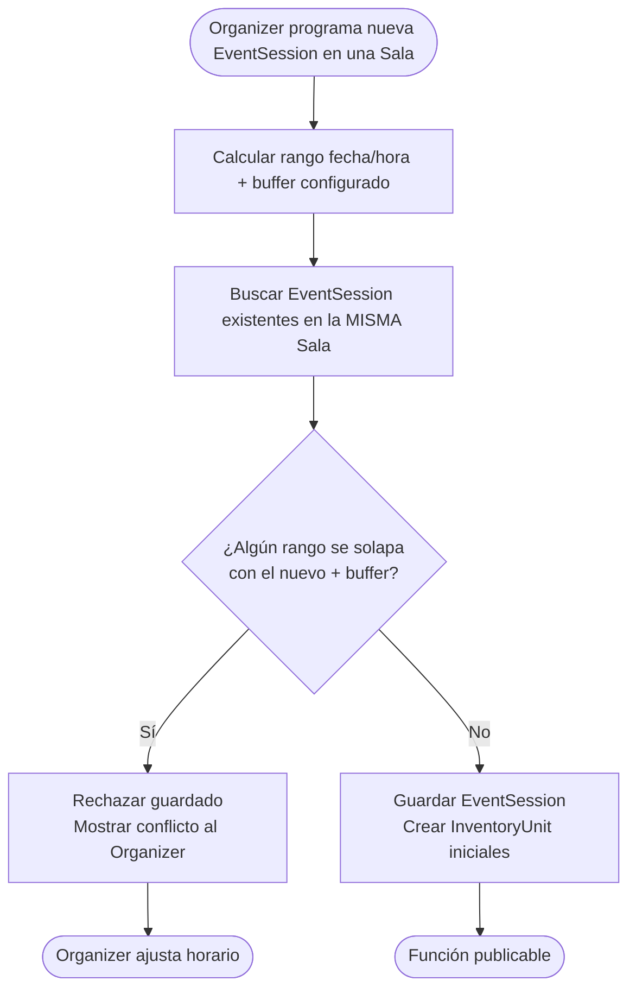
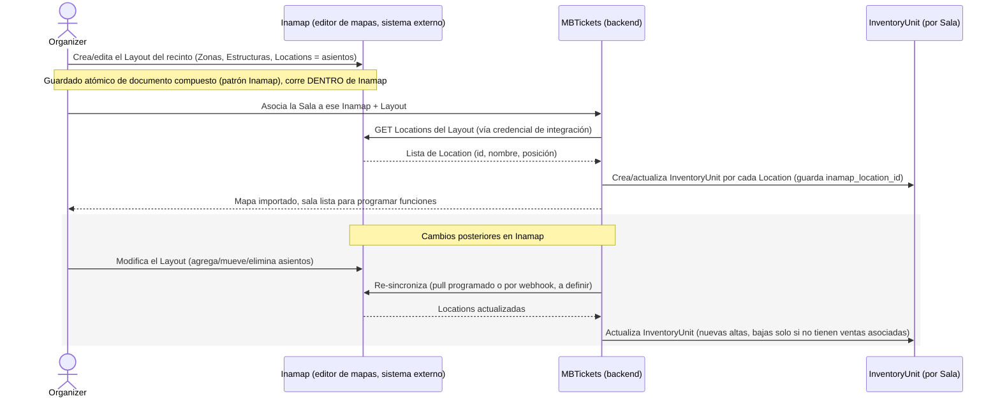
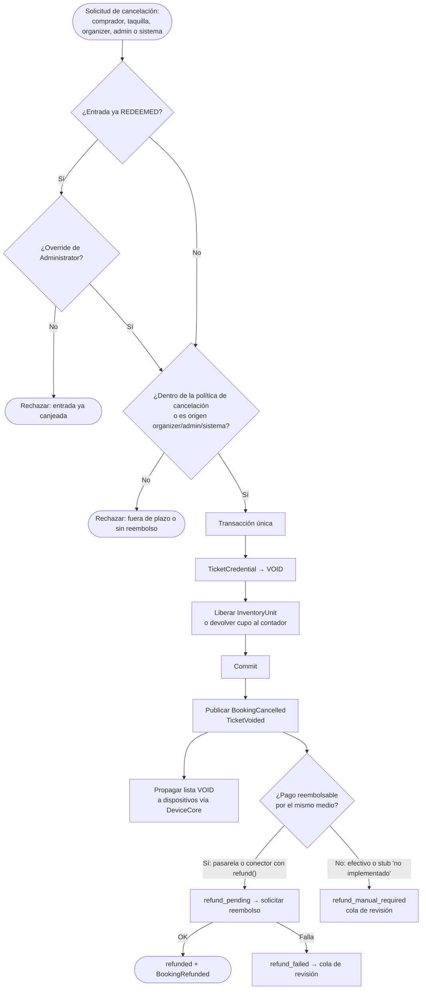
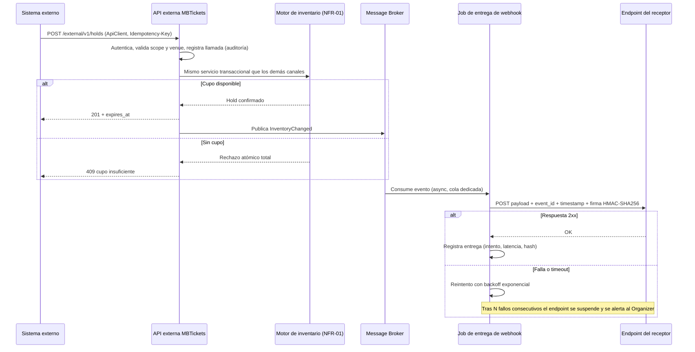

# MBTickets — Features Comunes y Flujos (con diagramas Mermaid)

> Documento 7 de 9. Consolida la decisión de reutilización módulo por módulo y los flujos end-to-end principales.
> Modelo de referencia: Tenancy (cadena) → Tenant = Venue → Sala → EventType → EventSession (ver `02-arquitectura.md` §4). Mapas de Sala: integración opcional con Inamap (§4.3).

## 1. Matriz de reutilización final

| Módulo/Feature | Fuente | Veredicto | Notas |
|---|---|---|---|
| Autenticación (Sanctum, OAuth) | Core | ✅ Reutilizar tal cual | |
| RBAC 2 capas (rutas + policies) | Core | ✅ Reutilizar tal cual | Solo se agregan permisos `mbtickets.*` |
| Multi-tenancy (Tenancy→Tenant=Venue) + `scopeVisibleTo` | Core + patrón Inamap | ✅ Reutilizar patrón | `Tenant` se reutiliza con significado de negocio "Venue"; Tenancy Admin ve todos sus Tenants/venues |
| Billing/suscripciones + límites por plan | Core + patrón Inamap/KitchnTabs | ✅ Reutilizar | Conteo propio del dominio (`MbTicketsPlanLimits`), incluye límite de nº de Salas por venue |
| Pasarelas de pago (Flow/Transbank/Rebill/Interno) | KitchnTabs (`Services/Payments`) | ✅ Reutilizar arquitectura de gateway intercambiable | Genérico, no depende de comida |
| Notificaciones multicanal + websockets + colas | Core (Reverb/Horizon) | ✅ Reutilizar infraestructura | El **patrón de invocación** debe cambiar: eventos desacoplados, no llamada síncrona directa |
| Panel admin genérico (`dash-auto-admin`) | Core | ✅ Reutilizar tal cual | |
| DeviceCore (heartbeat, comandos, presencia) | Core | ✅ Reutilizar como base de POS/kiosko/boletería/torniquete | Falta lógica de dominio de validación de tickets encima |
| Generación visual de QR (`endroid/qr-code`) | Core | ✅ Reutilizar solo el render | Sin firma — se envuelve con firma propia |
| Auditoría (Activitylog + Revisionable) | Core | ✅ Reutilizar tal cual | |
| **Mapa de asientos de Sala** | **Inamap (sistema externo)** | 🔗 **Integración, no reutilización de código** | El mapa se crea y vive en Inamap; MBTickets solo importa/sincroniza `Location` como `InventoryUnit`. Ver §2 y Flujo 7 |
| Patrón de token opaco hasheado + TTL | Inamap (`RouteSessionService`) | ✅ Reutilizar patrón | Para el canal de entrega del QR (no para su verificación offline) |
| Reportes de embudo/throughput | KitchnTabs (`TabsFunnelReport`, `TabsThroughputReport`) | ✅ Adaptar | Embudo de venta y de check-in, desglosado por Sala |
| Impresión térmica ESC/POS | KitchnTabs (`kitchntabs-python-service`) | ✅ Reutilizar tal cual | Para impresión física de entradas en taquilla/POS |
| Motor de locking/concurrencia de inventario | — | 🆕 Construir de cero | Sin precedente en ningún sistema hermano (NFR-01); corre 100% en MBTickets, independiente de Inamap |
| Entidad Sala + EventType + ScheduleRule + DateOverride + disponibilidad | — | 🆕 Construir de cero | `TenantSchedule` del core solo resuelve horario de tienda |
| EventCategory (tag genérico) + custom_attributes (JSON libre) por EventType | — | 🆕 Construir de cero | Tag plano de descubrimiento (ej. Entretenimiento/Música/Deportes), independiente del tipo de venue/sala; no ramifica locking, QR ni notificaciones (FR-18) |
| Validación de no-solapamiento de funciones por Sala | — | 🆕 Construir de cero | Regla de calendario, distinta del locking de inventario |
| Firma criptográfica Ed25519 + validación offline single-use | — | 🆕 Construir de cero | Ningún sistema hermano firma ni valida offline |
| Eventos de dominio desacoplados (`BookingConfirmed`, `TicketValidated`) | — | 🆕 Construir de cero (patrón Job/Listener del core como molde) | KitchnTabs usa Notifications acopladas, no Integration Events |
| Flujo de venta POS/kiosko/boletería de entradas | — | 🆕 Construir de cero | KitchnTabs solo tiene kiosko de *pedido*, Inamap solo de *consulta* |
| API externa de inventario + webhooks salientes firmados (FR-24) | — | 🆕 Construir de cero | Sin precedente en el core ni en hermanos. Las escrituras reutilizan el motor de NFR-01; la entrega corre sobre Horizon. Ver Flujo 9 |
| Cancelación, anulación de QR (`VOID`) y reembolso (FR-25) | — + `refundPayment()` de KitchnTabs + `refund()` de doc 09 | 🆕 Construir de cero (reutiliza los contratos de reembolso) | La lista de `VOID` hacia dispositivos offline es nueva. Ver Flujo 8 |
| Pago del canal online conciliado con el hold (FR-26) | KitchnTabs (`CheckoutGateway`) | ✅ Reutilizar la pasarela, 🆕 construir la conciliación con el hold | `completeTransaction()` como patrón de liquidación idempotente |
| Pago presencial con terminal físico (FR-20 a FR-23) | Capacidad nueva del **core** (`09-feature-pos-payment-terminal-integration.md`) | 🆕 Se construye en el core, MBTickets la consume | Ni MBTickets ni KitchnTabs tienen precedente |
| Canal de kiosko conversacional (FR-19) | Vanexa (`08-feature-vanexa-ai-kiosk-integration.md`) | 🔗 Integración | Nuevo canal sobre el mismo motor de reservas, no un motor nuevo |
| Catálogo de menú/productos, Stock de ingredientes, KDS, agente de voz con personaje | KitchnTabs | ❌ No reutilizar | Específico del dominio comida, sin relación con cupos de evento (el canal conversacional de Vanexa se integra aparte, ver fila anterior) |

## 2. Jerarquía de dominio: Venue multi-sala (y mapa opcional vía Inamap)

**Lectura clave:** la validación de no-solapamiento (FR-16) se aplica entre `EventSession` de la **misma Sala**; salas distintas del mismo venue son completamente independientes y pueden correr en simultáneo. Sala 3 no tiene mapa asociado y opera en modo admisión general gestionado 100% dentro de MBTickets. La categoría (`EventCategory`, FR-18) es ortogonal a esta jerarquía: el mismo Escenario Principal del Teatro Municipal aloja tanto una obra (*Entretenimiento*) como un recital (*Música*) — la categoría describe el `EventType`, no el venue ni la sala que lo aloja.

## 3. Flujo 1 — Venta online (comprador)

## 4. Flujo 2 — Venta en POS / Kiosko / Boletería (walk-up, múltiples ventanillas)

## 5. Flujo 3 — Emisión y validación de entrada (con resiliencia offline y múltiples puertas)

## 6. Flujo 4 — Eventos de dominio desacoplados

## 7. Flujo 5 — Motor de locking de inventario (detalle del componente de mayor riesgo)

**Nota:** el diagrama muestra la variante de contador (admisión general o sector). Para asientos numerados la unidad es la fila de `InventoryUnit`: se bloquean todas las filas solicitadas en orden de id y pasan de `disponible` a `retenido`. Si alguna ya no está disponible, se rechaza la solicitud completa. El hold, su expiración y la liberación son los mismos (NFR-01, "Dos modelos de inventario bajo el mismo motor"). Si el comprador inició el pago, el hold pasa a `payment_pending` y el job de liberación lo respeta hasta que la transacción se liquide o venza el plazo de la pasarela (FR-26.2).

## 8. Flujo 6 — Programación de funciones sin solapamiento de Sala (FR-16)

## 9. Flujo 7 — Asociación y sincronización de mapa de Sala con Inamap (NUEVO)

**Nota de diseño:** el estado de venta (`disponible`/`retenido`/`vendido`/`REDEEMED`) de cada `InventoryUnit` vive y se protege **exclusivamente en MBTickets** (motor de locking, Flujo 5). Inamap nunca conoce ni decide sobre ese estado — solo aporta la geometría/identidad del asiento.

## 10. Flujo 8 — Cancelación, anulación de QR y reembolso (FR-25)

**Lectura clave:** la anulación del QR y la liberación del inventario ocurren en la misma transacción, con el QR anulado antes de que el asiento pueda revenderse. El reembolso es un proceso aparte y tiene su propio estado: que falle nunca deja la entrada activa. Cancelar una función completa (FR-25.7) ejecuta este mismo flujo para cada reserva, por lotes y en cola, con política de cargos desactivada.

## 11. Flujo 9 — API externa de inventario y entrega de webhooks (FR-24)

**Nota de diseño:** la API externa no es un camino paralelo al inventario: usa el mismo servicio de dominio que online, POS, kiosko y taquilla. El webhook `InventoryChanged` es informativo y eventual (FR-24.9); un receptor que necesite certeza debe consultar la disponibilidad o intentar el `hold`, que es lo único que decide.

## 12. Resumen de decisión

El diseño de MBTickets reutiliza agresivamente todo lo que el core Dash-Admin y sus dominios hermanos (Inamap, KitchnTabs) ya resolvieron como problemas de **plataforma** (identidad, RBAC, multi-tenancy, billing, notificaciones, panel admin, dispositivos de borde), **integra con Inamap** para la parte de mapas de asientos (en vez de reconstruirla), y construye de cero, con el mismo estándar de calidad (servicios PHP puros + pruebas unitarias aisladas), los componentes que constituyen la propuesta de valor única de MBTickets: el motor de concurrencia de inventario sin sobreventa (por `EventSession`), la validación de no-solapamiento de Salas, y la cadena de confianza criptográfica de la credencial de entrada con validación offline — todo ello soportando, con un único modelo de datos, los casos de uso de teatro, cine multiplex, estadio/arena y boletería física de taquilla.
