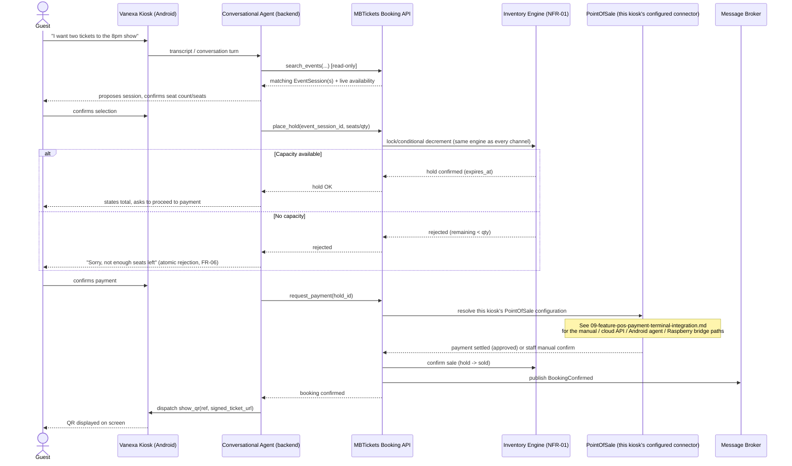

# MBTickets — Feature Spec: Vanexa AI Kiosk Integration

> Document 8 (feature addendum). Written in English per explicit request; the core 7 documents (01–07) remain in Spanish. This feature extends, rather than replaces, `02-arquitectura.md` (architecture), `04-requerimientos-funcionales.md` (FR), `06-historias-de-usuario.md` (HU) and `07-features-comunes-y-flujos.md` (flows). FR/HU numbering here continues from the existing series (FR-19, HU-19…).
>
> Companion document: `09-feature-pos-payment-terminal-integration.md` — the physical card-present payment layer this feature depends on for in-person kiosk sales.

## 1. Purpose

Vanexa provides the conversational AI kiosk interface for MBTickets. A guest standing in front of a kiosk (an Android tablet/terminal) can complete a full ticket purchase — browse events, pick a session, choose seats or GA quantity, pay, and receive a signed QR ticket — through voice and/or touch conversation with an AI agent, without staff involvement. This mirrors the existing KitchnTabs self-service kiosk pattern (AI-guided ordering → cart → checkout → QR), re-targeted from food orders to ticket bookings.

This is **a new sales channel**, not a new booking engine: every hold/confirm/reject still goes through the same inventory-locking engine (NFR-01), the same unified-inventory rule (FR-07), and the same signed-QR issuance (FR-08/FR-09) as the online, POS, and box-office channels. Vanexa only changes how the guest *expresses* their order.

## 2. What already exists and is reused as-is

Vanexa ships an existing, production backend/kiosk architecture (`vanexa-backend-domain`, `vanexa-android-kiosk`) built for a different first use case (an AI "Lab" experience: conversation, photo booth, trivia) and already adapted once for KitchnTabs self-service food ordering. Two pieces of that architecture are reused for MBTickets **unchanged**:

### 2.1 The Kiosk Actions Contract

A versioned, backend-authoritative, allowlisted JSON **action envelope**, delivered to the kiosk over a private real-time channel (Reverb), with a declared-capability gate and a result/ack pipeline. This is the mechanism by which the backend tells a kiosk device to *do* something (not just display conversation text).

```
Envelope (backend → kiosk):
{
  "v": 1,
  "id": "act_<ulid>",
  "session_id": "<kiosk session id>",
  "issued_at": "<ISO8601>",
  "ttl_ms": 15000,
  "origin": "<producer tag>",
  "actions": [ { "type": "<action_type>", "args": { ... } } ]
}
```

Key properties carried over unchanged:
- **Backend-only producer.** The conversational voice/text model never emits an action directly; a backend-side decision layer (the "screen director" pattern) inspects the conversation and calls a `trigger_action`-style tool, which the backend validates against an allowlist and the Lab/Tenant's configuration before dispatch.
- **Capability declaration.** A kiosk declares, at session start, exactly which action types its build supports (`capabilities.actions`). The backend refuses to dispatch a type the kiosk didn't declare, so an older or differently-built kiosk fails synchronously (`'show_qr' is not supported by this kiosk'`) rather than silently.
- **TTL + dedupe + ordered execution.** `ttl_ms` (1,000–120,000 ms, default 15,000) is counted from the kiosk's receipt, not server time, so clock skew between kiosk and backend never matters; it only gates *starting* an action (one already running finishes regardless of TTL). Actions in one envelope execute in order; a failure in one does not block the rest.
- **Result/ack pipeline.** The kiosk `POST`s a `{status: done|failed|ignored}` per action back to the backend, which aggregates results into an audit row — full traceability of what was asked and what actually happened on the device.

### 2.2 The `show_qr` action type — reused verbatim for ticket delivery

Already defined in the contract:

| type | args | meaning |
|---|---|---|
| `show_qr` | `ref` (string, unique), `url` (https, ≤1024 chars), `title` (≤60), `caption` (≤120), `seconds` (10–900, default 180), `position` (`center`\|`bottom_left`\|`bottom_right`\|`top_right`, default `bottom_right`), `dismiss_on_wake` (bool, default `true`) | Draws a QR card for the guest to scan with their phone, alongside the conversation. Same `ref` replaces an existing card. Disappears after `seconds`, on `hide_qr`, or — unless `dismiss_on_wake` is `false` — when the next conversation opens. |

For MBTickets, `show_qr` is dispatched once a booking is confirmed, pointing at the signed ticket QR payload (FR-08) instead of a photo-booth link. No new action type is required for ticket delivery. The existing fallback behavior (a kiosk that doesn't support `show_qr` gets the order/ticket code read aloud instead) is preserved unchanged — exactly the graceful-degradation precedent already used by the KitchnTabs kiosk integration.

A `hide_qr` (`ref` required) call removes a card early if needed (e.g., guest cancels before scanning).

## 3. What is new for MBTickets

### 3.1 Conversational domain mapping

The Lab/agent's conversation model must be re-targeted from a food menu/cart domain to the ticketing domain. This is prompt/tooling configuration, not new backend architecture:

| KitchnTabs concept (existing) | MBTickets equivalent (new) |
|---|---|
| Menu / product catalog | Public event discovery (FR-01): browse `EventType`/`EventSession` by category, date, venue, room |
| Cart (add/remove items) | Selection of a specific `EventSession` + seats (if the room has an Inamap-sourced seat map) or GA quantity |
| Tab (open order) | A `Booking` in `hold` state (FR-05.2), scoped to one `EventSession` |
| Tab confirm → kitchen notification | Booking confirm → inventory engine commit (NFR-01) → `BookingConfirmed` domain event (FR-10) |
| Self-service QR (order pickup code) | Signed ticket QR (FR-08), delivered via `show_qr` |

The agent's available tools (equivalent to KitchnTabs' cart tools) are:
- `search_events(query, category, date_range, venue, room)` — read-only discovery, no RBAC change (FR-01 remains unauthenticated).
- `select_session(event_session_id)` — narrows conversation context to one function/showtime.
- `place_hold(event_session_id, seat_ids[] | quantity)` — calls straight into the existing hold endpoint (FR-05); returns the same atomic accept/reject (FR-06) the online and POS channels get. **This is the single integration point with the booking engine** — Vanexa never touches inventory directly, it only calls the same API surface POS/online/box-office already call.
- `request_payment(hold_id)` — triggers the payment leg. See §3.2: this hands off to the POS Payment Terminal integration for in-person settlement.
- `cancel_hold(hold_id)` — releases a hold explicitly if the guest changes their mind before paying (in addition to the existing automatic hold-expiry release).

None of these tools can be reached by the voice/text model directly on inventory-mutating paths without going through `place_hold`/`cancel_hold` — the agent proposes, the backend's existing engine disposes.

### 3.2 Payment hand-off

A kiosk-based sale is, functionally, a point-of-sale transaction (same channel category as FR-07/FR-15), so it uses the same per-kiosk `PointOfSale` configuration described in `09-feature-pos-payment-terminal-integration.md`:

- If the kiosk's configured `PointOfSale` has **no connector** (manual mode), Vanexa's conversational flow degrades to "staff-assisted cash/manual confirm": the agent tells the guest to see a staff member, and a staff member confirms payment through the existing POS/box-office UI (FR-15). This is a legitimate v1 configuration for venues without a physical terminal yet.
- If the kiosk's configured `PointOfSale` has a connector attached (any of the three transports — cloud API, Android companion agent, or Raspberry Pi bridge — see the companion document), `request_payment(hold_id)` triggers a `charge_pos_terminal` action dispatch exactly as described there. Vanexa's role ends at triggering the charge and waiting for its settlement; it does not implement payment logic itself.
- Either way, the **hold is only confirmed once the payment settles** (approved charge, or staff manual confirmation) — never optimistically on "the agent said payment was requested."

### 3.3 New/adapted screen behavior

No new action types are required beyond what's already defined in the Actions Contract (`show_qr`/`hide_qr` cover ticket delivery; `charge_pos_terminal`/`cancel_pos_charge`, defined in the companion document, cover payment). One optional addition worth considering for a richer on-screen experience (not required for v1 functional completeness):

- `show_order_summary` (proposed, optional) — args: `event_session_label`, `seats[]`/`quantity`, `total_amount`, `currency`. Purely a display card (no state mutation) showing the guest their pending selection before confirming payment, analogous to KitchnTabs' cart summary screen. If not implemented, the same information is simply spoken by the agent.

## 4. Functional Requirements

**FR-19 — Conversational AI kiosk ordering (NEW):** Guests at a kiosk configured with the Vanexa integration can complete a full ticket purchase through voice/text conversation with an AI agent, using the same booking engine, inventory rules, and ticket issuance as every other channel.

- FR-19.1: The agent's event discovery is read-only and unauthenticated, equivalent to FR-01; no new RBAC surface is introduced.
- FR-19.2: Every inventory-affecting action (hold, confirm, cancel) the agent performs calls the same booking API endpoints used by the online and POS/box-office channels (FR-05/FR-06/FR-07) — the agent has no separate or privileged inventory code path.
- FR-19.3: A booking reaches `confirmed` only after its associated payment (manual or via a `PointOfSale` connector) settles successfully; the agent cannot mark a booking paid on its own authority.
- FR-19.4: Upon confirmation, the system dispatches `show_qr` to the kiosk with the signed ticket QR (FR-08); if the kiosk does not declare `show_qr` support, the ticket reference/confirmation code is communicated to the guest by other means (spoken aloud, or printed if the kiosk has a printer), consistent with the existing KitchnTabs fallback precedent.
- FR-19.5: The guest can explicitly cancel a pending hold before payment; the system also keeps the existing automatic hold-expiry release (FR-05.2) as a backstop.
- FR-19.6: A kiosk running the Vanexa integration declares its supported action types at session start; the backend never dispatches an action type the kiosk hasn't declared.

**FR-19.7 — Graceful degradation without a payment connector:** A kiosk whose `PointOfSale` has no connector attached (manual/cash mode) still supports the full conversational discovery-and-selection flow; only the final payment-confirmation step requires staff assistance in that configuration.

## 5. User Stories

**HU-19:** As a guest at a venue kiosk, I want to browse and select an event, session, and seats/quantity by speaking or typing with an AI agent, so I don't need a staff member to help me order. *(FR-19.1, FR-19.2)*
- AC: the agent's event list and availability match what FR-01 discovery shows elsewhere; selecting a sold-out session or more seats than remain is rejected the same way FR-06 rejects it on any other channel.

**HU-19b:** As a guest, I want my selection held while I decide on payment, so another customer doesn't take the same seat out from under me mid-conversation. *(FR-19.3, FR-05.2)*
- AC: the hold has the same expiration behavior as every other channel's hold; if I take too long, my seats are released automatically and the agent tells me so.

**HU-19c:** As a guest, I want to receive my ticket as an on-screen QR the moment my payment is confirmed, so I can scan it with my phone or screenshot it before leaving the kiosk. *(FR-19.4)*
- AC: the QR appears without me having to ask; if the kiosk can't display one, I'm told my confirmation code instead and how to retrieve my ticket (e.g., email/push if I provided contact details).

**HU-19d:** As an Organizer, I want to deploy a kiosk at my venue with no physical payment terminal yet and still let guests browse and select events conversationally, falling back to a staff member for payment, so I'm not blocked on hardware procurement to pilot the conversational experience. *(FR-19.7)*

**HU-19e:** As a guest, I want to be able to say "never mind, cancel that" before I pay and have my seats released immediately, not just after a timeout, so someone else can buy them right away if I change my mind. *(FR-19.5)*

## 6. Flow — Conversational kiosk sale, end to end



## 7. Non-functional notes

- **No new inventory-concurrency risk.** Because `place_hold`/`cancel_hold` call the exact same API surface as every other channel, Vanexa introduces zero new code paths against NFR-01; it is purely an additional caller of an already-hardened engine.
- **Latency.** The conversational round-trip (speech-to-text, agent reasoning, text-to-speech) adds guest-perceived latency on top of the booking API's own NFR-02 budget, but does not change the API's own p95 target — the agent is a client of the API like any other, not a new tier that needs its own concurrency budget.
- **Offline behavior.** Vanexa's conversational layer requires network connectivity to function at all (voice/text model, discovery, booking API) — it has no offline mode of its own, unlike the venue-entry scanners (NFR-04). A venue-internet outage affects a Vanexa kiosk the same way it affects the online/POS channels, not the way it affects already-issued-ticket validation at the door.
- **Device identity.** A Vanexa kiosk is registered as its own `DeviceCore` device (FR-11), independently revocable, consistent with every other terminal type in the system.

## 8. Explicitly out of scope for v1

- Multi-language voice support beyond what the underlying Vanexa/Sonic voice provider already offers out of the box — no MBTickets-specific localization logic is planned for v1 beyond the project's standing Spanish-language requirement.
- Upselling/cross-selling logic (e.g., agent proactively suggesting a different session or add-ons) — v1 scope is order-taking for a session the guest already has in mind, not merchandising.
- Accessibility accommodations beyond what the kiosk hardware/OS already provides (screen reader support, high-contrast mode) — flagged as a follow-up design pass, not blocking v1.
