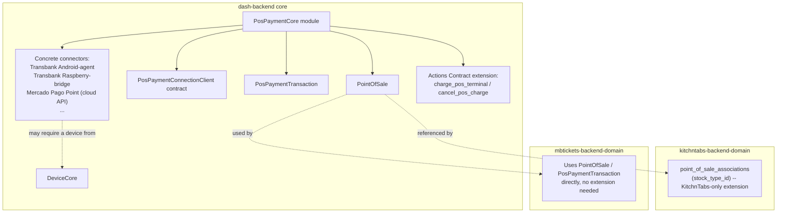
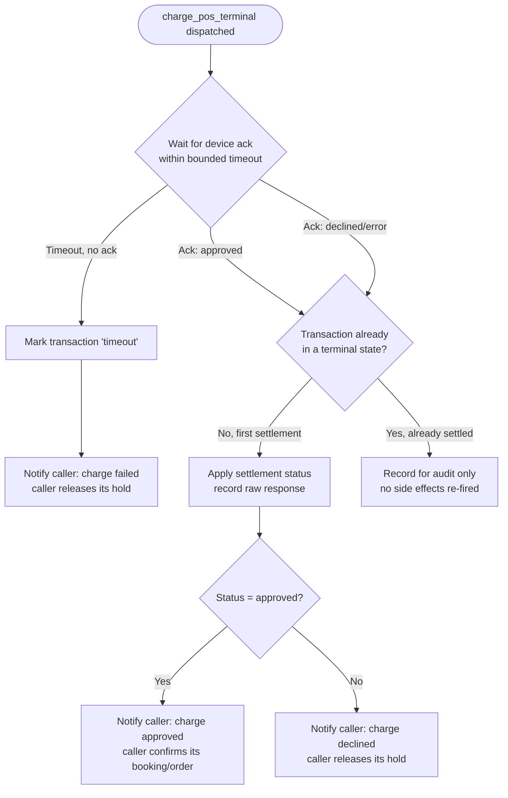

# MBTickets — Feature Spec: Point-of-Sale Payment Terminal Integration (Core Capability)

> Document 9 (feature addendum). Written in English per explicit request; the core 7 documents (01–07) remain in Spanish. This feature is promoted to **core** (`dash-backend`, alongside `DeviceCore`) rather than built inside `mbtickets-backend-domain`, because both MBTickets and KitchnTabs need physical card-present payment capture and neither sibling system currently has it. This document is the shared design; each domain's own doc set (MBTickets' `04-requerimientos-funcionales.md` / `06-historias-de-usuario.md`, and KitchnTabs' own requirements) references it rather than duplicating it.
>
> Companion document: `08-feature-vanexa-ai-kiosk-integration.md` — the conversational kiosk channel that is this feature's primary MBTickets consumer, alongside the existing POS/box-office channel (FR-07/FR-15).

## 1. Problem statement

Neither sibling system in this stack has ever integrated with a physical, card-present payment terminal:

- KitchnTabs' `CheckoutGateway` contract (`AbstractCheckoutGatewayProvider`, `TransbankPSTCheckoutProvider`, `MercadoPagoCheckoutProvider`) is a **redirect/webhook, card-not-present** model — the customer's browser is bounced to a hosted payment page (Webpay Plus) and back. There is no serial, USB, Bluetooth, or local-network code anywhere in the stack that talks to an actual payment terminal.
- KitchnTabs' existing `PointOfSale` model (`app/Models/ECommerce/PointOfSale.php`) **does** already represent the right generic concept — a sales channel/register that registers payments, optionally wired to an automated connector (`PointOfSaleConnectionClient`) — but its only built-out connector (`ManualOAuthClient`) and its only extension table (`point_of_sale_associations` → `stock_type_id`) serve a *different* concern: retail stock/pricelist synchronization with an external POS **system** (e.g. a Paris-style marketplace output integration), not payment capture. The contract's own docblock, however, already describes its intent correctly: *"the custom connection class with the service or **POS terminal** to handle **payment requests**."* This feature is the first real instantiation of that original intent.

This document specifies that instantiation: a generic, core-level **PointOfSale payment registration** capability, with pluggable connectors covering manual (cash/out-of-band), cloud-API-controlled terminals, Android-paired terminals, and Raspberry Pi-bridged terminals — reusable, unmodified, by any domain built on this framework.

### 1.1 Acquirer rollout priority (decided)

- **Priority 1: Mercado Pago.** First connector(s) to build.
- **Priority 2: Transbank.** Second.

Note that a single acquirer commonly ships more than one terminal product line, each potentially needing its own connector class under the same acquirer even though they share a brand — e.g. an autonomous, cloud-connected standalone terminal (cloud API transport) versus a smaller reader that pairs over Bluetooth to a companion app (Android-paired transport). "Build the Mercado Pago connector" may therefore resolve to more than one concrete `PosPaymentConnectionClient` implementation depending on which physical terminal model(s) the venues actually deploy — to be confirmed once specific hardware is selected per venue.

**Research findings (full detail in `03-requerimientos-tecnicos.md` §7):** external research into both acquirers' actual developer documentation confirms and sharpens this priority order:

- **Mercado Pago Point Smart, driven via Mercado Pago's own cloud Integration/Orders API, requires no paired device at all** (no companion app, no Raspberry Pi — just backend-to-acquirer HTTPS calls plus a webhook/poll for settlement). This is the simplest connector in the entire catalog to build and is now the concrete recommendation for the actual **first connector implemented**, not just "Mercado Pago" in the abstract.
- **Transbank's public developer documentation confirms there is no Android-embeddable SDK** for its POS Integrado terminals (Verifone VX520/VX520C, Ingenico Desk 3500); the official SDKs (.NET, Node.js, Java, Python, web-via-desktop-agent) all talk to the terminal over serial (RS-232) or USB. Transbank's v1 connector should therefore target the **Raspberry Pi bridge transport directly** rather than attempting an Android-paired path (which would require USB-OTG wiring with no real simplification over the Pi bridge).
- **Mercado Pago's own public pattern for a companion Android app is app-to-app delegation**, not a direct Bluetooth SDK: a third-party app invokes the official "Mercado Pago Point" app (installed on the same tablet) via an `Intent`/deep link, and that official app is the one that actually talks to the paired reader hardware. If an Android-paired Mercado Pago connector is ever built (e.g. for a Bluetooth reader rather than an autonomous Point Smart), §7's companion-agent design should be read as "invokes the official Mercado Pago Point app," not "embeds a Bluetooth SDK."
- A third Mercado Pago integration pattern was also found — "Smart Apps" installed directly on the Point Smart terminal itself (which is an Android device) — relevant only as a future alternative to the kiosk+terminal pairing model and out of scope for v1.

## 2. Core concept: `PointOfSale` registers payments; a connector is optional

A `PointOfSale` represents one physical or logical checkout station — a kiosk, a POS terminal, a box-office window — belonging to one Tenant. **It always registers payments against itself.** Whether that registration is automatic (triggered by this feature) or manual (a staff member marking a sale paid by cash) is a configuration detail, not two different features:

- **No connector configured** (`connection_client` is `null`): manual registration mode. Staff mark a sale as paid directly (cash, bank transfer, any out-of-band method); no device, no automated charge, no payment terminal involved at all. **This is a first-class, fully-supported configuration, not a fallback or an edge case** — many box-office windows will never need anything more than this.
- **A connector configured**: the Organizer has picked a specific **integration** (not an abstract "transport type") from the catalog of available connectors — e.g. "Transbank — Android-paired terminal," "Mercado Pago Point," "Transbank — Raspberry Pi bridge." Whether that integration needs a paired device, and which kind, is intrinsic to the connector class itself (declared in its own capability metadata), never a separate field the Organizer sets by hand. Picking the integration is the only configuration step; the device requirement (if any) follows from that choice.

This mirrors the existing `CheckoutGateway::getCapabilities()` idiom exactly (`supports_webhooks`, `requires_redirect` are properties of the provider class, not admin toggles) — this feature applies the same idiom to physical terminals.

## 3. Module placement

A new core module, **`PosPaymentCore`**, lives in `dash-backend` beside `DeviceCore`, `Billing`, and the other platform-level capabilities documented in `02-arquitectura.md` §2. It owns:

- The `PointOfSale` model itself (promoted/generalized from its current home in `kitchntabs-backend-domain`) — stripped of anything KitchnTabs-specific.
- The `PosPaymentConnectionClient` contract (the payment-terminal-flavored sibling of the existing `PointOfSaleConnectionClient` interface, inheriting its intent but shaped for charge/cancel/settle rather than OAuth/stock-sync).
- The `PosPaymentTransaction` model (the payment-terminal analog of `CheckoutGatewayTransaction`).
- The concrete connector implementations for each supported acquirer (Transbank, Mercado Pago Point, Getnet, etc. — built once, available to every domain).
- The two new Kiosk Actions Contract action types (`charge_pos_terminal`, `cancel_pos_charge` — see §6), since dispatch needs to reach any domain's kiosk/device fleet identically.

**What does *not* move:** KitchnTabs' existing `point_of_sale_associations` → `stock_type_id` extension (inventory/stock reconciliation) stays exactly where it is, in `kitchntabs-backend-domain`, now referencing the promoted core `PointOfSale.id` as a foreign key instead of a domain-local one. MBTickets never touches that table — it has no stock/stock-type concept at all.



## 4. Entities

### 4.1 `PointOfSale` (generalized core model)

| Field | Notes |
|---|---|
| `id` | UUID |
| `tenancy_id` / `tenant_id` | denormalized, per the standing data convention (`03-requerimientos-tecnicos.md`) |
| `name` | e.g. "Kiosk 1 — Main Lobby", "Box Office Window 2" |
| `active` | boolean |
| `is_default` | boolean, scoped per tenant (existing behavior preserved) |
| `connection_client` | nullable string — fully-qualified class name of the chosen `PosPaymentConnectionClient` implementation, or `null` for manual mode |
| `connection_params` | JSON — credentials/settings specific to the chosen connector (same shape convention as `CheckoutGateway.connection_params`) |
| `device_id` | nullable FK to `DeviceCore.Device` — populated only when the chosen connector's capability metadata declares it needs one; left `null` for manual mode and for cloud-API connectors |

### 4.2 `PosPaymentConnectionClient` (contract)

```php
interface PosPaymentConnectionClient
{
    /** Static capability metadata. Expected keys:
     *  - requires_device (bool)
     *  - device_kind (string|null)   // e.g. 'pos_terminal_agent', 'pos_bridge' — null if requires_device is false
     *  - supported_currencies (string[])
     *  - region (string)
     */
    public static function getCapabilities(): array;

    /** Field schema for the credentials/settings form. */
    public static function getConnectionParamFormats(): array;

    public function __construct(PointOfSale $pointOfSale);

    public function verifyCredentials(): bool;

    /** Initiate a charge. Returns a PosPaymentTransaction in 'pending' state and whatever
     *  reference the dispatch mechanism needs (e.g. the action id, for device-routed connectors). */
    public function charge(array $chargeData): PosPaymentTransaction;

    /** Explicit cancel of a pending charge (guest/staff-initiated, before settlement). */
    public function cancel(string $transactionId): array;

    /** Called by the result/ack pipeline (device-routed) or a webhook/poll (cloud API) to settle
     *  a transaction. Idempotency-guarded exactly like AbstractCheckoutGatewayProvider::completeTransaction. */
    public function settle(string $transactionId, string $status, array $raw = []): PosPaymentTransaction;

    /** Optional. Connectors are not required to implement a working refund — a connector that
     *  doesn't may simply inherit the default below. Reuses the exact same "not implemented yet"
     *  stub idiom already used by AbstractCheckoutGatewayProvider::refundPayment(). */
    public function refund(string $transactionId): array; // default: ['success' => false, 'error' => 'Refunds are not implemented for this connector.']
}
```

`refund()` is deliberately optional at the contract level — a connector may leave it at the default stub. The actual refund **feature** (authorization, audit, and the actual trigger) is not part of this contract at all: it is a UI/workflow concern implemented in the **Admin Payments Management UI** (§9, FR-23), which calls `refund()` on whichever connector is configured, when that connector supports it.

### 4.3 `PosPaymentTransaction`

Mirrors `CheckoutGatewayTransaction`'s shape and settlement idempotency pattern, generalized away from any Tab/Order-specific field:

| Field | Notes |
|---|---|
| `id` | UUID |
| `point_of_sale_id` | FK |
| `tenant_id` | denormalized |
| `reference` | opaque string — the caller's own identifier (a KitchnTabs Tab id, an MBTickets Booking/hold id); the core module never interprets it |
| `amount`, `currency` | |
| `status` | `pending` \| `approved` \| `declined` \| `timeout` \| `cancelled` \| `error` |
| `provider` | the connector class used, or the literal `manual` for a cash/out-of-band registration |
| `auth_code`, `card_brand`, `masked_pan`, `acquirer_transaction_id` | nullable, populated on settlement by card-based connectors; left null for `manual` |
| `raw_response` | JSON, the connector's raw settlement payload, for audit |
| `idempotency_key` | guards against double-settlement exactly like the existing `completeTransaction()` guard (a result arriving twice — e.g. a device ack race against a manual override — must not double-fire side effects) |

A manual registration still creates a `PosPaymentTransaction` (`provider = manual`, immediately `approved`), so reporting (FR-13) and reconciliation treat every payment — automated or manual — uniformly.

## 5. Transports

A connector's capability metadata declares whether it needs a paired device, and of which kind. The Organizer only ever picks the connector; the device requirement (if any) follows automatically and, if a device is required, the Organizer is then prompted to pick *which* already-registered device fulfills it (not a separate "transport type" selector).

| Transport | `requires_device` | `device_kind` | Example | Notes |
|---|---|---|---|---|
| **Manual** | — (no connector at all) | — | Cash, bank transfer, any out-of-band method | Default / baseline configuration. No `PosPaymentConnectionClient` instance exists; the `PosPaymentTransaction` is created and settled directly by whoever confirms the sale (staff, or the booking flow itself for a free/zero-amount case). |
| **Cloud API** | `false` | `null` | A standalone smart terminal controlled entirely via the acquirer's own cloud REST API (e.g. a Mercado Pago Point Smart terminal) | No local pairing, no companion app, no Raspberry Pi. The connector calls the acquirer's API directly from the backend; the terminal receives the charge over the acquirer's own infrastructure, independent of this system's device fleet. |
| **Android-paired terminal** | `true` | `pos_terminal_agent` | An acquirer SDK (Transbank, Getnet, etc.) embeddable on Android, pairing to the physical terminal over Bluetooth/USB | Runs as a **separate installable app/background process** on the same Android device as the guest-facing kiosk app (Vanexa, or any other front-of-house app) — not embedded inside it, and with no direct inter-app coupling (see §7). |
| **Raspberry Pi bridge** | `true` | `pos_bridge` | A terminal whose SDK is not Android-embeddable (serial/RS-232-only, or a PC-class SDK) | A small Python service on a Raspberry Pi, paired to the venue's local network, speaking the terminal's actual protocol. Raspberry Pi as a kiosk-adjacent device is already an operated, supported deployment target in this stack (`kt-kiosk-agent`'s existing `config.raspberry.*.yaml` profiles), so this is a proven form factor, just a new, narrower-purpose service rather than the full AI client. |

### 5.1 Two independent axes: terminal pairing medium vs. backend reachability (decided)

Each device-routed connector (Android-paired or Raspberry-bridge) actually has **two separate connectivity concerns**, and both must be independently configurable per integration — this isn't a single "transport" choice:

**Axis A — how the bridge/agent host physically pairs with the terminal.** A connector declares which medium(s) it supports:
- **Cable** — direct serial/USB connection between the bridge/agent host and the terminal.
- **Bluetooth** — wireless local pairing, when the terminal model supports it.
- *(Not applicable to cloud-API connectors — the acquirer's own infrastructure reaches the terminal directly; there is no local pairing at all.)*

**Axis B — how the bridge/agent host reaches the MBTickets backend.** Independently of Axis A, every device-routed connector can be configured with either:
- **Direct socket/real-time channel** (default) — the bridge/agent host connects straight to the backend's action-dispatch channel over the internet, exactly as described in §6/§7.
- **Local relay** — the bridge/agent host instead connects over the venue's own LAN to a local relay process (which may run on the same Raspberry Pi, a different always-on device at the venue, or the venue's own small server/NAS). The relay holds the actual persistent connection out to the backend and forwards dispatches to/from the devices on its LAN. This buys resilience specifically against **MBTickets backend reachability** hiccups that are separate from the device's own connectivity.

Both possibilities (local relay, and direct backend socket communication) must be supported, selectable **per integration/connector instance** — not a single global policy for the whole platform.

**Important caveat — this is not the same as NFR-04's offline ticket validation.** A card charge fundamentally requires live connectivity from the terminal to the card network/acquirer to be authorized — there is no cryptographic-signature trick that makes a charge "offline-capable" the way QR validation is. A local relay improves resilience against the *MBTickets backend* being briefly unreachable (so the charge-dispatch plumbing itself doesn't fail), but it cannot make a charge succeed if the terminal's own path to the acquirer is down. This distinction should be made explicit in any venue-facing documentation, so staff don't expect card sales to "keep working" through a full connectivity outage the way the entry turnstiles do.

## 6. Dispatch: extending the Kiosk Actions Contract

Two new action types are added to the same contract described in `08-feature-vanexa-ai-kiosk-integration.md` §2.1 (registry: `config/lab_actions.php` or its core-promoted equivalent). They are dispatched to **whichever `Device` is configured as the payment device for the relevant `PointOfSale`** — which may or may not be the same device the guest is looking at.

| type | args (in) | result (ack, out) |
|---|---|---|
| `charge_pos_terminal` | `transaction_id` (the `PosPaymentTransaction` id, **required**), `amount` (decimal, **required**), `currency` (ISO 4217, **required**), `reference` (string, **required** — caller's own order/booking id), `idempotency_key` (string, **required**) | `{status: approved\|declined\|cancelled\|error, auth_code?, card_brand?, masked_pan?, acquirer_transaction_id?}` |
| `cancel_pos_charge` | `transaction_id` (**required**) | `{status: cancelled\|already_settled\|error}` |

This dispatch path is used only for the two device-routed transports (Android-paired, Raspberry bridge). The cloud-API transport never dispatches an action at all — the connector talks to the acquirer directly from the backend and polls/receives a webhook to settle. Manual mode never reaches this layer.

## 7. The Android companion agent app — decoupled by design

Because the terminal-SDK integration must run **in parallel to** the guest-facing kiosk app (e.g. Vanexa) as its own background process, not embedded inside it, the design deliberately avoids any direct inter-app contract between the two (cross-vendor AIDL/bound-service coupling is fragile and ties this feature's release cycle to the kiosk app's):

- The companion agent registers as its **own, independent `DeviceCore` `Device`** (own revocable credential, own heartbeat/presence — consistent with FR-11/NFR-05; no shared or implicit trust with the kiosk app sharing the physical tablet).
- It independently subscribes to the backend's action-dispatch channel for commands addressed to **its own** device id — not relayed through the kiosk app.
- It independently POSTs its ack/result back, exactly like any other device in the Actions Contract's result pipeline.
- The guest-facing kiosk app never needs to know a payment terminal exists; it only ever receives `show_qr` (ticket delivery) once the backend has already settled the charge, addressed to its own, separate device id.

This means the backend's dispatch logic is uniform regardless of transport: "send `charge_pos_terminal` to `PointOfSale.device_id`" — that device id might belong to a companion Android app, a Raspberry Pi, or (for the cloud-API transport) simply not exist at all, with the backend instead calling the acquirer directly.

## 8. Settlement and idempotency

Reuses the exact pattern already proven in `AbstractCheckoutGatewayProvider::completeTransaction()`: capture whether the transaction was already in a terminal state (`approved`/`declined`/`cancelled`/`error`) **before** applying a new settlement, so a race between two settlement paths (e.g. a device ack arriving late after a staff member has already manually overridden the sale as paid) cannot double-fire the "confirm the booking / create the payment record" side effects. This is especially relevant for device-routed transports, where a terminal ack can legitimately arrive after a timeout has already caused the caller (MBTickets or KitchnTabs) to treat the charge as failed and release its hold — the late ack must be recorded for audit but must not re-open or re-confirm anything that has already moved on.



## 9. Functional Requirements

**FR-20 — Point-of-sale payment registration (NEW, core capability):** Every `PointOfSale` registers the payments made against it, whether confirmed manually by staff or settled automatically by a connected payment integration.

- FR-20.1: A `PointOfSale` with no connector configured operates in manual registration mode: staff confirm payment directly (cash or any out-of-band method), with no device or automated charge involved. This is a fully supported baseline configuration, not a degraded fallback.
- FR-20.2: Configuring an automated integration is a single choice of **connector** (e.g. a specific acquirer's Android-paired integration, cloud-API integration, or Raspberry-bridge integration) — the Organizer never separately selects a "transport type"; whether a paired device is required, and of which kind, is intrinsic to the chosen connector and determined automatically.
- FR-20.3: When the chosen connector requires a paired device, the Organizer selects which already-registered device (a companion Android agent or a Raspberry Pi bridge, each independently registered per FR-11) fulfills that role for this specific `PointOfSale`.
- FR-20.4: Every payment — manual or automated — produces a transaction record suitable for the same operational reporting as any other channel (FR-13), so reconciliation never needs to special-case payment method.
- FR-20.5: For v1, a `PointOfSale` has **at most one** configured connector (or none, for manual mode). Prioritized multi-connector fallback chains (e.g. try the Android-paired terminal, fall back to manual if the companion agent is offline) are explicitly out of scope for v1.

**FR-21 — Physical card-present charge dispatch and settlement (NEW, core capability):** The system can request a charge from a payment-terminal-connected `PointOfSale` and settle the result exactly once, regardless of which transport fulfills it.

- FR-21.1: A charge request carries the caller's own order/booking reference, amount, currency, and an idempotency key; the core module never interprets the reference beyond passing it back on settlement.
- FR-21.2: For a device-routed connector (Android-paired or Raspberry-bridge transport), the charge is dispatched as a `charge_pos_terminal` action to that `PointOfSale`'s configured device, reusing the same action envelope, TTL, and result/ack pipeline as every other device action in the system.
- FR-21.3: For a cloud-API connector, the charge is placed directly against the acquirer's API from the backend, with no device dispatch and no dependency on any kiosk or bridge device being online.
- FR-21.4: A charge that times out without a device ack, or that is explicitly cancelled, settles to a terminal non-approved state exactly once; a late-arriving ack after that point is recorded for audit but never re-fires confirmation or release side effects already triggered by the timeout/cancellation.
- FR-21.5: The calling domain (MBTickets' booking engine, or KitchnTabs' tab/order flow) only ever reacts to a settled `PosPaymentTransaction` status — it has no visibility into, or dependency on, which of the three transports fulfilled the charge.

**FR-22 — Companion Android payment agent (NEW):** An Android-paired terminal connector runs as an independently installable, independently credentialed companion app/background process, decoupled from any guest-facing kiosk app running on the same physical device.

- FR-22.1: The companion agent registers as its own `DeviceCore` device with its own revocable credential; revoking it never affects the guest-facing kiosk app or any other device at the venue.
- FR-22.2: The companion agent receives charge/cancel dispatches and posts results addressed to its own device id, independent of any other app on the same tablet; no direct inter-app communication channel between the companion agent and a guest-facing kiosk app is required or assumed.

**FR-23 — Admin Payments Management UI and refunds (NEW):** Administrators (and, where delegated, Organizers) manage settled payments — across every `PosPaymentTransaction` regardless of provider — from a dedicated payments management screen, including triggering a refund where the underlying connector supports it.

- FR-23.1: The Admin Payments Management UI lists `PosPaymentTransaction` records (and their `CheckoutGatewayTransaction` online-channel counterparts) with filters by venue, point of sale, status, date range, and provider.
- FR-23.2: From a settled, `approved` transaction, an authorized user can trigger a refund. The UI calls the transaction's connector `refund()` method; if the connector returns its default "not implemented" stub, the UI surfaces that plainly rather than silently failing, and the refund must be handled out-of-band (e.g. directly with the acquirer) for that provider.
- FR-23.3: A successful refund updates the `PosPaymentTransaction` status and, via the standard domain-event pipeline (FR-10), triggers whatever downstream effect the calling domain defines for a refunded sale (e.g. MBTickets releasing/voiding the associated ticket credential; out of scope for this document, defined in the consuming domain's own requirements).
- FR-23.4: Every refund action is recorded in the audit log with the acting user's identity, timestamp, and reason, extending the existing booking-override audit pattern (HU-12) rather than introducing a separate audit mechanism.
- FR-23.5: Refund authorization follows the standing two-layer RBAC model: route-level permission gates who can reach the Payments Management UI at all, and instance-level policy (`scopeVisibleTo`) restricts which transactions (by tenant/venue) a given Organizer can see and act on, exactly as the rest of the platform already scopes Organizer visibility.

## 10. User Stories

**HU-20:** As an Organizer setting up a new box-office window, I want it to register cash payments with no hardware or integration configured at all, so I can open for sales immediately without waiting on any terminal procurement. *(FR-20.1)*
- AC: a `PointOfSale` with no connector lets staff confirm a sale as paid directly; it appears in reporting the same as any other sale.

**HU-21:** As an Organizer, I want to pick a specific payment-terminal integration for a kiosk from a list (not configure a "transport" separately), so setup is a single, unambiguous choice. *(FR-20.2)*
- AC: selecting an integration that needs a paired device immediately prompts me to choose which registered device fulfills it; selecting one that doesn't (cloud API) skips that step entirely; selecting none leaves the `PointOfSale` in manual mode.

**HU-22:** As an Organizer, I want to pair a kiosk's physical card terminal to a separate companion app running on the same tablet as the guest-facing kiosk app, so I'm not dependent on the guest-facing app's vendor to support my specific acquirer's SDK. *(FR-22.1, FR-22.2)*
- AC: installing and configuring the companion agent does not require any change to, or cooperation from, the guest-facing kiosk app already running on the device.

**HU-23:** As an Organizer at a venue whose terminal only has a serial/PC-class SDK, I want to pair it through a small Raspberry Pi bridge device instead, so I'm not blocked by the terminal vendor never shipping an Android SDK. *(FR-20.2, FR-20.3, §5 Raspberry Pi bridge)*

**HU-24:** As a platform administrator, I want a companion payment agent or Raspberry bridge device to be individually revocable without affecting the kiosk app or any other device at the same venue, so a compromised or stolen payment device can be shut down in isolation. *(FR-22.1, NFR-05)*

**HU-25:** As a guest paying by card at a kiosk, I want my charge to either clearly succeed or clearly fail — never to be charged twice or have my seats released after my card was actually approved, so I can trust the kiosk with my payment. *(FR-21.4)*
- AC: if the terminal's approval arrives after the system already timed out and released my hold, the charge is still recorded for the venue's reconciliation, but my seats are not silently re-confirmed out from under whoever took them next; a declined-then-approved-late sequence is a known reconciliation/refund case staff can review, not a silent double-booking.

**HU-26:** As an Administrator, I want a single payments management screen listing every settled transaction across all venues and channels, so I can find and refund a specific sale without needing to know which connector or provider handled it. *(FR-23.1, FR-23.2)*
- AC: I can filter by venue, point of sale, status and date; triggering a refund on a transaction whose connector doesn't support it tells me clearly that it must be handled directly with the acquirer, instead of failing silently or pretending to succeed.

**HU-26b:** As an Organizer with delegated access, I want to see and refund only the transactions belonging to my own venue(s), never another Organizer's, so refund capability doesn't require full Administrator access. *(FR-23.5)*

## 11. Decisions and remaining open items

Resolved during review:

1. **Acquirer rollout priority:** Mercado Pago first, Transbank second (§1.1).
2. **Device connectivity:** both a local relay and direct backend-socket communication must be supported, configurable per integration/connector instance, independently of the terminal pairing medium (cable or Bluetooth) — see §5.1. Card charges still require live connectivity from the terminal to the acquirer; a local relay does not make charging "offline-capable."
3. **Refunds:** `refund()` is optional at the contract level (default "not implemented" stub, reusing `AbstractCheckoutGatewayProvider::refundPayment()`'s existing idiom); the actual refund feature — authorization, audit, trigger — lives in the Admin Payments Management UI (FR-23), not in the contract.
4. **Connector cardinality:** exactly one connector (or none) per `PointOfSale` for v1 (FR-20.5).

Still open, for the detailed-design phase:
- Which specific Mercado Pago and Transbank terminal product line(s)/models are targeted first — **partially resolved by research** (`03-requerimientos-tecnicos.md` §7): Mercado Pago Point Smart via the Cloud API transport is confirmed viable with no paired device, and Transbank has no Android-embeddable SDK so its connector targets the Raspberry Pi bridge transport. Still open: exact terminal unit sourcing/procurement per venue, and whether a Bluetooth-paired Mercado Pago reader (Point Mini or similar) is needed for any venue in addition to the autonomous Point Smart path.
- Where the local relay process is expected to run in practice (the Raspberry Pi bridge itself acting as its own relay for other on-site devices, a separate always-on venue device, or a venue router/NAS) — an implementation decision, not a requirements one, but worth settling before the Raspberry Pi bridge's detailed design.
- The exact downstream effect a refund has in the MBTickets domain specifically (does it void the ticket credential automatically, require manual Organizer action, or depend on how close the refund is to the event date) — to be defined in MBTickets' own functional requirements once this feature lands, not in this shared core document.
