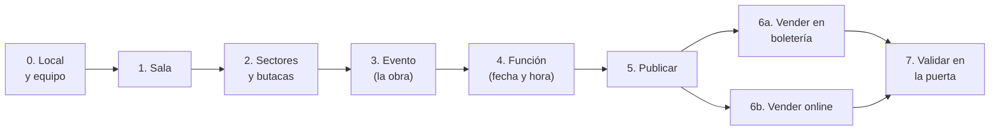

# Manual del administrador de cadena (TenancyAdmin)

## De la sala de teatro a la venta de entradas

Este manual es para quien administra una cuenta de MBTickets (una **cadena**, con uno o varios
**locales**) y empieza desde cero. Al terminarlo vas a tener un local con una sala de butacas
numeradas, una obra con una función a la venta, y vas a saber vender en la boletería, vender online y validar las entradas en la puerta.

Tiempo estimado: 20 minutos.

### Tu rol y el de tu equipo

| Rol | Quién es | Qué ve |
|---|---|---|
| **Administrador de cadena** (TenancyAdmin) | Tú. | Todos los locales de la cuenta, la suscripción, la facturación y los usuarios. |
| **Administrador de local** (Tenant) | Quien gestiona un local. | Solo su local: salas, eventos, funciones, ventas y reembolsos. |
| **Personal** (User) | Boletería y control de acceso. | Vende, cancela ventas y valida entradas en su local. |

## El recorrido completo

Cuatro palabras que se repiten en toda la guía:

| Palabra | Qué es | Ejemplo |
|---|---|---|
| **Sala** | El espacio físico. Se crea una vez. | "Sala Principal" |
| **Sector** | Una zona de la sala con su propio precio. | "Platea", "Balcón" |
| **Evento** | Lo que se presenta. | "Hamlet" |
| **Función** | Una presentación del evento en un día y hora. Las entradas se venden por función. | "Hamlet, sábado 24 a las 20:00" |

## 0. Antes de empezar

### 0.1 Entrar al panel

Entra al panel **MBTickets Web** con tu cuenta.

- En el entorno local de desarrollo está en `http://localhost:5191`.
- Si no tienes cuenta, regístrate en la misma pantalla de ingreso (crea la cadena con un plan de
  prueba) o pídela al equipo de la plataforma.

### 0.2 Crear el local

Un **local** (venue) es un recinto: un teatro, un cine, un centro cultural. Las salas, los eventos y las ventas pertenecen a un local.

Menú **Locales** → **Agregar Local**. Completa el nombre y los datos de contacto, y sube el logo: es el que verá el público en los correos de entradas.

### 0.3 Elegir el local con el que trabajas

Como administrador de cadena ves todos tus locales. Antes de crear salas, eventos o funciones,
**elige el local en el selector de locales**: el ícono de tienda de la barra lateral izquierda,
sobre la campana de notificaciones. Muestra la cuenta (vista de toda la cadena) y cada local. Si la
cadena tiene un solo local, ya viene elegido. Todo lo que crees
desde ese momento queda en ese local.

Si te olvidas, al guardar aparece: *"Seleccione el venue (tenant) sobre el que se crea el recurso."*

### 0.4 Crear los usuarios del equipo (opcional)

Menú **Usuarios** → **Crear Usuario**.

- Para el administrador del local, rol **Tenant**.
- Para boletería y puerta, rol **User**.

Asígnalos al local en el que trabajan.

### 0.5 Ten en cuenta

- Los menús de los pasos siguientes están en la barra lateral, en los grupos **Eventos** y **Ventas**.
- Para crear un registro usa el botón **+** de la esquina superior derecha. Ojo: cuando una lista está
  vacía aparece un botón "Crear" en el centro que hoy no abre el formulario. Es un error conocido.
- Tu plan (menú **Suscripción**) define cuántas salas y cuántos eventos publicados puedes tener a la vez. El plan de prueba
  permite **1 sala** y **3 eventos publicados**. Si llegas al límite, el sistema te lo dice al guardar o
  al publicar.

## 1. Crear la sala

Menú **Eventos → Salas** → **+**.

| Campo | Qué poner |
|---|---|
| Nombre | "Sala Principal". |
| Código | Opcional, un código corto ("SP"). |
| Tipo de sala | **Asientos numerados**, para un teatro con butacas. ("Admisión general / por sector" es para cupos sin número, como un recital de pie). |
| Capacidad | El total de la sala. Se usa solo si la sala no tiene sectores; con sectores, la capacidad la dan ellos. |
| Minutos entre funciones | Tiempo mínimo entre dos funciones de esta sala (limpieza, montaje). Vacío = el valor del local (15 min). |
| Activo | Marcado. |

Guarda.

## 2. Crear los sectores y las butacas

Un teatro suele tener zonas con precios distintos. Cada zona es un **sector**.

### 2.1 Crear el sector

Menú **Eventos → Sectores** → **+**.

| Campo | Ejemplo para la platea |
|---|---|
| Sala | Sala Principal |
| Nombre | Platea |
| Tipo | **Butacas numeradas** |
| Capacidad | Déjalo en 0: en un sector con butacas, la capacidad son sus butacas. |
| Precio | 12000. Vacío = el precio base del evento. |
| Orden | 1 (el orden en que se muestra). |

Guarda.

### 2.2 Generar las butacas

Abre el sector recién creado. Al final está **Generar butacas**:

| Campo | Ejemplo | Resultado |
|---|---|---|
| Filas | `A-J` | Filas A, B, C… J. También sirve `1-12` o una lista: `A,B,C`. |
| Butacas por fila | 20 | |
| Primer número | 1 | |

Con estos valores se crean 200 butacas, de "A-1" a "J-20". La entrada del comprador dirá
**"Platea A-1"**. Si lo repites, no se duplican: solo se agregan las que falten (útil para sumar una fila).

Repite los pasos 2.1 y 2.2 para cada zona. Por ejemplo, un "Balcón" a 8.000 con filas `K-M`.

> **¿Una zona sin butacas numeradas?** Crea el sector con tipo **Admisión general** y escribe su
> capacidad (por ejemplo, "Galería", 40 cupos). Se vende por cantidad, sin elegir asiento.

## 3. Crear el evento (la obra)

Menú **Eventos → Eventos** → **+**. El formulario tiene tres pestañas.

**General**

| Campo | Qué poner |
|---|---|
| Nombre | "Hamlet". |
| Sala | Sala Principal. Se elige al crear y no se puede cambiar después. |
| Categoría | Ayuda a encontrarlo en la cartelera ("Arte y Cultura"). |
| Descripción | El texto que verá el público. |
| Duración (min) | 120. Sirve para calcular cuándo termina cada función. |

**Venta**

| Campo | Qué poner |
|---|---|
| Precio base | Lo que cuesta una entrada en sectores sin precio propio. |
| Capacidad | Vacío = la de la sala. |
| Fecha máxima de compra | Opcional. Después de esa fecha no se vende ninguna función. |
| Cierre de venta (min antes de cada función) | Opcional. Por ejemplo, 30 = la venta de cada función cierra media hora antes. |

Si dejas ambos cierres vacíos, la venta online cierra cuando empieza la función, y la boletería sigue
vendiendo hasta que termina (para el público que llega tarde). Si defines los dos, manda el que llega
primero.

**Cancelación**

Si el comprador puede cancelar y cuánto recupera. Lo que dejes vacío toma el valor del local, que se
define en sus ajustes, sección MBTickets (de fábrica: puede cancelar hasta 24 h antes y recupera el 100 %).

| Campo | Ejemplo |
|---|---|
| El comprador puede cancelar | Sí / No / Como el local |
| Plazo para cancelar (horas antes) | 48 |
| Porcentaje que se reembolsa | 80 |
| Cargo fijo por cancelación | 1000 |
| Se pueden cancelar entradas sueltas | Sí / No / Como el local |

Guarda. El evento queda en **Borrador**: todavía nadie lo ve.

## 4. Programar la función

Menú **Eventos → Calendario de funciones** → **+**.

| Campo | Qué poner |
|---|---|
| Evento | Hamlet |
| Inicio | Sábado 24, 20:00 |
| Término | Vacío = inicio + la duración del evento. |
| Capacidad | Vacío = la del evento. |

Al guardar, el sistema revisa que la sala esté libre a esa hora, incluido el tiempo entre funciones. Si
choca con otra función, te avisa y no la crea.

La función también nace en **Borrador**. Ábrela y mira el panel **Disponibilidad**: ya están todas
las butacas, por sector, con su precio. Es el inventario que se va a vender.

> ¿Varias funciones? Repite el paso 4 por cada fecha. (La programación recurrente, del tipo "todos los
> sábados", todavía no está disponible.)

## 5. Publicar

Se publica en dos lugares; para que haya venta tienen que estar publicados los dos:

1. **El evento:** abre Hamlet → botón **Publicar**.
2. **La función:** abre la función → botón **Publicar**.

Desde ahora la función aparece en la cartelera y se puede vender. Para sacarla de la venta sin borrar
nada, usa **Volver a borrador**.

> **Cambiaste los sectores o las butacas después de crear la función?** Abre la función y pulsa
> **Sincronizar con la sala** en el panel Disponibilidad. Lo ya vendido nunca se modifica.

## 6a. Vender en la boletería

Menú **Ventas → Boletería → Vender entradas**.

1. Elige la función.
2. Marca las butacas, o la cantidad en los sectores sin número.
3. Opcional: nombre y correo del comprador. Con correo, el comprador recibe sus entradas con el QR.
4. **Retener**. Las butacas quedan apartadas 5 minutos mientras cobras: nadie más puede venderlas, ni
   online ni en otra ventanilla.
5. Elige el medio de pago (efectivo, tarjeta en terminal, transferencia o cortesía) y, si quieres, una
   referencia.
6. **Cobrar y confirmar**. Aparecen las entradas, cada una con su QR. **Imprimir** las saca en papel.

Si el cliente se arrepiente antes de pagar, usa **Liberar**: las butacas vuelven a la venta al instante.

## 6b. Vender online

El público compra en la app **MBTickets** (en local, `http://localhost:5190`):

1. Busca la obra en la cartelera.
2. Elige butacas e ingresa su nombre y correo.
3. Paga con la pasarela del local (Webpay o Mercado Pago).
4. Recibe sus entradas en pantalla y por correo.

Para vender online, el local necesita una **pasarela de pago activa**. Hoy no se configura desde el
panel: pídeselo al equipo de la plataforma. Sin pasarela, la app muestra la función pero indica que se
compra en la boletería. Cada local puede tener su propia pasarela.

Puedes compartir el enlace directo a una función: `…/funcion/<id de la función>`.

## 7. Validar las entradas en la puerta

Menú **Ventas → Control de acceso → Validar entradas**.

1. Elige la función y escribe el nombre de la puerta ("Acceso norte").
2. Lee cada QR:
   - con la cámara del equipo (**Usar cámara**);
   - o con un lector de mano, que escribe el código y presiona Enter.
3. La pantalla responde en grande:
   - **ADELANTE**: entrada válida, queda marcada como usada;
   - **YA USADA**: alguien ya entró con esa entrada;
   - **ANULADA**: la entrada se canceló;
   - **NO VÁLIDA** u **OTRA FUNCIÓN**: el QR no sirve aquí.

**Sin internet en la puerta:** antes de abrir, conéctate una vez para descargar el **kit offline**.
Si se corta la red, el equipo sigue validando solo. Al volver la conexión sincroniza las lecturas y
marca para revisión cualquier entrada que se haya usado dos veces en equipos distintos.

## 8. Después de vender

| Quiero… | Dónde |
|---|---|
| Ver todas las ventas y reservas | **Ventas → Reservas y ventas** |
| Reimprimir las entradas de una venta | Abre la venta → panel **Entradas** → **Imprimir** |
| Cancelar una venta (completa o algunas entradas) | Abre la venta → **Cancelar venta**. Antes de confirmar ves cuánto se devuelve. Si fue en efectivo y devolviste el dinero ahí mismo, márcalo en el diálogo. |
| Ver los reembolsos pendientes | **Ventas → Reembolsos → Por resolver**. Los pagos online se devuelven solos; los de efectivo o transferencia los marcas como devueltos con una referencia (folio de caja, comprobante). |
| Cancelar una función completa | Abre la función → **Cancelar función**. Si tiene ventas, el sistema te pide confirmar: anula todas las entradas, devuelve el 100 % a cada comprador y les avisa por correo. |
| Ver la ocupación de una función | Abre la función → panel **Disponibilidad** |

## Lista de verificación

- [ ] El local existe y está elegido en el selector de locales.
- [ ] La sala existe y está activa.
- [ ] Cada sector tiene sus butacas generadas (o su capacidad, si es admisión general).
- [ ] El evento tiene precio y está **Publicado**.
- [ ] La función está **Publicada** y el panel Disponibilidad muestra las butacas.
- [ ] Para vender online: el local tiene una pasarela activa.
- [ ] Antes de abrir la puerta: el equipo de control descargó el kit offline.

## Problemas frecuentes

| Mensaje o síntoma | Qué significa | Qué hacer |
|---|---|---|
| "Seleccione el venue (tenant) sobre el que se crea el recurso" | No hay un local elegido. | Elígelo en el selector de locales (paso 0.3). |
| No veo las salas o ventas de un local | El selector de locales tiene elegido otro local. | Cambia de local en el selector. |
| "La función se solapa con otra de la misma sala" | Otra función ocupa la sala a esa hora, contando el tiempo entre funciones. | Cambia el horario o revisa "Minutos entre funciones" de la sala. |
| "Su plan permite hasta N salas / eventos publicados" | Llegaste al límite del plan. | Despublica (o retira) un evento que ya no se presenta, o cambia de plan. |
| "La función no está a la venta" | La función o el evento siguen en borrador, o ya cerró la venta. | Publica ambos y revisa la fecha máxima de compra y el cierre de venta. |
| La función no aparece en la app | Igual que el anterior; además, se dejó de mostrar porque ya empezó. | Revisa la publicación y los cierres de venta. |
| "No queda disponibilidad suficiente" | Otro vendedor u otro comprador tomó esas butacas un momento antes. | Elige otras. El sistema nunca vende la misma butaca dos veces. |
| "Las butacas solo se crean en un sector con asientos numerados" | El sector es de tipo Admisión general. | Cambia el tipo a Butacas numeradas (si aún no tiene ventas). |
| El botón "Crear" de una lista vacía no hace nada | Error conocido del panel. | Usa el **+** de arriba a la derecha. |

## Para saber más

- Requerimientos del producto: [`../requirements`](../requirements/01-resumen-ejecutivo.md).
- Detalle técnico de cada parte, para el equipo de desarrollo: [`../features`](../features/README.md).
